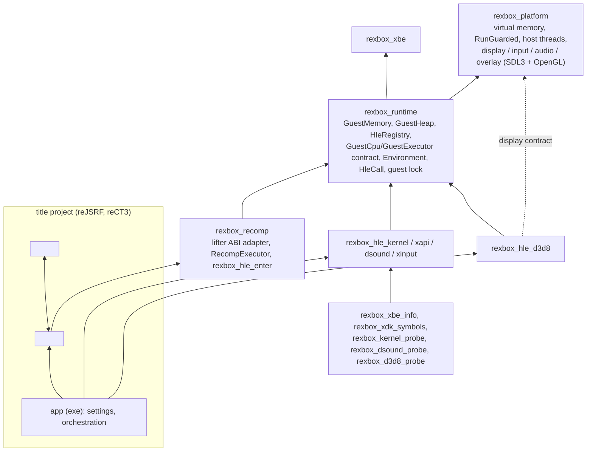
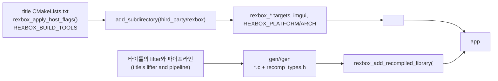
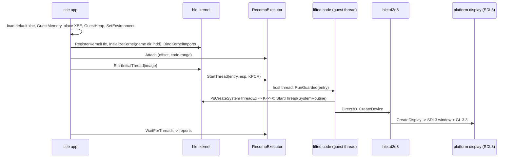

# rexbox 아키텍처

현재 구현된 코드의 구조를 기록한다. 이 코드는 reJSRF 안에서 만들어졌으므로 각 결정의 근거는 reJSRF의 설계 문서에 있다(예: [i001](https://github.com/nworkers/reJSRF/blob/main/docs/design/20261012-i001-project-bootstrap.md), [i002](https://github.com/nworkers/reJSRF/blob/main/docs/design/20261012-i002-recomp-pipeline.md), [i003](https://github.com/nworkers/reJSRF/blob/main/docs/design/20261012-i003-kernel-hle.md), [i006](https://github.com/nworkers/reJSRF/blob/main/docs/design/20261012-i006-xdk-symbol-binding.md), [i007](https://github.com/nworkers/reJSRF/blob/main/docs/design/20261012-i007-d3d8-hle-first-batch.md), [i012](https://github.com/nworkers/reJSRF/blob/main/docs/design/20261012-i012-d3d8-surfaces-first-frame.md), [i015](https://github.com/nworkers/reJSRF/blob/main/docs/design/20261012-i015-xinput-hle.md), [i017](https://github.com/nworkers/reJSRF/blob/main/docs/design/20261012-i017-dsound-hle.md), [i019](https://github.com/nworkers/reJSRF/blob/main/docs/design/20261012-i019-user-apc.md), [i023](https://github.com/nworkers/reJSRF/blob/main/docs/design/20261012-i023-d3d8-fixed-function-draw.md)). 분리 자체의 근거는 [설계 i001](docs/design/20261020-i001-project-bootstrap.md)이다. 아래에서 "설계 iNNN"은 달리 적지 않으면 reJSRF의 `docs/design/` 문서다.

## 1. 레이어와 CMake 타깃

| 타깃 | 경로 | 책임 | 상태 |
|---|---|---|---|
| `rexbox_platform` | `include/rexbox/platform/`, `src/platform/<os>/`, `src/platform/sdl/` | 가상 메모리(쓰인 페이지 기록 `TakeWrittenPages`, Win32 `GetWriteWatch`; 별칭이 있는 게스트 공간 `AllocateGuestSpace`: 공유 메모리 뷰, 설계 i008), `RunGuarded`/`RaiseStop`, `CreateHostThread`와 스레드 CPU 시간, 스레드 샘플링 프로파일러(`sampler.h`, 진단; Win32 구현), 표시 계약(`display.h`: 창 + OpenGL 계열 컨텍스트, GL 함수 포인터, present), 입력 계약(`input.h`: 게임패드 스냅샷, 진동 출력과 세기, 설계 i094), 오디오 계약(`audio.h`: 48 kHz 스테레오 float 출력, pull 렌더 함수, 장치가 없으면 실시간 pacing 스레드), 오버레이 계약(`overlay.h`: Dear ImGui 프레임), 경로 계약(`paths.h`: 실행 파일 폴더, 앱이 `SetApplicationIdentity`로 알려준 이름의 사용자 설정 폴더) | Win32 구현; Linux 구현(`src/platform/linux/`: mmap(쓰인 페이지 기록 없음: `TakeWrittenPages`는 늘 실패, [설계 i036](docs/design/20261027-i036-linux-write-tracking.md)), C++ 예외와 신호의 보호 호출, pthread, `/proc`; 샘플러는 미구현, [설계 i004](docs/design/20261020-i004-linux-preparation.md)); 표시·입력·오디오·오버레이는 SDL3 백엔드(모든 OS 공유) |
| `rexbox_xbe` | `src/xbe/` | XBE 파싱 | 구현 |
| `rexbox_runtime` | `src/runtime/` | `GuestMemory`(based 모델, 스칼라 접근, 페이지별 쓰기 버전 `WriteVersion`, 설계 i046; 옵션 `physical_window`로 RAM을 0x80000000·0xF0000000에 다시 매핑, 그때는 쓰기 추적 없음, [설계 i008](docs/design/20261020-i008-physical-window.md)), `GuestHeap`(페이지 할당자, 작은 객체용 slab, 물리 RAM 64 MiB와 가상 메모리 전용 위 64 MiB), `HleRegistry`, `GuestCpu`·`GuestExecutor` 계약, `Environment`, `HleCall`, 게스트 잠금 `rexbox_guest_lock_enter/leave`(C 계약, 설계 i068), 커널 thunk 합성 주소, 정지 보고 `thread_activity`(설계 i060) | 구현 |
| `rexbox_recomp` | `src/recomp/` | 생성 코드가 부르는 콜백의 본체(`recomp_bridge.cpp`, rexbox 이름 `rexbox_bridge_*`, `recomp_callbacks.h`), `RecompExecutor`(게스트 스레드 = 호스트 스레드, `CallGuest`, 스레드별 보고), XDK override 진입점 `rexbox_hle_enter`. lifter의 ABI 헤더는 include하지 않는다. 헤더를 include하는 유일한 파일 `recomp_abi.c`(생성 코드의 CPU 상태 전역, 레지스터 접근 함수, lifter 이름의 콜백 껍데기)는 타이틀의 생성 코드 타깃에서 그 `GEN_DIR/recomp_types.h`로 컴파일된다([설계 i026](docs/design/20261024-i026-drop-xboxrecomp.md)). upstream xboxrecomp v0.15.0이 선언하는 `g_eflags`, `xbox_Cpuid`, `xbox_PortIn/Out`, `g_xbox_guest_cpu_preempt`/`xbox_GuestCpuPreempt`와 reJSRF fork의 `recomp_unresolved_stub_log`를 모두 정의해 두 헤더에 다 링크된다 | 구현 |
| `rexbox_hle_kernel` | `src/hle/kernel/` | 커널 export 107개(아래 표; 내부 `rexbox_DpcLoop` 포함) | 부팅이 닿은 서비스 |
| `rexbox_hle_d3d8` | `src/hle/d3d8/` | Direct3D 8 HLE(아래 표): 어댑터·모드·Caps 질의, 디바이스·서피스·리소스 객체(Xbox 헤더 레이아웃), 라이브러리 전역에 쓰는 상태 setter, 리소스 생성·Lock, 셰이더 핸들, GL 고정 기능 그리기와 정점 프로그램·레지스터 컴바이너 셰이더, 렌더 타깃(표면 메모리로 식별, 설계 i071), 내부 렌더링 배율(설계 i080), MSAA·SMAA·비등방성(설계 i089), Hor+ 와이드스크린(설계 i085, 넓힌 깊이와 묶인 4:3 색 타깃도 넓힘 [i038](docs/design/20261029-i038-wide-depth-pairing.md)), 가상 vblank 시계(설계 i082·i095), 창 제목·설정 기본값 계약 `d3d8_display.h` | export 110개; 프로그래머블 셰이더·조명·안개는 보고만 |
| `rexbox_hle_xinput` | `src/hle/xinput/` | XAPI 장치·입력 함수 11개(`XInitDevices`, `XGetDevices`, `XGetDeviceChanges`, `XInput*`, `XMountMUA`/`XUnmountMU`) on 플랫폼 입력 계약 | 게임패드 포트 0(호스트 게임패드 또는 키보드), 메모리 유닛 없음 |
| `rexbox_hle_dsound` | `src/hle/dsound/` | DSOUND 함수 67개(`DirectSoundCreate`, `IDirectSound_*`, `IDirectSoundBuffer_*`) on 플랫폼 오디오 계약: 객체·버퍼 메모리, Lock·Play·Stop·커서(원본 의미), PCM 8/16·Xbox ADPCM 믹서(주파수·볼륨·루프 구간·믹스 빈), 효과 이미지 서술자와 상태 읽기·쓰기 | 3D·EG·LFO·필터·DSP 효과는 `S_OK`만 |
| `rexbox_hle_xapi` | `src/hle/xapi/` | XDK 라이브러리 HLE | 등록 진입점만 |
| `rexbox_xbe_info` | `tools/xbe_info/` | XBE 정보 | 구현 |
| `rexbox_xdk_symbols` | `tools/xdk_symbols/` | XbSymbolDatabase로 XDK 함수·변수 식별 → JSON (`scripts/recomp/hle_overrides.py`가 실행) | 구현 |
| `rexbox_kernel_probe` | `tools/kernel_probe/` | 게임 없이 커널 export 검사(83개, CI) | 구현 |
| `rexbox_dsound_probe` | `tools/dsound_probe/` | 게임 없이 DSOUND export 검사(55개, CI) | 구현 |
| `rexbox_d3d8_probe` | `tools/d3d8_probe/` | 게임·GPU 없이 D3D8 HLE의 순수 부분 검사(220개, CI) | 구현 |
| `rexbox_recomp_probe` | `tools/recomp_probe/` | 생성 코드 없는 타이틀처럼 `rexbox_recomp`를 링크하고 레지스터 접근 함수(`recomp_abi_none.c`) 검사(8개, CI) | 구현 |

타이틀의 lift 원본과 비교하는 도구(reJSRF의 `rejsrf_decomp_check`, `rejsrf_d3d8_check`)는 타이틀 프로젝트에 있다.

### 커널 HLE 파일

| 파일 | 내용 |
|---|---|
| `kernel_hle.cpp` | 등록, 초기화, thunk 슬롯 바인딩(함수 → 합성 주소, 데이터 → 변수 주소) |
| `kernel_state.cpp`, `kernel_internal.h` | 디스패처 잠금, 핸들 표, 구조체 오프셋, 공용 도우미 |
| `kernel_thread.cpp` | KPCR/ETHREAD/스택/TLS 구성, `PsCreateSystemThreadEx`, 종료, 일시정지, 우선순위, 초기 스레드 |
| `kernel_sync.cpp` | 이벤트, 세마포어, 뮤턴트, 타이머 초기화, 대기(`KeWaitForMultipleObjects` 포함; 경고 가능 사용자 모드 대기는 사용자 APC를 실행하고 `STATUS_USER_APC`) |
| `kernel_timer.cpp` | 발화하는 타이머(타이머 서비스 호스트 스레드), DPC 큐와 DPC 스레드(예약 ordinal `0x3FF`의 `rexbox_DpcLoop`, IRQL 2), [설계 i012](docs/design/20261020-i012-kernel-timers-dpc.md) |
| `kernel_apc.cpp` | 스레드별 사용자 APC 큐(파일 I/O의 `ApcRoutine`), 전달, `NtUserIoApcDispatcher` |
| `kernel_memory.cpp` | 가상·연속·시스템 메모리, 풀 |
| `kernel_object.cpp` | `NtClose`, `Ob*` |
| `kernel_rtl.cpp` | 크리티컬 섹션, 문자열, 시간 변환, 상태 코드(공용 `NtStatusToDosError`) |
| `kernel_hal.cpp` | IRQL, 시간, 인터럽트(전달 안 함), `KeInitializeDpc`, PCI, AV, 비휘발 설정, `DbgPrint` |
| `kernel_crypto.cpp` | `XcSHA*` (SHA-1) |
| `kernel_file.cpp`, `kernel_vfs.*` | 파일·디렉터리·장치·볼륨·IOCTL(디스크 geometry·파티션, DVD 드라이브의 `IOCTL_SCSI_PASS_THROUGH`: MODE SENSE 페이지 0x3E의 보안 페이지 답, [설계 i006](docs/design/20261020-i006-scsi-pass-through.md)), Xbox 이름공간 → 호스트 디렉터리 |
| `kernel_data.cpp` | 데이터 export, `KeTickCount` 갱신 스레드, 커널 시간 |

### D3D8 HLE 파일

| 파일 | 내용 |
|---|---|
| `d3d8_hle.cpp` | 등록, 모듈 상태 |
| `d3d8_internal.h` | Xbox D3D 상수, 구조체 오프셋(`D3DDISPLAYMODE`, `D3DPRESENT_PARAMETERS`, `D3DCAPS8`), `D3dState` |
| `d3d8_adapter.cpp`, `d3d8_caps.cpp` | 어댑터·모드·포맷·멀티샘플 질의와 `D3DCAPS8`(reJSRF에서 XDK 4134 원본으로 측정한 표) |
| `d3d8_device.cpp` | `Direct3D_CreateDevice`(표시 생성, 백버퍼·깊이 서피스, 원본 기본 상태 루틴 실행), `Swap`(vblank 페이싱, 감마, frame dump), `Clear`, `SetRenderTarget`, `Reset`, 뷰포트, 감마 램프 등 |
| `d3d8_resource.h/.cpp`, `d3d8_create.cpp` | Xbox `D3DResource` 헤더 레이아웃, `ResourceTable`, 리소스 생성·Lock, 연속 메모리 |
| `d3d8_globals.h/.cpp`, `d3d8_render_state.h`, `d3d8_state.cpp` | 라이브러리 전역(`D3D__RenderState` 등)의 위치와 읽기·쓰기, 상태 setter |
| `d3d8_shader.*`, `d3d8_vsh.*`, `d3d8_psh.*` | 정점·픽셀 셰이더 객체, NV2A 정점 프로그램 → GLSL, 레지스터 컴바이너 → GLSL |
| `d3d8_draw.cpp`, `d3d8_fvf.*`, `d3d8_immediate.*`, `d3d8_ff_shader.*` | `Draw*`, FVF 배치, `Begin`/`End` 즉시 모드, 고정 기능 GLSL(텍스처 좌표 생성·변환, 조명) |
| `d3d8_texture_format.*`, `d3d8_gl_textures.*` | 텍스처 포맷 변환(스위즐, DXT), 텍스처 캐시와 샘플러 |
| `d3d8_gl.*`, `d3d8_gl_targets.*`, `d3d8_gl_programs.*`, `d3d8_gl_program_cache.*`, `d3d8_gl_buffers.*` | GL 함수 표, 렌더 타깃 FBO·present·BMP 덤프·와이드스크린, 프로그램 캐시와 드라이버 바이너리 캐시, 정점·인덱스 버퍼 |
| `d3d8_smaa.*`, `d3d8_gamma.*`, `d3d8_vblank.*` | SMAA 1x, 감마 램프, 가상 vblank 시계 |
| `d3d8_trace.*`, `d3d8_profile.*`, `d3d8_capture.*`, `d3d8_draw_watch.*` | 진단: 한 번 보고, 프레임 프로파일, F9 캡처, 정점 셰이더 감시 |
| `d3d8_display.cpp`, `include/rexbox/hle/d3d8/d3d8_display.h` | 앱과의 계약: 렌더링 배율, 종횡비, 시작 기본값, 비디오 메모리 정보, `rexbox_d3d8_horizontal_view_scale` |

## 2. 소비자 계약

타이틀 프로젝트는 이 저장소를 `third_party/rexbox`로 두고 `add_subdirectory`한다.

* **lifter는 타이틀의 것이다.** lifter 체크아웃(xboxrecomp upstream이든 fork든), 그것을 실행하는 파이프라인, 그 출력 형식을 읽는 코드는 타이틀 프로젝트에 있다. rexbox는 lifter를 모르고 xboxrecomp를 가지지 않는다([설계 i026](docs/design/20261024-i026-drop-xboxrecomp.md)).
* `rexbox_apply_host_flags()`: `/utf-8 /permissive- /EHa`, `NOMINMAX WIN32_LEAN_AND_MEAN _CRT_SECURE_NO_WARNINGS`. 디렉터리 범위이므로 소비자도 자기 루트에서 부른다. `/EHa`는 `RaiseStop`의 unwind가 모든 레이어를 지나므로 프로그램 전체에 필요하다.
* `rexbox_strict_warnings(target)`: 소비자의 타깃에도 적용한다.
* `rexbox_add_recompiled_library(<target> GEN_DIR <dir> TITLE <title lib>)`: 생성 코드 타깃. `<dir>`에는 생성 코드와 lifter의 ABI 헤더 `recomp_types.h`가 있어야 한다. 생성 코드가 없으면(게임 데이터 없는 트리, CI) `<target>`을 만들지 않고, 레지스터 접근 함수를 lifter 헤더 없이 정의한 `src/recomp/recomp_abi_none.c`를 `<target>_abi`로 타이틀에 링크한다. 그래야 `rexbox_recomp`를 링크하는 앱이 그대로 링크된다. `src/recomp/recomp_abi.c`를 그 헤더로 컴파일해(OBJECT 타깃 `<target>_abi`, rexbox 경고 수준) 같은 아카이브에 넣는다. 그래서 생성 코드와 ABI 정의가 어긋날 수 없고, 헤더가 선언한 콜백의 시그니처가 바뀌면 컴파일 에러가 난다. 옵션 `REXBOX_RECOMP_CALL_PROFILE`, `REXBOX_RECOMP_ABI_CHECK`, `REXBOX_RECOMP_XMM_SSE2`(끄면 `RECOMP_XMM_PORTABLE`이 생성 코드와 타이틀에 PUBLIC으로 붙는다).
* 플랫폼 계약으로 앱이 알려주는 것: `platform::SetDisplayTitle`(창 제목), `platform::SetApplicationIdentity`(사용자 설정 폴더 이름), `platform::SetOverlayBuilder`(오버레이 내용), `hle::d3d8::SetDisplayDefaults`(설정 파일의 표시 기본값), `platform::SetRumbleStrength`.
* 재컴파일 보조 스크립트(`scripts/recomp/`, 평범한 데이터만 받는다): `hle_overrides.py`(`find_symbol_tool`, `identify_symbols`, `write_hle_overrides(symbols, function_starts, out_dir, hle_libraries, entry_name, lifted_name)`), `hle_pops.py`(`xdk_function_names`, `hle_pop_counts`, `compare_pops`), `pointer_targets.py`(`scan(image, lifted)`, `print_candidates`, `merge_seeds`), `xbe_variant.py`(XBE 신원과 변형 검사). lifter 출력에서 시작 주소, `ret` 피연산자, lift된 주소를 뽑는 일과 이름 규칙은 타이틀이 한다. 테스트는 `test_*.py`(합성 입력, CI).

## 3. 실행 흐름

## 4. 주요 계약

* **게스트 주소**: 32비트 `GuestAddress`. C++은 `GuestMemory::Translate`/`Read32`/`Write32`, 생성·디컴파일 C는 `MEM32` 등.
* **레지스터**: HLE와 런타임은 `runtime::GuestCpu`로만 접근한다. 생성 코드의 TLS 전역을 아는 것은 `recomp_abi.c`뿐이며, 나머지는 그것이 정의하는 `rexbox_recomp_*` 접근 함수(`include/rexbox/recomp/recomp_abi.h`)를 쓴다.
* **HLE 함수**: `void()`; 안에서 `runtime::HleCall`로 stdcall 인자(`[esp+4+4i]`)·fastcall 레지스터를 읽고 `Return(value, n)`으로 eax와 esp를 맞춘다.
* **XDK override**: 타이틀 파이프라인이 부르는 `hle_overrides.write_hle_overrides`가 HLE 대상 라이브러리의 함수마다 lifter 이름(예: `sub_X`)의 정의를 생성해 `rexbox_hle_enter(slot)`로 같은 이름의 export를 부른다. 없으면 `stopped at unimplemented XDK function <library> <name>`으로 멈춘다(`REXBOX_HLE_FALLBACK=lifted`면 원본 `sub_X_gen` 실행).
* **스레드**: 커널이 게스트 메모리에 KPCR/ETHREAD/스택/TLS를 만들고 `GuestExecutor::StartThread`에 맡긴다. 종료는 `ExitThread`(SEH 해제, `/EHa`).
* **동기화**: 디스패처 객체 상태는 게스트 메모리의 `SignalState`, 대기는 전역 디스패처 잠금과 condition variable.
* **표시·오디오·입력·파일**: reJSRF ARCHITECTURE §4와 같다. 창 제목은 앱이 `SetDisplayTitle`로 준 문자열에 GL 버전과 FPS를 붙인다. 파일은 `\Device\CdRom0` → 게임 디렉터리, `\Device\Harddisk0\Partition1..5` → `<hdd root>/PartitionN`.

## 5. 빌드 구성과 환경 변수

* 생성 코드 `/w /bigobj /MP`, 우리 타깃 `/W4`. 게스트 스레드의 호스트 스택은 64 MiB(`CreateHostThread`가 명시). 앱은 `/LARGEADDRESSAWARE`로 링크하고 이미지 기본 스택은 작게 둔다(reJSRF issue #25).
* 실행 시 환경 변수(모두 `REXBOX_` 접두사; 타이틀의 HDD 루트 같은 앱 변수는 타이틀이 정한다): `REXBOX_TRACE_FILES`, `REXBOX_HLE_FALLBACK=lifted`, `REXBOX_DISPLAY=none|hidden`, `REXBOX_AUDIO=none`, `REXBOX_DSOUND_TRACE=1`, `REXBOX_FRAME_LOG=<n>`, `REXBOX_FRAME_DUMP=<n>[,…]`, `REXBOX_FRAME_DUMP_DIR`, `REXBOX_SHADER_DUMP=1`, `REXBOX_D3D8_TRACE=1`, `REXBOX_D3D8_PROFILE=<n>`, `REXBOX_SAMPLE=<first>-<last>[:<file>]`, `REXBOX_GL_CALLS=1`, `REXBOX_SHADER_CACHE=<폴더>|0`, `REXBOX_RENDER_SCALE=<1~8>`, `REXBOX_VSYNC=off|on|adaptive`, `REXBOX_INPUT=keyboard`, `REXBOX_DXT=cpu`, `REXBOX_STALL_REPORT=<초>`, `REXBOX_STALL_DUMP=<파일>`, `REXBOX_GUEST_LOCK_TIMEOUT_MS`, `REXBOX_VSH_WATCH`, `REXBOX_CAPTURE_FRAME=<n>`(또는 창에서 F9), `REXBOX_HLE_TRACE=<n>`, `REXBOX_TRACE_MEMORY`, `REXBOX_HEAP_CHECK=<주소>`, `REXBOX_WATCH32=<주소,…>`, `REXBOX_PROFILE_ON_SKIP`, `REXBOX_SKIP_DUMP=<파일>`, `REXBOX_ABI_IGNORE`, `REXBOX_ABI_ESP_ONLY`. 의미는 reJSRF ARCHITECTURE §5와 같다. lifted 코드의 포트 I/O는 `[recomp] in/out port`로 처음 한 번 보고된다.
* Linux: `CMakePresets.json`의 `linux-{x64,x86}-{debug,release}`와 `scripts/build_linux.sh`. 32비트 x86의 GCC/Clang에는 `rexbox_apply_host_flags()`가 `-msse2 -mfpmath=sse`를 건다(x87 확장 정밀도 배제, 설계 i004 §3). CI는 ubuntu-24.04에서 네 조합을 빌드·테스트한다.
* 테스트와 CI: probe 네 개가 CTest에 등록되어 `ctest -C <config>`로 돈다. 재컴파일 보조 스크립트는 `python -m unittest discover -s scripts/recomp -p "test_*.py"`. `.github/workflows/ci.yml`은 `main` push와 PR에서 빌드, `ctest`, Python 테스트를, `release.yml`은 `v*` 태그에서 `VERSION`·`main` 검사와 같은 빌드·테스트를 하고 `docs/release-notes/<tag>.md`가 있으면 GitHub Release(소스만)를 만든다([설계 i002](docs/design/20261020-i002-github-actions.md)).
* `third_party/SDL`(release-3.4.18, zlib) 정적 링크, `third_party/imgui`(v1.93.0, MIT), `third_party/smaa`(MIT), `third_party/XbSymbolDatabase`(MIT, 도구에만). xboxrecomp는 가지지 않는다(타이틀이 고정한다).

---

# rexbox Architecture

This records the structure of the code as implemented now. The code was built inside reJSRF, so the reasons for each decision are in reJSRF's design documents (linked above); the split itself is [design i001](docs/design/20261020-i001-project-bootstrap.md). "Design iNNN" below means a reJSRF `docs/design/` document unless said otherwise.

## 1. Layers and CMake targets

The diagram and tables above apply. In short: `rexbox_platform` (virtual memory with written-page queries, guarded runs, host threads and their CPU time, a sampling profiler, and the display, input, audio, overlay and paths contracts implemented on SDL3 in `src/platform/sdl/`; Win32 and Linux implementations, the Linux one on mmap without written-page records (`TakeWrittenPages` always fails, [design i036](docs/design/20261027-i036-linux-write-tracking.md)), C++ exceptions and signals for guarded calls, pthreads and `/proc`, without the sampler, [design i004](docs/design/20261020-i004-linux-preparation.md); the application names itself through `SetDisplayTitle` and `SetApplicationIdentity`) ← `rexbox_runtime` (guest memory: a 128 MiB address space whose low 64 MiB stands for physical RAM, mapped again at 0x80000000 and 0xF0000000 when a title turns the physical window on, [design i008](docs/design/20261020-i008-physical-window.md); a page heap with slabs; HLE registry, the GuestCpu/GuestExecutor contract, Environment, HleCall, the guest lock, the stall monitor) ← `rexbox_recomp` (the bodies of the callbacks generated code calls, under rexbox's `rexbox_bridge_*` names, and `RecompExecutor`, one host thread per guest thread; it does not include the lifter's ABI header. `recomp_abi.c`, the one file that does, holds the generated code's CPU state, the register accessors and the callback shells under the lifter's names, and compiles in the title's generated-code target against its `GEN_DIR/recomp_types.h`, [design i026](docs/design/20261024-i026-drop-xboxrecomp.md); it defines the state and services both upstream xboxrecomp v0.15.0 and reJSRF's fork declare) and the HLE modules: the kernel (107 exports, one file per area; timers fire from a host timer-service thread and DPCs run on a kernel-owned guest thread, [design i012](docs/design/20261020-i012-kernel-timers-dpc.md)), D3D8 (117 exports on OpenGL 3.3: fixed-function and shader draws, render targets keyed by surface memory, render scale, MSAA/SMAA/anisotropy, Hor+ widescreen (a 4:3 color target bound with the widened depth is widened too, [design i038](docs/design/20261029-i038-wide-depth-pairing.md)), a virtual vblank clock), DSOUND (67 functions with a guest-memory mixer), XInput (11 XAPI device and input functions). Tools: `rexbox_xbe_info`, `rexbox_xdk_symbols`, and the four probes that run in CI without game data (83, 55, 220 and 8 checks; `rexbox_recomp_probe` links `rexbox_recomp` the way a title with no generated code does). Tools that compare a title's code with its lifted originals (reJSRF's `rejsrf_decomp_check`, `rejsrf_d3d8_check`) stay in the title project.

## 2. Consumer contract

A title project keeps this repository as `third_party/rexbox` and adds it with `add_subdirectory`. **The lifter is the title's:** its checkout (upstream xboxrecomp or a fork), the pipeline that runs it and the code that reads its output live in the title project; rexbox knows no lifter and holds no xboxrecomp ([design i026](docs/design/20261024-i026-drop-xboxrecomp.md)). `rexbox_apply_host_flags()` sets the directory-scoped compiler settings the whole program must share (`/EHa` above all, since `RaiseStop` unwinds through every layer), so the consumer calls it at its root too. `rexbox_strict_warnings` applies to the consumer's targets as well. `rexbox_add_recompiled_library(<target> GEN_DIR <dir> TITLE <title lib>)` builds the generated code; without generated code in `<dir>` (a tree without game data, CI) it makes no `<target>` and links `src/recomp/recomp_abi_none.c`, the register accessors without the lifter's header, into the title as `<target>_abi`, so an application linking `rexbox_recomp` still links; with it, `<dir>` must hold the lifter's ABI header `recomp_types.h`, against which `src/recomp/recomp_abi.c` is compiled (OBJECT target `<target>_abi`, rexbox's warnings) into the same archive, so the ABI definitions always match the generated code and a changed callback signature the header declares fails to compile. Options: `REXBOX_RECOMP_CALL_PROFILE`, `REXBOX_RECOMP_ABI_CHECK`, `REXBOX_RECOMP_XMM_SSE2` (off: `RECOMP_XMM_PORTABLE` goes PUBLIC on the generated code and so to the title). The application tells the runtime what only it knows through the contracts: `platform::SetDisplayTitle`, `platform::SetApplicationIdentity`, `platform::SetOverlayBuilder`, `hle::d3d8::SetDisplayDefaults`, `platform::SetRumbleStrength`. The recompilation helpers in `scripts/recomp/` take plain data only: `hle_overrides.py` (`find_symbol_tool`, `identify_symbols`, `write_hle_overrides(symbols, function_starts, out_dir, hle_libraries, entry_name, lifted_name)`), `hle_pops.py` (`xdk_function_names`, `hle_pop_counts`, `compare_pops`), `pointer_targets.py` (`scan(image, lifted)`, `print_candidates`, `merge_seeds`), `xbe_variant.py` (an XBE's identity and the variant check). Extracting function starts, `ret` operands and lifted addresses from the lifter's output, and the lifter's naming, are the title's. Their tests are `test_*.py` (synthetic inputs, in CI).

## 3. Execution flow

The app builds guest memory, places the XBE, creates the heap and installs the Environment; registers the HLE; initializes the kernel (data exports, VFS with the game directory and the HDD root) and binds the kernel imports; attaches the executor; and starts the entry point as the first guest thread. When the game calls `Direct3D_CreateDevice`, the D3D8 HLE opens the SDL3 window with a GL 3.3 context on that guest thread. The kernel builds each thread's KPCR/ETHREAD/stack/TLS and hands it to `RecompExecutor::StartThread`; the app waits for the threads and prints their reports.

## 4. Key contracts

Guest addresses are 32-bit `GuestAddress` values translated through `GuestMemory`; registers are reached through `runtime::GuestCpu` only (only `recomp_abi.c` knows the generated code's thread-local globals; the rest uses the `rexbox_recomp_*` accessors it defines); HLE functions are `void()` using `runtime::HleCall` and `Return(value, n)`; XDK overrides, generated by `hle_overrides.write_hle_overrides` from the title's pipeline, enter through `rexbox_hle_enter(slot)` and stop at an unimplemented function unless `REXBOX_HLE_FALLBACK=lifted`; threads, synchronization, display, audio, input and files behave as reJSRF's ARCHITECTURE §4 describes.

## 5. Build configuration and environment variables

Generated code builds with `/w /bigobj /MP`, our targets with `/W4`; guest threads get 64 MiB host stacks. Every run-time variable of the runtime carries the `REXBOX_` prefix (the list above; meanings as in reJSRF's ARCHITECTURE §5); an application's own variables, such as its HDD root, are the title's. Port I/O from lifted code is reported once per port as `[recomp] in/out port`. Linux: the `linux-{x64,x86}-{debug,release}` presets of `CMakePresets.json` and `scripts/build_linux.sh`; on 32-bit x86 GCC/Clang `rexbox_apply_host_flags()` adds `-msse2 -mfpmath=sse` (no x87 excess precision, design i004 §3); CI builds and tests the four combinations on ubuntu-24.04. Tests and CI: the three probes are registered with CTest and run with `ctest -C <config>`, and the recompilation helpers' tests with `python -m unittest discover -s scripts/recomp -p "test_*.py"`; `ci.yml` builds and runs `ctest` and the Python tests on pushes to `main` and pull requests, and `release.yml` verifies a `v*` tag against `VERSION` and `main`, runs the same build and tests, and creates a source-only GitHub Release when `docs/release-notes/<tag>.md` exists ([design i002](docs/design/20261020-i002-github-actions.md)). Third-party: SDL3 release-3.4.18 (zlib, static), Dear ImGui v1.93.0 (MIT), SMAA (MIT), XbSymbolDatabase (MIT, tools only). No xboxrecomp: the titles pin it.
