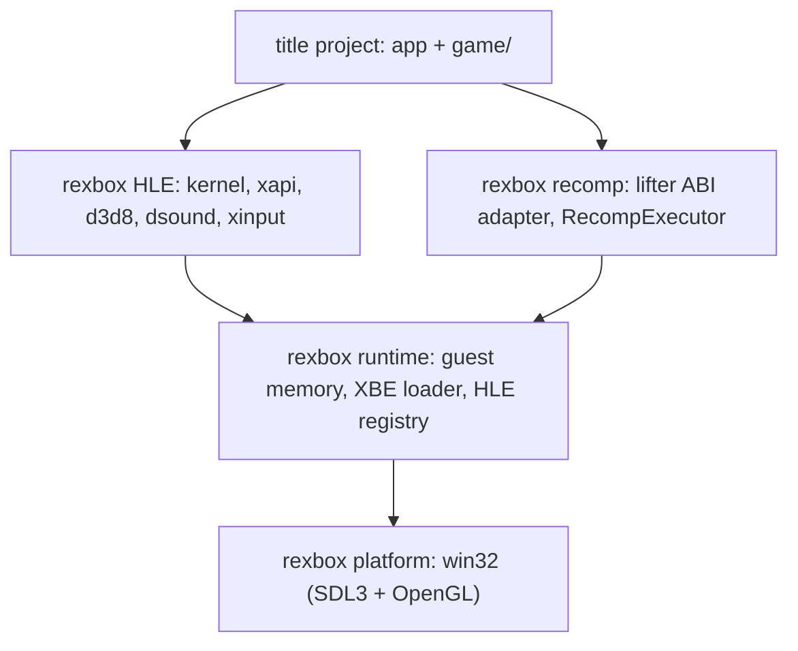

# rexbox


rexbox는 [reJSRF](https://github.com/nworkers/reJSRF)(Jet Set Radio Future)와 [reCT3](https://github.com/reexec/reCT3)(Crazy Taxi 3: High Roller)가 함께 쓰는 **공용 Xbox 런타임**입니다. 특정 타이틀에 종속되지 않아 어떤 Xbox 타이틀에서도 그대로 쓸 수 있습니다. 두 프로젝트는 원본 Xbox 실행 파일(XBE)의 x86 코드를 [xboxrecomp](https://github.com/sp00nznet/xboxrecomp)로 C로 옮겨 호스트에서 네이티브로 실행하고, 그 코드가 부르는 Xbox 커널·XDK 라이브러리·하드웨어를 rexbox의 HLE가 대신합니다.

rexbox는 reJSRF 안에서 만들어진 뒤 이 저장소로 분리되었습니다(이력 포함). 현재 버전은 [VERSION](VERSION)에서 확인할 수 있습니다.

*rexbox is the **title-agnostic Xbox runtime** shared by [reJSRF](https://github.com/nworkers/reJSRF) (Jet Set Radio Future) and [reCT3](https://github.com/reexec/reCT3) (Crazy Taxi 3: High Roller). Both lift the x86 code of an original Xbox executable (XBE) to C with [xboxrecomp](https://github.com/sp00nznet/xboxrecomp) and run it natively on the host; rexbox's HLE stands in for the Xbox kernel, the XDK libraries and the hardware that code calls. It was built inside reJSRF and split out, history included. See [VERSION](VERSION) for the current version.*

> [!WARNING]
> 개발 중입니다. Win32 x86에서 reJSRF가 로고 시퀀스와 3D 어트랙트 데모를 음악과 함께 그리는 데 쓰인 코드 그대로이며, 다른 호스트는 아직 없습니다.
>
> *Work in progress. This is the code reJSRF uses on Win32 x86 to show the logo sequence and the 3D attract demo with music; no other host exists yet.*

## 게임 데이터는 포함되지 않습니다

이 저장소에는 어떤 게임의 실행 파일, 자산, 그리고 실행 파일에서 생성한 코드도 들어 있지 않으며 앞으로도 넣지 않습니다.

## 구조



* `include/rexbox/`, `src/`: XBE 파서, 런타임, 재컴파일 ABI 어댑터, HLE 모듈. 타이틀 이름이나 주소는 없습니다.
* `src/platform/`: OS 계층(Win32, Linux)과 SDL3 백엔드.
* `tools/`: `rexbox_xbe_info`, `rexbox_xdk_symbols`(재컴파일 파이프라인용), 게임 없이 도는 probe 세 개.
* `scripts/recomp/`: 타이틀 프로젝트가 wrapper로 부르는 재컴파일 파이프라인 스크립트.
* `third_party/`: SDL3, Dear ImGui, SMAA, XbSymbolDatabase, xboxrecomp(upstream v0.15.0) submodule.
* 자세한 내용: [ARCHITECTURE.md](ARCHITECTURE.md), [설계 i001](docs/design/20261020-i001-project-bootstrap.md), [프로젝트 헌장](docs/PROJECT_CHARTER.md)

## 타이틀 프로젝트에서 쓰기

```cmake
set(REXBOX_BUILD_TOOLS ON)                       # rexbox_xdk_symbols and the probes
# set(REXBOX_XBOXRECOMP_DIR ".../my/xboxrecomp")  # to pin your own lifter checkout
add_subdirectory(third_party/rexbox)
rexbox_apply_host_flags()                        # /EHa and friends for the whole program
add_library(mytitle_game STATIC ...)
target_link_libraries(mytitle_game PUBLIC rexbox_recomp)
rexbox_add_recompiled_library(mytitle_recomp GEN_DIR "${CMAKE_SOURCE_DIR}/gen/my_variant/gen" TITLE mytitle_game)
add_executable(mytitle main.cpp)
target_link_libraries(mytitle PRIVATE mytitle_game rexbox_hle rexbox_platform imgui)
```

앱은 `rexbox::platform::SetDisplayTitle`과 `SetApplicationIdentity`로 자기 이름을 알려주고, 타이틀 프로파일은 XBE를 인증서로 식별해 `HleRegistry`에 XDK 변수를 묶습니다. 전체 계약은 [ARCHITECTURE.md §2](ARCHITECTURE.md)에 있습니다.

## 단독 빌드 (Win32)

```powershell
git clone --recurse-submodules https://github.com/reexec/rexbox.git
cd rexbox
.\scripts\build_win32_x86.ps1          # 실행 정책이 막으면 scripts\build_win32_x86.bat
.\build\win32_x86\tools\Debug\rexbox_kernel_probe.exe
.\build\win32_x86\tools\Debug\rexbox_dsound_probe.exe
.\build\win32_x86\tools\Debug\rexbox_d3d8_probe.exe
```

자세한 절차: [Win32 개발 환경 준비와 빌드](docs/guides/win32-setup-and-build.md), [Linux 개발 환경 준비와 빌드](docs/guides/linux-setup-and-build.md)(`scripts/build_linux.sh x64 debug`)

## 플랫폼 상태

| 플랫폼 | 상태 |
|---|---|
| Win32 x86 | 빌드됨. reJSRF가 로고 시퀀스와 3D 어트랙트 데모를 그리고 음악을 내는 데 쓴다 |
| Win64 | 예정 |
| Linux x64 / x86 | 라이브러리 빌드와 probe 통과(GCC 13, Ubuntu 24.04). 샘플러 없음. 타이틀 앱은 아직 없음 |
| Web (wasm32) | 예정 |
| Android | 예정 |

## 기여와 작업 규칙

[AGENTS.md](AGENTS.md)와 [docs/CODING_STYLE.md](docs/CODING_STYLE.md)를 따릅니다. 규칙은 reJSRF와 같고, 그 바탕은 [reexec/rePIU](https://github.com/reexec/rePIU)입니다.

## 참고 프로젝트

[xboxrecomp](https://github.com/sp00nznet/xboxrecomp)(재컴파일 파이프라인과 lifter ABI), [XbSymbolDatabase](https://github.com/Cxbx-Reloaded/XbSymbolDatabase)(XDK 함수 식별), [re2DJ](https://github.com/reexec/re2DJ)(같은 호스트 계층) 등. 목록과 라이선스: [docs/kb/external-references.md](docs/kb/external-references.md), [CREDITS.md](CREDITS.md)

## 라이선스

[MIT](LICENSE). 서드파티 코드: [THIRD_PARTY_NOTICES.md](THIRD_PARTY_NOTICES.md). 이 프로젝트는 Microsoft 또는 어떤 게임 퍼블리셔와도 관련이 없습니다.

---

# rexbox (English)

## No game data included

This repository does not and will not contain any game's executable, assets, or code generated from an executable.

## Structure

See the diagram above. `include/rexbox/` and `src/` hold the XBE parser, the runtime, the recompiled-code ABI adapter and the HLE modules, with no title's name or addresses; `src/platform/` the OS layer (Win32) and the SDL3 backend; `tools/` `rexbox_xbe_info`, `rexbox_xdk_symbols` (for the recompilation pipeline) and three probes that run without a game; `scripts/recomp/` the pipeline scripts a title project calls through a wrapper; `third_party/` the SDL3, Dear ImGui, SMAA, XbSymbolDatabase and xboxrecomp (upstream v0.15.0) submodules. More: [ARCHITECTURE.md](ARCHITECTURE.md), [design i001](docs/design/20261020-i001-project-bootstrap.md), [project charter](docs/PROJECT_CHARTER.md).

## Using it from a title project

The CMake snippet above is the whole contract: add the subdirectory, call `rexbox_apply_host_flags()`, link `rexbox_recomp` into the title library, build the generated code with `rexbox_add_recompiled_library`, and link the app against `rexbox_hle`, `rexbox_platform` and `imgui`. The app names itself through `rexbox::platform::SetDisplayTitle` and `SetApplicationIdentity`; the title profile identifies the XBE by its certificate and binds the XDK variables into the `HleRegistry`. The full contract is in [ARCHITECTURE.md §2](ARCHITECTURE.md).

## Standalone build (Win32)

See the commands above, and [Win32 development setup and build](docs/guides/win32-setup-and-build.md) for the full procedure. The build yields the tools and the three probes; there is no executable to run a game with, since that is a title project.

## Platform status

Win32 x86 builds and is what reJSRF runs on; Linux x64 and x86 build the library and pass the probes (GCC 13, Ubuntu 24.04; no sampler, no title app yet); Win64, the web (wasm32) and Android are planned.

## Contributing and working rules

Follow [AGENTS.md](AGENTS.md) and [docs/CODING_STYLE.md](docs/CODING_STYLE.md). The rules are those of reJSRF, based on [reexec/rePIU](https://github.com/reexec/rePIU).

## License

[MIT](LICENSE). Third-party code: [THIRD_PARTY_NOTICES.md](THIRD_PARTY_NOTICES.md). This project is not affiliated with Microsoft or any game publisher.
