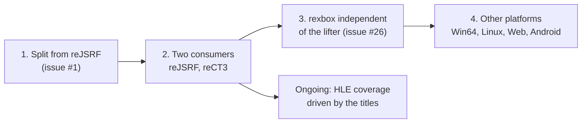

# 프로젝트 헌장

## 목적

rexbox는 원본 Xbox 타이틀을 정적 재컴파일과 디컴파일로 Win32, Win64, Linux x86, Linux x64, Web, Android에서 네이티브로 실행하는 프로젝트들이 공유하는 Xbox 런타임이다. [reJSRF](https://github.com/nworkers/reJSRF)(Jet Set Radio Future)에서 만들어져 분리되었고, [reCT3](https://github.com/reexec/reCT3)(Crazy Taxi 3: High Roller)가 두 번째 소비자다.

타이틀 프로젝트의 게임 로직은 원본 x86 코드에서 기계적으로 옮긴 코드가 담당한다. rexbox는 그 코드가 부르는 Xbox 커널, XDK 라이브러리, 하드웨어를 HLE로 대신하고, 호스트 플랫폼 서비스를 제공한다.

## Purpose

rexbox is the Xbox runtime shared by the projects that run original Xbox titles natively on Win32, Win64, Linux x86, Linux x64, the web and Android through static recompilation and decompilation. It was built inside [reJSRF](https://github.com/nworkers/reJSRF) (Jet Set Radio Future) and split out; [reCT3](https://github.com/reexec/reCT3) (Crazy Taxi 3: High Roller) is its second consumer.

A title project's game logic is carried by code mechanically lifted from the original x86. rexbox stands in for the Xbox kernel, the XDK libraries and the hardware that code calls, through HLE, and provides the host platform services.

## 현재 1차 목표

* 1차 호스트는 Win32 x86이다. 어느 정도 진행된 뒤 Win64, Linux x86/x64, Web, Android로 넓힌다.
* 소비자가 둘(reJSRF, reCT3)인 상태를 유지한다. 한 타이틀에서만 필요한 동작은 계약의 매개변수로 만들고, rexbox 자체는 특정 타이틀에 의존하지 않는다.
* reJSRF가 도달한 기능(로고 시퀀스, 3D 어트랙트 데모, 음악, 설정 오버레이, 와이드스크린, 안티에일리어싱)을 그대로 보존한다.

## Current First Target

* The first host is Win32 x86. Once the project is well along, it widens to Win64, Linux x86/x64, the web and Android.
* Keep two consumers (reJSRF, reCT3) working. Behavior one title alone needs becomes a parameter of a contract; rexbox itself knows no title.
* Preserve what reJSRF reached (the logo sequence, the 3D attract demo, music, the settings overlay, widescreen, anti-aliasing).

## 방향성

* 재컴파일된 원본 코드를 기준 구현으로 취급한다.
* 에뮬레이터(xemu, Cxbx-Reloaded)를 통합하지 않는다. 동작 비교의 기준으로만 쓴다.
* HLE는 API 경계(커널 ordinal, XDK 라이브러리 함수)에서 하고, 하드웨어 LLE는 필요한 지점에만 둔다.
* 플랫폼 공용 코어를 먼저 설계하고 OS별 세부 구현은 플랫폼 계층에 둔다.
* 게임 데이터와 그것에서 생성한 코드는 저장소에 넣지 않는다.
* 라이선스는 MIT이며, 전염성 라이선스 코드는 빌드에 넣지 않는다.
* 코드 변경 전에는 설계와 작업 계획을 문서화한다.
* 프로젝트 버전은 `VERSION` 파일의 `major.minor.patch` 형식으로 관리하고, 소비자는 submodule 커밋으로 고정한다.

## Direction

* Treat the recompiled original code as the reference implementation.
* Do not integrate an emulator (xemu, Cxbx-Reloaded); use one only as a reference for comparing behavior.
* Do HLE at API boundaries (kernel ordinals, XDK library functions), with hardware LLE only where needed.
* Design the shared platform-neutral core first and keep OS specifics in the platform layer.
* Keep game data and code generated from it out of the repository.
* The license is MIT, and copyleft code is not built in.
* Document design and work plans before changing code.
* Manage the project version in the `VERSION` file using `major.minor.patch`; consumers pin a submodule commit.

## 단계

1. 분리: reJSRF의 rexbox 부분을 이력과 함께 떼어내 독립 라이브러리로 만든다.
2. 소비자 둘: reCT3가 처음부터 submodule로 쓰고, reJSRF가 뒤따라 전환한다.
3. rexbox가 lifter에서 독립한다(issue #26): xboxrecomp 체크아웃과 파이프라인은 타이틀이 가지고, rexbox는 lifter ABI의 런타임 쪽만 구현한다. 어느 lifter(upstream, fork)를 쓸지는 각 타이틀이 정한다.
4. Win64, Linux, Web, Android로 확장한다. HLE 범위는 타이틀이 필요로 하는 만큼 계속 넓힌다.

## Stages

1. Split: take reJSRF's rexbox part out with its history as a standalone library.
2. Two consumers: reCT3 uses the submodule from the start; reJSRF follows.
3. rexbox independent of the lifter (issue #26): the xboxrecomp checkout and the pipeline belong to the titles, and rexbox implements only the runtime side of the lifter ABI. Each title picks its lifter (upstream or a fork).
4. Widen to Win64, Linux, the web and Android. HLE coverage keeps growing as the titles need it.
