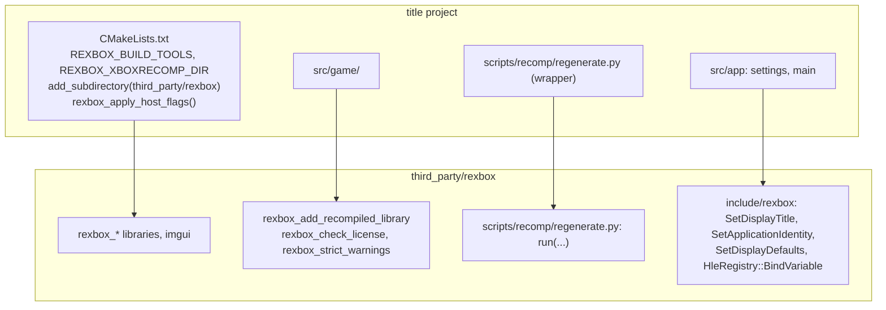

# 설계: reJSRF에서 rexbox 분리와 독립 라이브러리 구성 (issue #1)

## 1. 요구사항

* reJSRF가 `src/rexbox/`, `src/platform/`, `include/rexbox/`, `tools/`, `cmake/`에 만든 타이틀 독립 Xbox 런타임을 별도 저장소 `reexec/rexbox`로 분리한다.
* reJSRF와 reCT3(Crazy Taxi 3: High Roller)가 이 저장소를 submodule로 공유한다. reCT3는 처음부터 이 저장소를 쓴다. reJSRF의 전환은 별도 작업이다(사용자 지시: reJSRF는 다른 작업 중이므로 건드리지 않는다).
* xboxrecomp는 upstream(sp00nznet) 최신 버전 v0.15.0을 기본으로 한다. reJSRF는 fork 브랜치 `rejsrf`를 쓰므로 둘 다 지원해야 한다.
* 작업 규칙은 reJSRF와 동일하게 따른다.

## 2. 분리 범위

| reJSRF 경로 | rexbox 경로 | 판단 |
|---|---|---|
| `src/rexbox/{xbe,runtime,recomp,hle}` | `src/{xbe,runtime,recomp,hle}` | 타이틀 독립. 이력 보존 |
| `src/platform/` | `src/platform/` | 타이틀 독립 |
| `include/rexbox/` | `include/rexbox/` | 공개 계약 |
| `tools/{xbe_info,xdk_symbols,kernel_probe,dsound_probe,d3d8_probe}` | `tools/` | 게임 없이 도는 도구 |
| `tools/{decomp_check,d3d8_check}` | (reJSRF에 남음) | JSRF의 lift 원본·디컴파일 함수 목록에 묶임 |
| `cmake/embed_text.cmake` | `cmake/` | + `rexbox_host_flags`, `rexbox_license`, `rexbox_recomp` 신설 |
| `scripts/recomp/*.py`, `scripts/perf/resolve_samples.py` | `scripts/` | 경로를 인자로 받도록 일반화 |
| `docs/kb/`, `docs/CODING_STYLE.md` | `docs/` | 일반 Xbox 지식. JSRF에서 확인한 사실은 출처를 남김 |
| `docs/analysis/`, `docs/design/`, `docs/work-*`, `src/app/`, `src/game/jsrf/` | (reJSRF에 남음) | 타이틀 이력과 타이틀 코드 |
| `third_party/{SDL,imgui,smaa,XbSymbolDatabase}` | 같은 pin | |
| `third_party/xboxrecomp` | upstream v0.15.0 | reJSRF fork는 `REXBOX_XBOXRECOMP_DIR`로 지정 가능 |

이력은 `git filter-repo`로 위 경로만 남겨 보존했다(41개 커밋). 커밋 제목의 `(#N)`은 reJSRF의 issue이므로 `(nworkers/reJSRF#N)`으로 바꿨다.

## 3. 소비자 계약

결정:

1. **CMake**: rexbox는 `project(rexbox)`를 가진 서브디렉터리 프로젝트다. `REXBOX_PLATFORM`/`REXBOX_ARCH`를 고르고 부모에 내보낸다. SDL3·imgui·smaa는 항상, XbSymbolDatabase와 도구는 `REXBOX_BUILD_TOOLS`일 때 빌드한다(기본은 최상위일 때만; 소비자는 `rexbox_xdk_symbols`가 필요하므로 켠다).
2. **호스트 플래그**: `add_compile_options`는 디렉터리 범위라 `rexbox_apply_host_flags()` 함수로 만들어 rexbox와 소비자가 각자 부른다. `/EHa`는 프로그램 전체 요구사항이다.
3. **라이선스 가드**: `REXBOX_COPYLEFT_PATHS`를 `REXBOX_XBOXRECOMP_DIR` 기준 상대 경로로 바꿔 소비자의 fork 체크아웃도 같은 가드를 받는다.
4. **생성 코드 타깃**: reJSRF `src/game/jsrf/CMakeLists.txt`의 생성 코드 부분을 `rexbox_add_recompiled_library`로 옮겼다. ABI 헤더 해시 검사, `/w /bigobj /MP`, 프로파일·ABI 검사 옵션(`REXBOX_RECOMP_*`), `RECOMP_STUB_REPORT`, 타이틀 라이브러리와의 순환 링크를 담당한다. 타이틀 쪽에 남는 것은 gen 디렉터리 include와 `<TITLE>_HAS_RECOMP` 정의다.
5. **타이틀 이름 제거**: `paths_sdl.cpp`의 `SDL_GetPrefPath("reJSRF","reJSRF")`는 새 계약 `platform::SetApplicationIdentity(organization, application)`으로 받는다(설정하지 않으면 사용자 폴더 없음). D3D8의 기본 창 제목은 `"rexbox"`이며 앱이 `SetDisplayTitle`로 덮는다. CMake 변수 `REJSRF_*`는 `REXBOX_*`로 바꿨다(`REXBOX_RECOMP_CALL_PROFILE`, `REXBOX_RECOMP_ABI_CHECK`). 측정 출처를 적은 주석("reJSRF's rejsrf_d3d8_check")은 사실이므로 남긴다.
6. **스크립트**: `regenerate.py`는 `run(xbe, variant, title_dir, gen_root, override_dirs, symbol_tool_candidates, root)`로 타이틀 wrapper가 부른다. `xbe_variant.py`는 변형 파일 경로를 받고, `md5`가 `null`인 변형은 "등록되지 않음"으로 멈춘다(reCT3처럼 XBE가 아직 없는 타이틀을 위해). `check_hle_pops.py`, `find_pointer_targets.py`, `resolve_samples.py`도 경로·실행 파일 이름을 인자나 map 파일 이름에서 얻는다.

## 4. lifter ABI: upstream v0.15.0과 reJSRF fork

reJSRF의 fork(v0.13.1 + 수정)와 upstream v0.15.0의 `recomp_types.h`를 비교했다.

| 항목 | fork(reJSRF) | upstream v0.15.0 | rexbox_recomp |
|---|---|---|---|
| 미해결 스텁 보고 | `RECOMP_STUB_REPORT` → `recomp_unresolved_stub_log(va)` | 스텁 자체가 `RECOMP_STUB_LOG=1`로 보고 | 함수를 무조건 정의(upstream에선 미사용) |
| EFLAGS | 없음 | `extern RECOMP_TLS uint32_t g_eflags`(pushfd/popfd) | 정의, 스레드 시작 때 `0x202` |
| cpuid | 없음 | `xbox_Cpuid(leaf, subleaf, out[4])` | Pentium III(Coppermine) 값 정의 |
| 포트 I/O | 없음 | `xbox_PortIn/xbox_PortOut` | 0 반환·버림, 포트마다 한 번 보고; `0x80C0` 비트 5 토글 |
| 루프 back edge | 없음 | `g_xbox_guest_cpu_preempt`, `xbox_GuestCpuPreempt` (`--back-edge-yield`일 때만 emit) | 0으로 두고 no-op 정의 |
| XMM 도우미 | SSE2 intrinsic 선택(`RECOMP_XMM_PORTABLE`) | 칸 단위 C만 | `REXBOX_RECOMP_XMM_SSE2` 옵션 유지(fork에서만 의미) |
| `RECOMP_MEM_BASE` | 함수별 지역 base | 없음 | 무관 |
| `--exclude-manual`, `--seed-functions`, 도구 CLI | 같음 | 같음 | `regenerate.py` 그대로 |

정의를 조건부(`#ifdef`)로 하지 않고 모두 정의하는 이유: 헤더에 없는 심볼을 더 정의해도 링크에 해가 없고, 선언이 바뀌면 컴파일 오류로 드러난다. 두 헤더 모두에 대해 `rexbox_recomp`가 컴파일되는 것을 검증한다(§7).

upstream에 아직 머지되지 않은 reJSRF fork의 수정(PR [#200](https://github.com/sp00nznet/xboxrecomp/pull/200): 다른 함수 본문 중간으로 가는 분기, 늦은 본문의 `jcc`, 복구된 switch 안의 중첩 switch)은 JSRF 부팅에 필요했던 것이다. reCT3가 upstream v0.15.0으로 같은 문제를 만나면 그때 upstream PR 또는 fork로 대응한다(**미확정**, reCT3 쪽 위험으로 기록).

## 5. 저장소 구성

| 경로 | 내용 |
|---|---|
| `include/rexbox/`, `src/{xbe,runtime,recomp,hle}/` | 런타임과 HLE |
| `include/rexbox/platform/`, `src/platform/<os>/`, `src/platform/sdl/` | 플랫폼 계약과 구현 |
| `tools/` | `rexbox_xbe_info`, `rexbox_xdk_symbols`, probe 3개 |
| `cmake/` | `embed_text`, `rexbox_host_flags`, `rexbox_license`, `rexbox_recomp` |
| `scripts/recomp/`, `scripts/perf/`, `scripts/build_win32_x86.*` | 파이프라인·진단·빌드 스크립트 |
| `docs/kb/`, `docs/guides/`, `docs/design/`, `docs/work-orders/`, `docs/work-logs/` | 문서 |
| `third_party/` | SDL, imgui, smaa, XbSymbolDatabase, xboxrecomp(upstream) |

## 6. 소비자가 할 일(reJSRF 전환 시, 별도 작업)

* `src/rexbox`, `src/platform`, `include/rexbox`, `cmake`, 도구 다섯 개를 지우고 `third_party/rexbox` submodule 추가.
* 루트 CMake: `REXBOX_BUILD_TOOLS ON`, `REXBOX_XBOXRECOMP_DIR`를 자기 fork로, `rexbox_apply_host_flags()`, `rejsrf_check_license`→`rexbox_check_license`, 생성 코드 부분을 `rexbox_add_recompiled_library`로.
* `main.cpp`: `SetApplicationIdentity("reJSRF", "reJSRF")` 추가. `REJSRF_RECOMP_CALL_PROFILE`→`REXBOX_RECOMP_CALL_PROFILE`.
* `scripts/recomp/*.py`: rexbox 스크립트를 부르는 wrapper로 교체.
* `rejsrf_d3d8_probe` include 경로 `src/rexbox/hle/d3d8` → `third_party/rexbox/src/hle/d3d8`.

## 7. 이번 task의 검증

* Win32 x86 Debug/Release 단독 빌드(우리 타깃 /W4 경고 없음), probe 세 개 0 failure.
* `REXBOX_XBOXRECOMP_DIR`를 reJSRF의 fork 체크아웃으로 두고 `rexbox_recomp` 컴파일(읽기만).
* reCT3가 submodule로 가져가 빌드(reCT3 issue #1).
* 스크립트는 `py_compile`과 `xbe_variant.py`로 실제 XBE의 신원 출력.

---

# Design: splitting rexbox out of reJSRF as a standalone library (issue #1)

## 1. Requirements

* Move the title-agnostic Xbox runtime reJSRF built under `src/rexbox/`, `src/platform/`, `include/rexbox/`, `tools/` and `cmake/` into its own repository, `reexec/rexbox`.
* reJSRF and reCT3 (Crazy Taxi 3: High Roller) share it as a submodule. reCT3 uses it from the start; reJSRF's migration is a separate task (the user asked that reJSRF stay untouched while other work is in progress there).
* xboxrecomp defaults to upstream (sp00nznet) v0.15.0. reJSRF uses the fork branch `rejsrf`, so both must be supported.
* The working rules are those of reJSRF.

## 2. What moves

The table above: the runtime, platform layer, public headers, the five title-independent tools, the CMake helpers, the generalized scripts, `docs/kb/` and `docs/CODING_STYLE.md` move; reJSRF keeps its analysis, design history, app, title code and the two title-bound check tools. The submodules keep their pins except xboxrecomp, which is upstream v0.15.0 (a consumer may point `REXBOX_XBOXRECOMP_DIR` at its own fork). History was preserved with `git filter-repo` over those paths (41 commits), with `(#N)` in commit titles rewritten to `(nworkers/reJSRF#N)`.

## 3. Consumer contract

Decisions: (1) rexbox is a subdirectory project with its own `project()`, exporting `REXBOX_PLATFORM`/`REXBOX_ARCH`; SDL3, imgui and smaa always build, XbSymbolDatabase and the tools under `REXBOX_BUILD_TOOLS` (default: top level only; a consumer turns it on for `rexbox_xdk_symbols`). (2) `rexbox_apply_host_flags()` wraps the directory-scoped compiler settings so rexbox and the consumer each apply them; `/EHa` is a whole-program requirement. (3) `REXBOX_COPYLEFT_PATHS` is relative to `REXBOX_XBOXRECOMP_DIR`, so a consumer's fork checkout is guarded too. (4) `rexbox_add_recompiled_library` takes over reJSRF's generated-code CMake: the ABI header hash check, `/w /bigobj /MP`, the `REXBOX_RECOMP_*` options, `RECOMP_STUB_REPORT` and the cyclic link with the title library; the title keeps the gen include path and its `<TITLE>_HAS_RECOMP` definition. (5) Title names leave the runtime: `platform::SetApplicationIdentity(organization, application)` names the user settings folder (none without it), the D3D8 default window title is `"rexbox"` under the app's `SetDisplayTitle`, and `REJSRF_*` CMake variables become `REXBOX_*`; comments naming the measurement's source stay, being facts. (6) `regenerate.py` is called by a title wrapper through `run(...)`; `xbe_variant.py` takes the variants file and treats a `null` md5 as "not registered yet"; the other scripts take paths as arguments.

## 4. Lifter ABI: upstream v0.15.0 and the reJSRF fork

The table above compares the two `recomp_types.h` headers. rexbox_recomp defines everything both declare, unconditionally: `recomp_unresolved_stub_log` for the fork's `RECOMP_STUB_REPORT`; `g_eflags` (reset to `0x202`), `xbox_Cpuid` (Coppermine Pentium III values), `xbox_PortIn`/`xbox_PortOut` (no device: 0 and dropped, reported once per port, with port `0x80C0` bit 5 toggling), and `g_xbox_guest_cpu_preempt` with a no-op `xbox_GuestCpuPreempt` for upstream. An extra definition harms nothing, and a changed declaration shows up as a compile error. The fork's fixes not yet upstream (PR #200: branches into another function's interior, late `jcc`, nested switches) were needed to boot JSRF; if reCT3 meets the same on upstream v0.15.0, that is handled then by an upstream PR or a fork (**unresolved**; recorded as a reCT3 risk).

## 5. Repository layout

As in the table above.

## 6. What a consumer does (reJSRF's migration, a separate task)

Remove `src/rexbox`, `src/platform`, `include/rexbox`, `cmake` and the five tools; add the `third_party/rexbox` submodule; set `REXBOX_BUILD_TOOLS ON` and `REXBOX_XBOXRECOMP_DIR` to its fork, call `rexbox_apply_host_flags()`, rename `rejsrf_check_license` to `rexbox_check_license`, build the generated code with `rexbox_add_recompiled_library`; add `SetApplicationIdentity("reJSRF", "reJSRF")` to `main.cpp` and rename `REJSRF_RECOMP_CALL_PROFILE`; replace `scripts/recomp/*.py` with wrappers; fix `rejsrf_d3d8_probe`'s include path.

## 7. Verification for this task

Win32 x86 Debug and Release standalone builds without warnings on our targets and the three probes at 0 failures; `rexbox_recomp` compiled with `REXBOX_XBOXRECOMP_DIR` at reJSRF's fork checkout (read only); reCT3 building it as a submodule (reCT3 issue #1); the scripts byte-compiled and `xbe_variant.py` printing a real XBE's identity.
