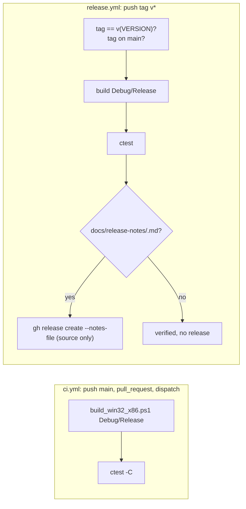

# 설계: GitHub Actions — main 검증, 태그 검증, 릴리스 (issue #2)

## 1. 요구사항

* `main` 반영 시 빌드를 검증한다. rexbox의 검증은 라이브러리 자체 빌드와 단위 테스트다.
* 태그를 검증하고, 태그에 릴리스 노트가 있으면 GitHub Release를 만든다.
* 산출물은 소스만이다(빌드 결과물을 붙이지 않는다).
* 같은 규칙을 reCT3에도 적용한다([reCT3 #2](https://github.com/reexec/reCT3/issues/2)).

## 2. 워크플로

| 항목 | 결정 |
|---|---|
| 단위 테스트 | probe 세 개(`rexbox_kernel_probe`, `rexbox_dsound_probe`, `rexbox_d3d8_probe`)를 CTest에 등록한다(`tools/CMakeLists.txt`의 `add_test`, 루트의 `enable_testing()`). CI는 실행 파일을 하나씩 부르지 않고 `ctest --test-dir build\win32_x86 -C <config> --output-on-failure`로 돈다. 테스트가 늘면 CMake에만 추가하면 된다. 소비자가 자기 루트에서 `enable_testing()`을 부르면 같은 테스트를 받는다 |
| 태그 검증 | `v*` 태그 push에서 (1) 태그 이름이 `v` + `VERSION` 파일 값과 같고, (2) 태그 커밋이 `origin/main`의 조상이어야 한다(`git merge-base --is-ancestor`). 둘 중 하나라도 아니면 실패. 그다음 CI와 같은 빌드·테스트 |
| 릴리스 | `verify` 성공 뒤 `ubuntu-latest`에서 `docs/release-notes/<tag>.md`가 있으면 `gh release create <tag> --verify-tag --notes-file`로 만든다. 없으면 성공으로 끝나고 릴리스는 없다(태그만 검증). 이미 있으면 건너뛴다. 자산은 붙이지 않는다(GitHub의 소스 아카이브만; 아카이브에는 submodule이 없으므로 README의 `--recurse-submodules` clone이 빌드 경로다) |
| 권한 | `ci.yml`은 `contents: read`, `release.yml`은 `contents: write`(릴리스 생성). 토큰은 `github.token` |
| 러너 | `windows-2022` 고정(빌드 스크립트가 설치된 VS로 생성기를 고르므로) |

AGENTS.md의 Git 규칙에 "릴리스 노트는 태그를 push하기 전에 `main`에 머지되어 있어야 한다"를 더했다. 기존 절차(머지 요청 → patch 올림 → PR squash → 로컬 태그 → 사용자가 push)와 맞물려, 사용자가 태그를 push하는 순간 검증과 릴리스가 일어난다.

## 3. 검증

* 로컬: `ctest -C Debug`와 `-C Release`가 3개 테스트 통과.
* 워크플로 파일은 push 뒤 Actions에서 돈다(`ci.yml`은 PR에서; `release.yml`은 첫 태그에서). 문법은 `gh workflow` 목록과 YAML 파싱으로 확인한다.

---

# Design: GitHub Actions — main verification, tag verification, releases (issue #2)

## 1. Requirements

Verify the build on every push to `main` (for rexbox: the library's own build and its unit tests); verify tags, and create a GitHub Release when the tag has a release note; artifacts are source only; the same rules for reCT3 ([reCT3 #2](https://github.com/reexec/reCT3/issues/2)).

## 2. Workflows

As in the diagram and table: the three probes are registered with CTest (`add_test` in `tools/CMakeLists.txt`, `enable_testing()` at the root), so CI runs `ctest --test-dir build\win32_x86 -C <config> --output-on-failure` after `build_win32_x86.ps1`, and a consumer that enables testing at its top level gets the same tests. `release.yml` runs on `v*` tags: the tag must equal `v` + the `VERSION` file and its commit must be an ancestor of `origin/main`; then the same build and tests; then, on `ubuntu-latest`, a release is created from `docs/release-notes/<tag>.md` with `gh release create --verify-tag --notes-file` when the file exists (skipped when the release already exists), with no assets attached (GitHub's source archives only; they hold no submodules, so a `--recurse-submodules` clone is the build path). `ci.yml` has `contents: read`, `release.yml` `contents: write`; the runner is pinned to `windows-2022`. AGENTS.md's Git rules now say the release note must be merged into `main` before the tag is pushed, which fits the existing procedure (merge request, patch bump, squash, local tag, the user pushes the tag).

## 3. Verification

Locally `ctest -C Debug` and `-C Release` pass the three tests; the workflows run on GitHub after the push (`ci.yml` on the pull request, `release.yml` on the first tag), and their syntax is checked by YAML parsing and `gh workflow list`.
