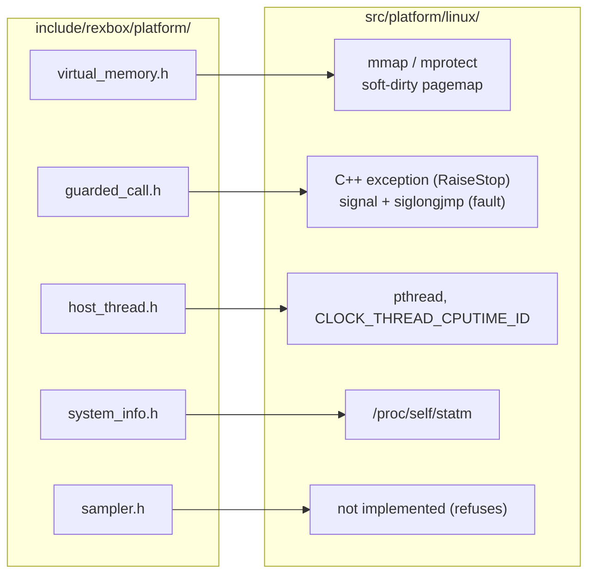

# 설계: Linux x64 / x86 준비 — POSIX 플랫폼 계층, 프리셋, Linux CI (issue #4)

## 1. 요구사항

* Win32 x86 다음 호스트로 Linux x64와 x86을 준비한다. 라이브러리가 Linux에서 빌드되고 단위 테스트(probe)가 통과해야 하며, GitHub Actions가 그것을 검증한다.
* 타이틀 실행(게임)은 범위 밖이다. 타이틀 프로젝트가 Linux 앱을 만들 때 필요한 것은 이 작업 뒤에 rexbox가 제공한다.

## 2. 현재 상태와 이식 범위

플랫폼 계층 밖에는 Windows 의존이 없었다(`include/rexbox/platform/display.h`의 `REXBOX_GL_APIENTRY`만 32비트 Windows에서 `__stdcall`). SDL3 백엔드(`src/platform/sdl/`)는 그대로 Linux에서 쓴다. 이식 대상은 Win32가 구현한 다섯 계약이다.

| 계약 | Win32 | Linux | 비고 |
|---|---|---|---|
| 가상 메모리 | `VirtualAlloc`, `MEM_WRITE_WATCH`/`GetWriteWatch` | `mmap`(`MAP_FIXED_NOREPLACE`로 선호 주소), `mprotect`; 쓰인 페이지는 커널의 soft-dirty 비트(`/proc/self/pagemap` 비트 55, `/proc/self/clear_refs`에 `4`) | soft-dirty를 지원하지 않는 커널(WSL2 포함)은 처음 한 번 자가 검사로 알아내고 추적 없이 할당한다. `TakeWrittenPages`는 false를 돌려주고 호출자는 모든 페이지를 쓰인 것으로 본다(정확성은 같고 D3D8의 버퍼 비교만 느려진다). `clear_refs`는 프로세스 전체를 지우지만 추적 블록은 게스트 메모리 하나뿐이다 |
| 보호 호출 | SEH(`__try`, `RaiseException`, `/EHa`) | `RaiseStop`은 C++ 예외를 던지고 `RunGuarded`가 받는다(사이 프레임의 소멸자가 실행됨). fault는 `SIGSEGV`/`SIGBUS`/`SIGILL`/`SIGFPE` 핸들러(`SA_SIGINFO | SA_NODEFER`)가 스레드별 최내곽 프레임의 결과에 적고 `siglongjmp`로 빠져나온다(소멸자 없음; fault 난 게스트 스레드는 끝나므로 그 프레임은 다시 쓰이지 않는다) | 쓰기 여부는 x86의 `REG_ERR` 비트 1. 스택 오버플로용 대체 신호 스택은 아직 없다(**미확정**, 후속) |
| 호스트 스레드 | `CreateThread`, `GetThreadTimes` | `pthread_create`(스택 크기), `pthread_join`, `nanosleep`, `CLOCK_THREAD_CPUTIME_ID` | |
| 시스템 정보 | `GetProcessMemoryInfo` | `/proc/self/statm` | 주소 공간 전체는 32비트 3 GiB, 64비트 128 TiB |
| 샘플러 | `SuspendThread` + IP 읽기 | 미구현: `StartThreadSampling`이 false | 타이머 신호로 대상 스레드의 PC를 읽는 구현은 후속(**미확정**). 진단 기능이라 런타임은 의존하지 않는다 |

## 3. 툴체인과 x86의 부동소수점

* GCC 13(Ubuntu 24.04)과 Ninja. x86은 `-m32`(gcc-multilib)이며 SDL3가 컴파일되려면 i386 개발 라이브러리가 필요하다.
* **x87 대 SSE**: 첫 `-m32` 빌드에서 D3D8 probe 두 개가 실패했다(`diffuse kept across batches`, `a mapped register not written since SetPixelShader ...`). 둘 다 `== 0.498f`, `(x >> 16 & 0xFF) / 255.0f == …` 같은 float 동등 비교로, x87이 중간값을 80비트로 들고 있어 저장된 float와 다르게 반올림된 것이다. `-msse2 -mfpmath=sse`로 빌드하면 163개 모두 통과했다. 이는 테스트만의 문제가 아니다. lift된 게스트 산술은 Xbox의 Pentium III SSE와 MSVC x86 기본(`/arch:SSE2`)처럼 연산마다 단정밀도로 반올림해야 하므로, `rexbox_apply_host_flags()`가 32비트 x86의 GCC/Clang에 `-msse2 -mfpmath=sse`를 건다(소비자도 같은 함수를 부르므로 함께 적용된다).
* `-Wall -Wextra`가 MSVC `/W4`가 놓친 미사용 함수 하나(`d3d8_resource.cpp`의 `Log2Floor`)를 찾아 지웠다.

## 4. 빌드 진입점과 CI

* `CMakePresets.json`: `linux-x64-debug/release`, `linux-x86-debug/release`(configure, build, test 프리셋). `scripts/build_linux.sh [x64|x86] [debug|release]`가 셋을 차례로 돈다. Windows는 기존 `scripts/build_win32_x86.ps1`이다.
* `ci.yml`에 `linux` 잡(ubuntu-24.04, arch × configuration 네 조합: apt로 의존 설치, x86은 `dpkg --add-architecture i386`과 `:i386` 패키지), `release.yml`에 같은 `verify-linux` 잡. `release`는 두 verify를 모두 기다린다.
* Actions의 x86 잡은 i386 패키지 설치에 달려 있다. 로컬 WSL(같은 Ubuntu 24.04)에는 헤더가 이미 있어 통과했지만, CI의 패키지 조합은 첫 PR에서 확인한다(**미확정**).

## 5. 검증

| 검증 | 방법 |
|---|---|
| Linux x64 Debug/Release 빌드, `ctest` 3/3 | WSL2 Ubuntu 24.04, GCC 13 |
| Linux x86 Debug/Release 빌드, `ctest` 3/3 | 같은 환경, `-m32` |
| Win32 x86 회귀 없음 | `rexbox_apply_host_flags` 변경은 MSVC 분기에 손대지 않음; Debug 빌드와 `ctest` |
| 소비자(reCT3) | Win32 빌드 유지(reCT3의 Linux 앱은 후속) |

---

# Design: Linux x64 / x86 preparation — POSIX platform layer, presets, Linux CI (issue #4)

## 1. Requirements

Prepare Linux x64 and x86 as the hosts after Win32 x86: the library builds on Linux, the unit tests (the probes) pass, and GitHub Actions verifies it. Running a title is out of scope; what a title project needs for a Linux app comes from rexbox after this.

## 2. Current state and what is ported

Nothing outside the platform layer depended on Windows (only `REXBOX_GL_APIENTRY` in `display.h`, `__stdcall` on 32-bit Windows). The SDL3 backend is reused. The five contracts Win32 implements get `src/platform/linux/` implementations, as in the table: virtual memory on `mmap`/`mprotect` with written pages from the kernel's soft-dirty bits (a one-time self test detects kernels without them, WSL2 among them, and such blocks are allocated untracked so `TakeWrittenPages` reports failure and callers treat every page as written: same correctness, slower D3D8 buffer comparison; `clear_refs` clears the whole process, but the guest memory is the only tracked block); guarded calls with `RaiseStop` as a C++ exception caught in `RunGuarded` (destructors run) and faults as `SIGSEGV`/`SIGBUS`/`SIGILL`/`SIGFPE` handlers writing the innermost frame's result and leaving by `siglongjmp` (no destructors; a faulted guest thread ends; write detection from x86's `REG_ERR` bit 1; no alternate signal stack yet, **unresolved**); host threads on pthreads with `CLOCK_THREAD_CPUTIME_ID`; system info from `/proc/self/statm`; the sampler not implemented (`StartThreadSampling` returns false; a timer-signal implementation is a follow-up, **unresolved**; nothing in the runtime depends on it).

## 3. Toolchain and x86 floating point

GCC 13 (Ubuntu 24.04) and Ninja; x86 is `-m32` with gcc-multilib and the i386 development libraries SDL3 needs. The first `-m32` build failed two D3D8 probe checks (float equality against stored floats), because the x87 keeps intermediates at 80 bits; with `-msse2 -mfpmath=sse` all 163 pass. This is not only a test matter: lifted guest arithmetic must round per operation to single precision as the Xbox's Pentium III SSE and MSVC's x86 default (`/arch:SSE2`) do, so `rexbox_apply_host_flags()` adds `-msse2 -mfpmath=sse` for GCC/Clang on 32-bit x86 (consumers call the same function). `-Wall -Wextra` found one unused helper (`Log2Floor` in `d3d8_resource.cpp`), now removed.

## 4. Build entry points and CI

`CMakePresets.json` with `linux-x64-debug/release` and `linux-x86-debug/release` (configure, build and test presets) and `scripts/build_linux.sh [x64|x86] [debug|release]`; Windows keeps `scripts/build_win32_x86.ps1`. `ci.yml` gains a `linux` job (ubuntu-24.04, arch × configuration; apt dependencies, with `dpkg --add-architecture i386` and `:i386` packages for x86) and `release.yml` the same `verify-linux` job, which `release` waits for. The x86 job depends on the i386 package set; local WSL (the same Ubuntu 24.04) already had the headers, so CI's package combination is confirmed at the first pull request (**unresolved**).

## 5. Verification

Linux x64 and x86 Debug/Release builds with `ctest` 3/3 on WSL2 Ubuntu 24.04 (GCC 13); no Win32 regression (the MSVC branch of `rexbox_apply_host_flags` is untouched; Debug build and `ctest`); reCT3 keeps building on Win32 (its Linux app is a follow-up).
