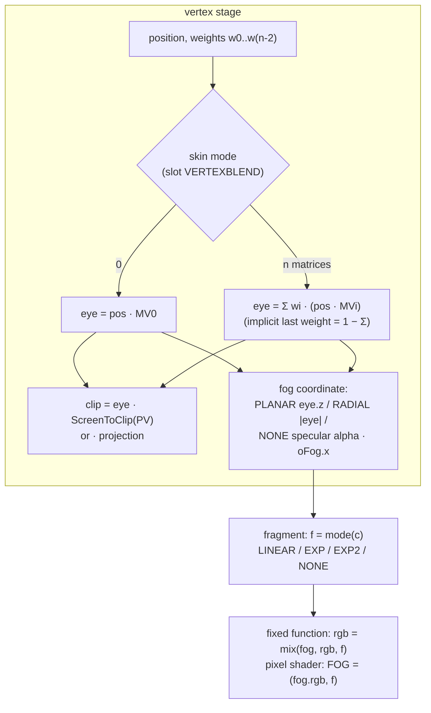

# 설계: 포그와 정점 블렌딩 (issue #7, reexec/reCT3#5)

## 1. 요구사항

Crazy Taxi 3(reexec/reCT3, XDK 4531)는 어트랙트 데모를 3D로 그리지만 두 가지가 빠져 있다.

* **포그**: `fog is not drawn yet`. 고정 기능 경로에는 포그가 없다. 정점 프로그램의 `oFog`는 `v_fog`로 나가지만 쓰이지 않는다. 픽셀 셰이더의 `FOG` 레지스터는 계수 1로 고정이다.
* **정점 블렌딩**: `SetVertexBlendModelView`는 첫 행렬만 쓰고(`2 model views; blending is not modelled`), `D3DRS_VERTEXBLEND`와 정점의 블렌드 가중치는 읽지 않는다.

## 2. 측정 (CT3, 라이브러리 코드와 실행)

### 2.1 포그 (**확인됨**: 상태 내보내기 `sub_000FD590`)

| 상태(4531 슬롯) | CT3 값 | 라이브러리가 하는 일 |
|---|---|---|
| FogEnable(83) | 1 | 0이면 포그 레지스터를 건드리지 않는다 |
| FogTableMode(84) | 1 | 0 NONE: 생성 모드 0(정점이 준 값), LINEAR 계수 (1, 1). 3 LINEAR: `scale = 1/(end − start)`(같으면 8192), NV2A 계수 `(1 + end·scale, −scale)`, 모드 `0x2601`. 1 EXP: `density × −0.0901681`, 모드 `0x800`. 2 EXP2: `density × −0.2123300`, 모드 `0x801`. EXP 계열의 bias는 1.5 |
| FogStart(85), FogEnd(86) | −10.0, −500.0 | LINEAR에서만 쓴다 |
| FogDensity(87) | −0.0 | EXP/EXP2에서만 쓴다 |
| RangeFogEnable(88) | 0 | 0이면 생성 모드 2(PLANAR: 눈 공간 z, 부호 유지), 1이면 1(RADIAL: 눈 공간 거리) |
| FogColor(120) | `0x0F000000` | |

* 상수 해석: `−0.0901681 = −1/(16·ln 2)`, `−0.2123300 = −1/(16·ln 2)^½`(**추정**). 하드웨어가 EXP를 `2^(16·…)` 꼴로 계산한다고 보면 `e^(−density·d)`와 같다. LINEAR의 `+1`은 하드웨어가 계수에서 1을 빼는 것과 짝이다(**추정**). 그래서 HLE는 NV2A 계수 대신 D3D의 정의를 그대로 쓴다: LINEAR `(end − d)/(end − start)`, EXP `e^(−density·d)`, EXP2 `e^(−(density·d)²)`, NONE은 정점이 준 값.
* PLANAR가 z의 부호를 지키므로, 오른손 좌표계의 CT3가 음수 start/end를 주어도 LINEAR가 맞게 나온다(**추정**, 측정한 값과 맞음).
* **CT3 데모는 EXP에 density −0.0이라 포그 계수가 1이다(보이는 포그 없음).** 구현의 효과는 화면으로 확인할 수 없다. 그래서 probe와 다른 장면(게임 플레이)으로 확인한다.

### 2.2 정점 블렌딩 (**확인됨**)

* `D3DDevice_SetRenderState_VertexBlend`(`000F3DA0`)는 값을 바꾸지 않고 NV2A `0x328`(SET_SKIN_MODE)로 보내고 슬롯 119에 둔다. 그러므로 슬롯 값은 NV2A 스킨 모드다: 0 끔, 1 행렬 2개(가중치 1개, 마지막 가중치는 1 − 합), 2 행렬 2개(가중치 2개), 3 행렬 3개(암묵), 4 행렬 3개, 5 행렬 4개(암묵), 6 행렬 4개(XDK의 `D3DVBF_*`와 같은 값, **추정**).
* CT3는 0, 1, 3, 5를 오간다(데모 동안 1120회 이상 바뀜). `SetVertexBlendModelView(Count, pModelViews, pInverseModelViews, pProjectionViewport)`로 모델뷰를 준다(Count 2 이상).
* 가중치는 정점의 블렌드 가중치(FVF `XYZB1..4`, declaration의 레지스터 1 `D3DVSDE_BLENDWEIGHT`)다.

## 3. 설계

### 3.1 포그

| 항목 | 결정 |
|---|---|
| 포그 좌표(정점) | 고정 기능: PLANAR(RangeFog 0) = 눈 공간 z(부호 유지), RADIAL = 눈 공간 거리, 테이블 모드 NONE = specular의 alpha. 사전 변환 정점(XYZRHW): NONE = specular alpha, 그 밖 = w(= 1/rhw)(**추정**). 정점 프로그램: `oFog.x` |
| 계수(픽셀) | `f = clamp(g(c), 0, 1)`. g는 LINEAR `(end − c)/(end − start)`(start = end이면 c < end일 때 1), EXP `exp(−density·c)`, EXP2 `exp(−(density·c)²)`, NONE `c` |
| 적용 | 고정 기능 프래그먼트 끝에서 `rgb = mix(fog.rgb, rgb, f)`(alpha는 그대로). 픽셀 셰이더: 최종 컴바이너의 `FOG` 입력을 `vec4(fog.rgb, f)`로 둔다 |
| 키·uniform | 고정 기능 키와 픽셀 셰이더 프로그램 키에 `fog_mode`(끔, NONE, LINEAR, EXP, EXP2)와 `fog_source`(PLANAR, RADIAL, 정점 값). uniform `u_fog_params`(start, end, density), `u_fog_color` |
| 순수 함수 | `FogSettings FogFromStates(enable, table_mode, range, start, end, density)`(모드와 좌표 원천 결정)와 `float FogFactor(...)`(CPU 참조식) — probe가 검사한다 |

### 3.2 정점 블렌딩

| 항목 | 결정 |
|---|---|
| 상태 | `PipelineState`에 `blend_model_views[4]`, `blend_count`, `projection_viewport`(SetVertexBlendModelView). 지금의 "첫 행렬을 `model_view`로" 대신 모두 보관한다 |
| 행렬 수 | 스킨 모드에서: `matrices = (mode + 3) / 2`(1,2→2, 3,4→3, 5,6→4), 가중치 수 = 모드가 홀수면 matrices − 1(마지막은 1 − 합), 짝수면 matrices. 순수 함수 `SkinMatrices(mode, &weights, &implicit)` |
| 쓰는 경우 | 고정 기능 정점 처리이고 `blend_count > 0`이고 스킨 모드가 0이 아닐 때. 행렬 수는 `min(스킨 모드의 수, blend_count)`. 스킨 모드 0이면 지금처럼 첫 모델뷰 |
| 가중치 입력 | `VertexLayout`에 `blend_offset`(바이트)과 `blend_weights`. FVF는 위치 바로 뒤(이미 개수만 있음), declaration은 레지스터 1(float1..4). 속성 위치 하나(`attr::kBlendWeight`) |
| 셰이더 | 고정 기능 키에 `blend_matrices`(0, 2..4)와 `blend_implicit`. `u_blend_model_view[4]`, `u_blend_normal[4]`(각 모델뷰의 법선 행렬, rexbox의 `NormalMatrix`), clip 행렬 `ScreenToClip(PV)`. `eye = Σ wi·(pos·MVi)`, `normal = Σ wi·(n·Ni)` |
| 정점 프로그램 | 바꾸지 않는다(프로그램이 스스로 스키닝한다) |
| world 행렬 블렌딩 | `SetTransform(D3DTS_WORLD1..3)`로 하는 표준 경로는 CT3가 쓰지 않는다. 범위 밖으로 두고 쓰이면 보고한다 |

### 대안과 기각 이유

* **NV2A 포그 계수를 그대로 구현**: 하드웨어 공식(EXP의 2 거듭제곱 형태, LINEAR의 −1)이 **추정**이다. D3D 정의는 슬롯 값만으로 정해지고 결과가 같으므로 D3D 정의를 쓴다.
* **CPU에서 정점 스키닝**: 정점 버퍼마다 다시 계산·업로드해야 하고 캐시가 깨진다. 셰이더로 한다.

## 4. 검증

* `rexbox_d3d8_probe`: `FogFromStates`(CT3의 값: EXP, density −0 → 계수 1, PLANAR), LINEAR 식과 start = end, EXP/EXP2, `SkinMatrices`(0..6), declaration 레지스터 1 → `blend_offset`, 고정 기능 GLSL에 포그·블렌드 식이 들어가는지.
* reCT3: 데모 프레임(1900, 2100 무렵)을 바꾸기 전후로 비교한다(운전자·승객의 스키닝). 포그는 데모에서 계수 1이라 화면 변화가 없어야 한다. 게임 플레이 화면은 사용자 환경에서 확인한다.
* 빌드: Win32 x86 Debug, CTest. Linux는 CI.

---

# Design: fog and vertex blending (issue #7, reexec/reCT3#5)

## 1. Requirement

Crazy Taxi 3 (reexec/reCT3, XDK 4531) draws its attract demo in 3D with two parts missing: **fog** (`fog is not drawn yet`: the fixed-function path has none, a vertex program's `oFog` reaches `v_fog` unused, and a pixel shader's `FOG` register has factor 1) and **vertex blending** (`SetVertexBlendModelView` uses the first matrix, and neither `D3DRS_VERTEXBLEND` nor the vertices' blend weights are read).

## 2. Measurements (CT3: library code and runs)

**2.1 Fog** (**confirmed** from the state flush `sub_000FD590`): FogEnable (4531 slot 83) = 1, FogTableMode (84) = 1, FogStart (85) = −10.0, FogEnd (86) = −500.0, FogDensity (87) = −0.0, RangeFogEnable (88) = 0, FogColor (120) = `0x0F000000`. The library leaves the fog registers alone when FogEnable is 0; for table mode 0 (NONE) it selects generation mode 0 (the vertex's value) with LINEAR parameters (1, 1); for 3 (LINEAR) `scale = 1/(end − start)` (8192 when equal), NV2A parameters `(1 + end·scale, −scale)` and mode `0x2601`; for 1 (EXP) `density × −0.0901681` and mode `0x800`; for 2 (EXP2) `density × −0.2123300` and mode `0x801`, the EXP bias being 1.5; RangeFogEnable 0 selects generation mode 2 (PLANAR: eye-space z, sign kept), 1 selects 1 (RADIAL: eye-space distance). The constants read as `−1/(16·ln 2)` and its square-root form (**inferred**), i.e. the hardware evaluating EXP as a power of two equal to `e^(−density·d)`, and LINEAR's `+1` pairs with the hardware subtracting 1 (**inferred**); the HLE therefore uses D3D's definitions straight from the slots: LINEAR `(end − d)/(end − start)`, EXP `e^(−density·d)`, EXP2 `e^(−(density·d)²)`, NONE the vertex's value. PLANAR keeping z's sign makes LINEAR right for CT3's negative start and end in a right-handed eye space (**inferred**, consistent with the measured values). **CT3's demo uses EXP with density −0.0, a factor of 1 (no visible fog)**, so the effect cannot be seen there and is checked by the probe and other scenes (gameplay).

**2.2 Vertex blending** (**confirmed**): `D3DDevice_SetRenderState_VertexBlend` (`000F3DA0`) sends its value unchanged to NV2A `0x328` (SET_SKIN_MODE) and keeps it in slot 119, so the slot holds the NV2A skin mode: 0 off, 1 two matrices (one weight, the last weight 1 − the sum), 2 two matrices (two weights), 3 three (implicit), 4 three, 5 four (implicit), 6 four (the same values as the XDK's `D3DVBF_*`, **inferred**). CT3 moves between 0, 1, 3 and 5 (over 1,120 changes during the demo) and gives its model views with `SetVertexBlendModelView(Count, pModelViews, pInverseModelViews, pProjectionViewport)` (Count 2 or more). The weights are the vertices' blend weights (FVF `XYZB1..4`, declaration register 1 `D3DVSDE_BLENDWEIGHT`).

## 3. Design

As in the diagram above.

**3.1 Fog.** The fog coordinate per vertex: fixed function, PLANAR (RangeFog 0) eye-space z with its sign, RADIAL the eye-space distance, table mode NONE the specular alpha; pretransformed vertices (XYZRHW), NONE the specular alpha and otherwise w (= 1/rhw) (**inferred**); vertex programs `oFog.x`. The factor per pixel `f = clamp(g(c), 0, 1)` with g LINEAR `(end − c)/(end − start)` (with start = end, 1 when c < end), EXP `exp(−density·c)`, EXP2 `exp(−(density·c)²)`, NONE `c`. It is applied at the end of the fixed-function fragment as `rgb = mix(fog.rgb, rgb, f)` (alpha kept), and for pixel shaders as the final combiner's `FOG` input `vec4(fog.rgb, f)`. The fixed-function key and the pixel-shader program key gain `fog_mode` (off, NONE, LINEAR, EXP, EXP2) and `fog_source` (PLANAR, RADIAL, the vertex's value), with the uniforms `u_fog_params` (start, end, density) and `u_fog_color`. Pure functions `FogSettings FogFromStates(enable, table_mode, range, start, end, density)` (mode and coordinate source) and `float FogFactor(...)` (a CPU reference) are checked by the probe.

**3.2 Vertex blending.** `PipelineState` keeps `blend_model_views[4]`, `blend_count` and `projection_viewport` from `SetVertexBlendModelView`, instead of folding the first matrix into `model_view`. The matrix count from the skin mode is `matrices = (mode + 3) / 2` (1,2→2; 3,4→3; 5,6→4), with matrices − 1 weights for an odd mode (the last 1 − the sum) and matrices for an even one, as the pure function `SkinMatrices(mode, &weights, &implicit)`. Blending applies to fixed-function vertex processing when `blend_count > 0` and the skin mode is non-zero, over `min(the mode's count, blend_count)` matrices; with skin mode 0 the first model view is used as now. `VertexLayout` gains `blend_offset` (bytes) beside `blend_weights` (an FVF's follow the position, a declaration's are register 1, float1..4), on one attribute location (`attr::kBlendWeight`). The fixed-function key gains `blend_matrices` (0, 2..4) and `blend_implicit`, with `u_blend_model_view[4]`, `u_blend_normal[4]` (each model view's normal matrix from rexbox's `NormalMatrix`) and the clip matrix `ScreenToClip(PV)`: `eye = Σ wi·(pos·MVi)`, `normal = Σ wi·(n·Ni)`. Vertex programs are unchanged (they skin themselves). The standard world-matrix path (`SetTransform(D3DTS_WORLD1..3)`), which CT3 does not use, stays out of scope and is reported when used.

**Alternatives rejected**: implementing the NV2A fog parameters as they are (the hardware formulas, EXP as a power of two and LINEAR's −1, are **inferred**, while D3D's definitions follow from the slots alone with the same result); skinning vertices on the CPU (a recomputation and upload per vertex buffer that defeats the caches; shaders do it).

## 4. Verification

* `rexbox_d3d8_probe`: `FogFromStates` (CT3's values: EXP, density −0 → factor 1, PLANAR), the LINEAR formula and start = end, EXP/EXP2, `SkinMatrices` (0..6), declaration register 1 → `blend_offset`, and the fog and blend terms in the fixed-function GLSL.
* reCT3: demo frames (around 1900 and 2100) before and after (the driver's and passengers' skinning); fog has factor 1 in the demo, so the picture must not change for it; gameplay is checked on the user's machine.
* Build: Win32 x86 Debug and CTest; Linux in CI.
