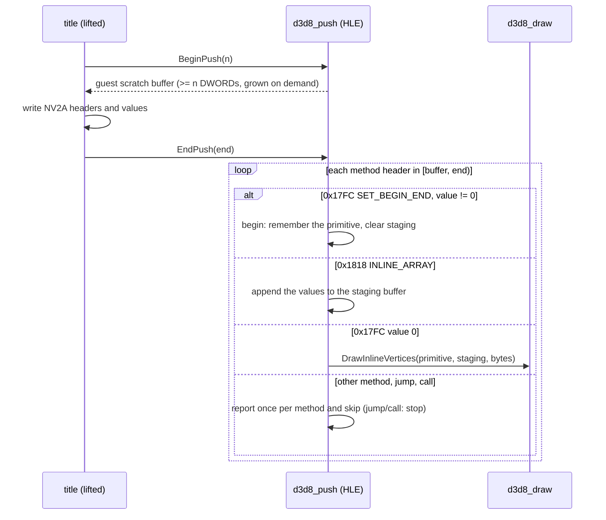

# 설계: 타이틀이 직접 쓰는 푸시 버퍼, `BeginPush`/`EndPush` (issue #7)

## 1. 요구사항

Crazy Taxi 3(reexec/reCT3#3, XDK 4531)는 첫 프레임 뒤 `D3DDevice_BeginPush_4`(stdcall 1인자)에서 멈춘다. 타이틀은 D3D 그리기 함수를 부르지 않는다. 대신 `BeginPush(n)`이 돌려준 메모리에 NV2A 메서드 헤더와 값을 직접 쓰고 `EndPush(p)`로 넘긴다. API 수준 HLE에는 푸시 버퍼도 GPU도 없으므로 `EndPush`에서 그 내용을 읽어 해석해야 한다(AGENTS 핵심 설계 목표 2: API 경계로 안 될 때만 하드웨어 수준).

## 2. 타이틀이 쓰는 것 (reCT3 분석)

| 항목 | 내용 | 상태 |
|---|---|---|
| 호출 | `eax = BeginPush(count + 4)`; 반환값이 쓰기 포인터. 끝에서 `EndPush(끝 포인터)` | **확인됨**(호출 지점 `000A44D2` 등 5곳) |
| 헤더 `0x000417FC` | 메서드 `0x17FC` `SET_BEGIN_END`, 값 1개. 값은 함수 인자인 primitive, 끝은 0 | **확인됨**(상수) |
| 헤더 `0x40801818` | 메서드 `0x1818` `INLINE_ARRAY`, 비증가(bit 30), 32 DWORD | **확인됨**(상수) |
| 정점 데이터 | `rep movsd`/MMX로 그대로 복사, 32 DWORD마다 `INLINE_ARRAY` 헤더 | **추정**(헤더를 실행 중에 계산하는 경로가 있을 수 있다) |
| primitive 값 | Xbox `D3DPRIMITIVETYPE`(1 점 … 5 삼각형 목록, 6 strip, 8 quad 목록 …)과 NV2A `SET_BEGIN_END` op가 같은 번호 | **추정**(타이틀이 primitive 인자를 그대로 쓴다. xemu `nv2a` 소스의 `NV097_SET_BEGIN_END_OP_*`와 같은 번호는 지식 출처로만 참고) |

즉 `SET_BEGIN_END(prim)` → inline 정점 → `SET_BEGIN_END(0)`이며, 의미는 `DrawVerticesUP(prim, n, data, stride)`와 같다.

## 3. 설계

| 항목 | 결정 |
|---|---|
| 모듈 | 새 `src/hle/d3d8/d3d8_push.{h,cpp}`: 버퍼 관리와 메서드 해석. 그리기는 `d3d8_draw.cpp`의 새 진입점 `DrawInlineVertices(primitive, data, bytes)`가 한다 |
| scratch 버퍼 | 게스트 힙에서 페이지 단위로 할당하고 모자라면 다시 할당한다. 돌려준 버퍼는 다음 `BeginPush` 전까지 유효하다. 그리기를 부르는 스레드는 하나라고 가정한다(D3D 디바이스 스레드; **추정**) |
| 헤더 형식 | 비트 2..12 메서드, 13..15 subchannel(무시), 18..28 개수, 30 비증가. `(h & 0xE0000003) == 0x20000000`(옛 jump), `(h & 3) == 1`(jump), `(h & 3) == 2`(call), `h == 0x00020000`(return)은 지원하지 않고 해석을 멈춘다 |
| 정점 수와 stride | stride는 현재 정점 셰이더에서: 프로그램이면 declaration(또는 `SetVertexShaderInput` 핸들의 declaration)의 스트림 0 바이트, FVF면 그 stride. 정점 수 = 모은 바이트 / stride |
| staging | inline 값은 헤더 사이에 끊겨 있으므로 별도의 게스트 staging 버퍼에 이어 붙인 뒤 `Draw`에 UP 데이터로 넘긴다 |
| 모르는 메서드 | 메서드 번호마다 한 번 `[d3d8] push buffer method …`로 보고하고 건너뛴다. 실행으로 실제 메서드 집합을 확인한다 |

### 대안과 기각 이유

* **버퍼만 주고 내용을 버림**: 진행은 되지만 그 그림(타이틀의 자체 2D·이펙트로 **추정**)이 사라진다. 해석 비용이 작아 기각.
* **NV2A 전체 LLE(xemu 방식)**: AGENTS 목표 2와 5에 어긋나고 규모가 크다.

### 추가: 인덱스 그리기 (구현 뒤 측정)

CT3는 디스크에서 읽은 인덱스로 미리 만든 푸시 버퍼 조각을 `SET_BEGIN_END` 사이에 넣는다. 조각은 타이틀 `000AAD20`이 만들며, `ARRAY_ELEMENT16`(`0x1800`, DWORD 하나에 16비트 인덱스 둘)을 `0x41FC1800`(127 DWORD) 단위로 묶고 개수가 홀수면 마지막에 `ARRAY_ELEMENT32`(`0x1808`) 하나를 둔다. 정점 배열은 `SetVertexShaderInput`의 스트림이다(**확인됨**). 그래서 `END`에서 모은 인덱스를 16비트 staging에 두고, 현재 스트림 0(입력 override 포함)으로 인덱스 그리기를 한다(`DrawArrayElements`). 16비트를 넘는 `ARRAY_ELEMENT32` 인덱스는 보고하고 버린다.

## 4. 검증

* reCT3: `REXBOX_D3D8_TRACE=1 rect3.exe roms`가 `BeginPush`를 지나고, `[d3d8] push buffer` 보고에 모르는 메서드가 있으면 그 목록을 분석 문서에 적는다.
* 프레임 캡처(`REXBOX_CAPTURE_FRAME`)나 창 표시로 inline 그리기가 그려지는지 확인한다(화면 확인은 사용자 환경에서).
* 빌드: Win32 x86 Debug, CTest.

---

# Design: push buffers the title writes itself, `BeginPush`/`EndPush` (issue #7)

## 1. Requirement

Crazy Taxi 3 (reexec/reCT3#3, XDK 4531) stops after its first frame at `D3DDevice_BeginPush_4` (stdcall, one argument). The title calls no D3D draw function there: it writes NV2A method headers and values straight into the memory `BeginPush(n)` returns and hands it over with `EndPush(p)`. An API-level HLE has neither a push buffer nor a GPU, so `EndPush` must read and interpret what was written (AGENTS design goal 2: hardware level only where the API boundary cannot work).

## 2. What the title writes (reCT3 analysis)

**Confirmed**: `eax = BeginPush(count + 4)` returns the write pointer and `EndPush(end pointer)` closes it (five call sites, `000A44D2` and others); header `0x000417FC` is method `0x17FC` `SET_BEGIN_END` with one value, the primitive argument, and 0 at the end; header `0x40801818` is method `0x1818` `INLINE_ARRAY`, non-incrementing (bit 30), 32 DWORDs. **Inferred**: vertex data is copied as is with `rep movsd`/MMX, an `INLINE_ARRAY` header every 32 DWORDs (a path computing headers at run time may exist); Xbox `D3DPRIMITIVETYPE` (1 points … 5 triangle list, 6 strip, 8 quad list …) and the NV2A `SET_BEGIN_END` ops share their numbers (the title passes its primitive argument straight through; xemu's `nv2a` `NV097_SET_BEGIN_END_OP_*` is consulted as a knowledge source only). So the sequence is `SET_BEGIN_END(prim)` → inline vertices → `SET_BEGIN_END(0)`, meaning `DrawVerticesUP(prim, n, data, stride)`.

## 3. Design

As in the diagram above. A new `src/hle/d3d8/d3d8_push.{h,cpp}` manages the buffer and interprets methods; drawing goes through a new `d3d8_draw.cpp` entry, `DrawInlineVertices(primitive, data, bytes)`. The scratch buffer is page-granular guest heap memory, reallocated when too small, valid until the next `BeginPush`; one drawing thread is assumed (the D3D device thread; **inferred**). Header format: bits 2..12 method, 13..15 subchannel (ignored), 18..28 count, 30 non-incrementing; the old jump (`(h & 0xE0000003) == 0x20000000`), jump (`(h & 3) == 1`), call (`(h & 3) == 2`) and return (`h == 0x00020000`) are not supported and stop the parse. The stride comes from the current vertex shader (a program's declaration, or the `SetVertexShaderInput` handle's, stream 0 bytes; an FVF's stride), the vertex count is the gathered bytes over the stride. Inline values are split by headers, so they are appended to a separate guest staging buffer that `Draw` receives as UP data. An unknown method is reported once per method number (`[d3d8] push buffer method …`) and skipped, so a run shows the real method set.

**Addition: indexed draws (measured after implementation).** CT3 places push-buffer fragments it builds from indices read from disk (title `000AAD20`: `ARRAY_ELEMENT16` (`0x1800`, two 16-bit indices a DWORD) in runs of `0x41FC1800` (127 DWORDs), and one closing `ARRAY_ELEMENT32` (`0x1808`) for an odd count) between `SET_BEGIN_END`s, over the vertex arrays of `SetVertexShaderInput`'s streams (**confirmed**). At `END` the gathered indices go to a 16-bit staging buffer and draw indexed from the current stream 0 (input override included; `DrawArrayElements`); an `ARRAY_ELEMENT32` index past 16 bits is reported and dropped.

Alternatives rejected: handing out a buffer and dropping its contents (progress, but those drawings, **inferred** to be the title's own 2D and effects, vanish; interpreting costs little); a full NV2A LLE like xemu's (against AGENTS goals 2 and 5, and large).

## 4. Verification

reCT3's `REXBOX_D3D8_TRACE=1 rect3.exe roms` passes `BeginPush`, and any unknown methods in the `[d3d8] push buffer` reports go into the analysis document; a frame capture (`REXBOX_CAPTURE_FRAME`) or the window shows whether the inline draws appear (the screen check happens on the user's machine); Win32 x86 Debug build and CTest.
