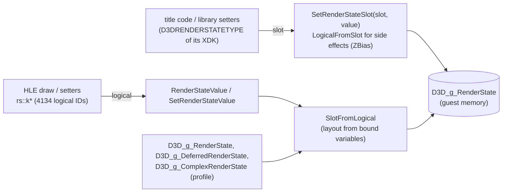

# 설계: XDK 4531 렌더 상태 번호, 기본 상태 루틴, 팔레트 (issue #7)

## 1. 요구사항

Crazy Taxi 3(reexec/reCT3#3, XDK 4531)는 프레임 루프를 돌지만, 덤프한 프레임(60, 150, 250, 350)이 모두 검다. 그리고 `D3DDevice_CreatePalette`에서 멈춘다. rexbox D3D8 HLE의 렌더 상태 번호(`rs::k*`, `d3d8_render_state.h`)는 XDK 4134(reJSRF) 기준이라 4531에서는 82번부터 한 칸씩 어긋난다. 또 4531에서는 기본 상태 루틴이 바인딩되지 않아 렌더 상태가 모두 0으로 시작한다(`ColorWriteEnable` 0이면 아무것도 쓰이지 않는다).

## 2. 측정(reCT3, 일본판 XBE)

### 2.1 렌더 상태 슬롯

식별된 변수의 주소를 `D3D_g_RenderState`(`0x00102160`)에 대한 DWORD 슬롯으로 바꾼 값이다.

| 상태 | 4531 슬롯 | 4134 슬롯 | 근거 |
|---|---|---|---|
| `D3D_g_DeferredRenderState` (= `D3DRS_FogEnable`) | 83 | 82 | **확인됨**(변수) |
| `D3D_g_ComplexRenderState` (= `D3DRS_PSTextureModes`) | 118 | 117 | **확인됨** |
| `FillMode`, `BackFillMode`, `TwoSidedLighting` | 121, 122, 123 | 120, 121, 122 | **확인됨** |
| `StencilEnable` … `CullMode`, `ZBias`, `LogicOp` | 126 … 129, 131, 132 | 125 … 128, 130, 131 | **확인됨** |
| `MultiSampleAntiAlias` … `DoNotCullUncompressed` | 134 … 146 | 133 … 145 | **확인됨** |

complex 블록 전체가 정확히 +1이다.

### 2.2 기본 상태 루틴과 단순 블록

4531의 `D3D_InitializeDeviceState`는 `sub_000FAA20`이다(**확인됨**). `Direct3D_CreateDevice`(`000F65E0`) → `000FB140`이 부르고, 다음을 한다.

1. 변환 10개를 단위 행렬(`0x00100E40`)로 `SetTransform`.
2. `SetRenderStateNotInline(57 + k, table[0x00101358 + 4k])`, k = 0..89(상태 57..146). 단 117과 136(4531의 `SwapFilter`, `MultiSampleMode`)은 건너뛴다.
3. `SetRenderStateNotInline(125, 0)`: 4531의 `ZEnable`(4134의 124).
4. 스테이지마다 `SetTextureStageStateNotInline(stage, slot, table[0x00101338 + slot])`(slot 0..31). 이어서 `TexCoordIndex`(28) = stage, 스테이지 0의 `ColorOp`(12) = 4, `AlphaOp`(16) = 2, `SetScreenSpaceOffset(0, 0)`.

기본값 표에서 단순 블록을 읽은 결과(**확인됨**):

* 57..81은 4134의 순서와 값이 그대로 맞는다: ZFunc `0x203`, AlphaFunc `0x207`, SrcBlend 1, ZWriteEnable 1, ShadeMode `0x1D01`, ColorWriteEnable `0x01010101`, StencilZFail·Pass `0x1E00`, StencilFunc `0x207`, StencilMask·WriteMask `0xFFFFFFFF`, BlendOp `0x8006`, 76(SwathWidth) 4, 77..81 0.
* **82가 4531에 새로 들어온 단순 상태**이며 기본값은 1이다. 이름은 공개 XDK의 `D3DRS_DEPTHCLIPCONTROL`로 **추정**한다.
* 83부터는 4134의 82번 이후가 이어진다: FogEnable 0, FogTableMode 0, FogStart 0, FogEnd 1.0f.

텍스처 스테이지 번호는 4134와 같다(**확인됨**). 슬롯 기본값 표가 4134 순서의 D3D 기본값과 맞는다: AddressU/V/W 1, MaxAnisotropy(8) 1, ColorOp(12) 1, ColorArg1(14) 2 = TEXTURE, AlphaArg1(18) 2, ResultArg(20) 1. 또 루틴이 `TexCoordIndex` 28, `ColorOp` 12, `AlphaOp` 16을 쓴다.

### 2.3 팔레트(lift된 원본, **확인됨**)

* `D3DDevice_CreatePalette(D3DPALETTESIZE Size, D3DPalette** ppPalette)`(`000F93A0`): 12바이트 헤더를 풀에서 할당한다. 데이터는 `MmAllocateContiguousMemoryEx(table[0x00101208 + Size×4], 0, 0x07FFFFFF, 0, 0x404)`로 받으며, 표는 `{256, 128, 64, 32}`바이트다. 헤더는 `Common = (Size << 30) | 0x01030001`(참조 1, 타입 팔레트 `0x00030000`, D3D가 만듦 `0x01000000`), `Data = 주소 & 0x0FFFFFFF`다. 실패하면 `E_OUTOFMEMORY`(`0x8007000E`).
* `D3DDevice_SetPalette(Stage, pPalette)`(`000F6050`): 디바이스 `+0xA88 + Stage×4`에 두고, 이전 팔레트의 내부 참조(`Common - 0x80000`)를 풀고 새 것의 참조를 늘린다. NV2A 메서드 `0x1B20 + Stage×64`(SET_TEXTURE_PALETTE)에 `Data | (Common >> 28)`(크기 비트)를 푸시한다.
* 항목은 D3DCOLOR(4바이트, ARGB)로 **추정**한다(공개 XDK 문서). 그러면 라이브러리가 요청하는 `256 >> Size`바이트는 항목 수와 같은 값이 된다. Xbox의 연속 메모리는 페이지 단위로 할당되므로 실기에서는 항목 × 4바이트가 들어간다(**추정**).

## 3. 설계

| 항목 | 결정 |
|---|---|
| 논리 번호 | `rs::k*`는 그대로 4134 번호를 **논리 ID**로 쓴다. HLE 안의 모든 사용처(그리기, setter)는 바뀌지 않는다 |
| 배치 유도 | `d3d8_globals`가 바인딩된 세 변수에서 deferred 시작 슬롯과 complex 시작 슬롯을 구한다(4531: 83, 118). 둘 다 없으면 4134(82, 117). 단순 블록에 더해진 상태 수 = deferred 시작 − 82. 상태 수 = complex 시작 + 29. 타이틀 이름이나 XDK 빌드 번호를 쓰지 않는다 |
| 논리 → 슬롯 | 논리 < 82: 같은 슬롯. 82..116: 논리 − 82 + deferred 시작. 117..145: 논리 − 117 + complex 시작 |
| 슬롯 → 논리 | 위의 역. 단순 블록에 더해진 슬롯(4531의 82)은 논리 ID가 없다. 값만 저장하고 그리기에는 쓰지 않는다 |
| 타이틀이 주는 상태 번호 | `SetRenderStateNotInline(State, Value)` 등 타이틀(또는 lift된 라이브러리)이 넘기는 `D3DRENDERSTATETYPE`은 **슬롯**이다. `SetRenderStateSlot`으로 쓰고, ZBias 같은 부작용은 `LogicalFromSlot`으로 판단한다 |
| 개수 상수 | `kRenderStateCount`, `kDeferredRenderStateFirst`, `kComplexRenderStateFirst` 상수는 유도된 값으로 바꾼다 |
| 텍스처 스테이지 | 바꾸지 않는다(§2.2) |
| 기본 상태 루틴 | rexbox는 지금처럼 바인딩된 `D3D_InitializeDeviceState`를 실행한다. reCT3 프로파일이 `0x000FAA20`을 바인딩한다(reCT3 변경). 루틴 뒤의 `SetRenderStateValue(rs::kZEnable, …)`는 논리 ID이므로 매핑을 거친다 |
| `CreatePalette` | 헤더 12바이트(`AllocateObject`)와 데이터 `(256 >> Size) × 4`바이트. 연속 메모리, 페이지 단위, 0으로 채운다. `Common = (Size << 30) \| 0x01030001`, `Data` = 물리 주소(다른 리소스처럼 `& 0x03FFFFFF`), `Lock` = 0. 리소스 표에 팔레트로 등록한다 |
| `SetPalette` | `PipelineState::palettes[stage]`에 두고, 바인딩 참조는 `SetTexture`처럼 `AddResourceBinding`/`ReleaseResourceBinding`으로 관리한다. 타이틀의 `D3DPalette_Lock`은 인라인(`Data \| 0x80000000`)이며 물리 창(#8)이 받는다 |
| P8 텍스처 | 업로드 때 그 텍스처가 묶인 스테이지의 팔레트로 BGRA8로 펼친다. 캐시가 유효한지는 텍스처 내용과 함께 팔레트의 `Data` 주소·크기·내용 해시로 판단해, 팔레트를 바꾸거나 고치면 다시 올린다. 팔레트가 없으면 지금처럼 흰색으로 하고 한 번 보고한다 |

### 대안과 기각 이유

* **`rs::k*`를 4531 번호로 바꾸기**: 4134 타이틀(reJSRF)이 깨진다. 기각.
* **XDK 빌드 번호로 표 선택**: 빌드마다 표가 필요하고 근거가 약하다. 바인딩된 변수에서 유도하면 어떤 빌드든 블록 경계만으로 맞는다. 단순 블록 안의 순서가 바뀐 빌드라면 이 방식으로도 잡히지 않는다(**위험**, 해당 타이틀에서 기본값 표로 확인한다).
* **P8을 GL 팔레트 확장으로 처리**: GL 3.3 코어에 없다. CPU에서 펼친다.

## 4. 검증

* `rexbox_d3d8_probe`: 배치 유도(변수 없음 → 4134, 4531 배치 → 82가 더해진 슬롯, 왕복 변환), `SetRenderStateNotInline(131, …)`이 4531 배치에서 ZBias 부작용을 낸다. `CreatePalette`의 헤더 필드와 크기, `SetPalette`의 바인딩, 2×2 P8 텍스처를 팔레트로 펼친 결과.
* reCT3: `no D3D_InitializeDeviceState binding` 보고가 사라지고, 루틴 뒤 슬롯 57..81과 83..의 값이 §2.2의 기본값 표와 같아야 한다. `CreatePalette`를 지나야 한다. 프레임 덤프가 검지 않은지 본다(그 외 원인이 남을 수 있다).
* 빌드: Win32 x86 Debug와 CTest. reJSRF(4134)에서 같은 rexbox로 화면이 그대로인지는 사용자 환경에서 확인한다.

---

# Design: XDK 4531 render-state numbering, the default-state routine, palettes (issue #7)

## 1. Requirement

Crazy Taxi 3 (reexec/reCT3#3, XDK 4531) runs its frame loop, but every dumped frame (60, 150, 250, 350) is black, and it stops at `D3DDevice_CreatePalette`. rexbox's D3D8 HLE numbers render states (`rs::k*`, `d3d8_render_state.h`) as XDK 4134 (reJSRF) does, one slot off from 82 on in 4531; and with no default-state routine bound in 4531 every render state starts at 0 (with `ColorWriteEnable` 0 nothing is written).

## 2. Measurements (reCT3, the Japan XBE)

**2.1 Render-state slots** (identified variables as DWORD slots of `D3D_g_RenderState` at `0x00102160`; all **confirmed**): `D3D_g_DeferredRenderState` (= `D3DRS_FogEnable`) 83 (4134: 82); `D3D_g_ComplexRenderState` (= `D3DRS_PSTextureModes`) 118 (117); `FillMode`, `BackFillMode`, `TwoSidedLighting` 121–123 (120–122); `StencilEnable` … `CullMode` 126–129, `ZBias` 131, `LogicOp` 132 (125–128, 130, 131); `MultiSampleAntiAlias` … `DoNotCullUncompressed` 134–146 (133–145). The whole complex block is exactly +1.

**2.2 The default-state routine and the simple block.** 4531's `D3D_InitializeDeviceState` is `sub_000FAA20` (**confirmed**), called from `Direct3D_CreateDevice` (`000F65E0`) → `000FB140`. It sets the ten transforms to identity (`0x00100E40`); calls `SetRenderStateNotInline(57 + k, table[0x00101358 + 4k])` for k = 0..89 (states 57..146), skipping 117 and 136 (4531's `SwapFilter` and `MultiSampleMode`); calls `SetRenderStateNotInline(125, 0)`, 4531's `ZEnable` (4134's 124); and per stage `SetTextureStageStateNotInline(stage, slot, table[0x00101338 + slot])` for slots 0..31, then `TexCoordIndex` (28) = stage, stage 0's `ColorOp` (12) = 4 and `AlphaOp` (16) = 2, and `SetScreenSpaceOffset(0, 0)`. The default table reads (**confirmed**): slots 57..81 match 4134's order and values (ZFunc `0x203`, AlphaFunc `0x207`, SrcBlend 1, ZWriteEnable 1, ShadeMode `0x1D01`, ColorWriteEnable `0x01010101`, StencilZFail/Pass `0x1E00`, StencilFunc `0x207`, StencilMask/WriteMask `0xFFFFFFFF`, BlendOp `0x8006`, 76 (SwathWidth) 4, 77..81 0); **slot 82 is the simple state new in 4531**, default 1, **inferred** to be the public XDK's `D3DRS_DEPTHCLIPCONTROL`; 83 on continue 4134's 82 on (FogEnable 0, FogTableMode 0, FogStart 0, FogEnd 1.0f). Texture-stage numbering equals 4134's (**confirmed**: the slot default table matches the D3D defaults in 4134 order, AddressU/V/W 1, MaxAnisotropy (8) 1, ColorOp (12) 1, ColorArg1 (14) 2 = TEXTURE, AlphaArg1 (18) 2, ResultArg (20) 1, and the routine writes `TexCoordIndex` 28, `ColorOp` 12 and `AlphaOp` 16).

**2.3 Palettes** (lifted originals, **confirmed**): `D3DDevice_CreatePalette(D3DPALETTESIZE Size, D3DPalette** ppPalette)` (`000F93A0`) takes a 12-byte header from the pool and its data from `MmAllocateContiguousMemoryEx(table[0x00101208 + Size×4], 0, 0x07FFFFFF, 0, 0x404)` with the table `{256, 128, 64, 32}` bytes, and sets `Common = (Size << 30) | 0x01030001` (reference 1, palette type `0x00030000`, D3D-created `0x01000000`) and `Data = address & 0x0FFFFFFF`, or fails with `E_OUTOFMEMORY` (`0x8007000E`). `D3DDevice_SetPalette(Stage, pPalette)` (`000F6050`) keeps it at device `+0xA88 + Stage×4`, releases the previous palette's internal reference (`Common - 0x80000`) and adds one to the new, and pushes NV2A method `0x1B20 + Stage×64` (SET_TEXTURE_PALETTE) with `Data | (Common >> 28)` (the size bits). Entries are **inferred** to be D3DCOLOR (4 bytes, ARGB; public XDK documents), so the library's request of `256 >> Size` bytes equals the entry count; Xbox contiguous memory is page-granular, so on hardware the entries × 4 bytes fit (**inferred**).

## 3. Design

As in the diagram above.

* **Logical IDs**: `rs::k*` keeps 4134's numbers as **logical IDs**; every use inside the HLE (drawing, setters) is unchanged.
* **Layout derivation**: `d3d8_globals` derives the deferred and complex first slots from the three bound variables (4531: 83, 118), or 4134's (82, 117) when they are absent; the states added to the simple block are deferred first − 82, the state count complex first + 29. No title name or XDK build number is used.
* **Logical → slot**: below 82 the same slot; 82..116 → logical − 82 + deferred first; 117..145 → logical − 117 + complex first. **Slot → logical** is the inverse; slots added to the simple block (4531's 82) have no logical ID and are stored but not drawn with.
* **State numbers from the title**: a `D3DRENDERSTATETYPE` passed by the title or the lifted library (`SetRenderStateNotInline(State, Value)` and the like) is a **slot**: it is written with `SetRenderStateSlot`, and side effects such as ZBias are decided by `LogicalFromSlot`.
* **Count constants**: `kRenderStateCount`, `kDeferredRenderStateFirst` and `kComplexRenderStateFirst` become derived values.
* **Texture stages**: unchanged (section 2.2).
* **Default-state routine**: rexbox runs the bound `D3D_InitializeDeviceState` as now; the reCT3 profile binds `0x000FAA20` (a reCT3 change); the following `SetRenderStateValue(rs::kZEnable, …)` is a logical ID and goes through the mapping.
* **`CreatePalette`**: a 12-byte header (`AllocateObject`) and `(256 >> Size) × 4` bytes of zeroed, page-granular contiguous data; `Common = (Size << 30) | 0x01030001`, `Data` the physical address (`& 0x03FFFFFF` like other resources), `Lock` 0; registered as a palette in the resource table.
* **`SetPalette`**: kept in `PipelineState::palettes[stage]`, bindings counted with `AddResourceBinding`/`ReleaseResourceBinding` as `SetTexture` does; the title's `D3DPalette_Lock` is inline (`Data | 0x80000000`) and lands in the physical window (#8).
* **P8 textures**: expanded to BGRA8 at upload with the palette of the stage the texture is bound to; the cache stays valid only while the palette's `Data` address, size and content hash are unchanged as well as the texture's, so changing or editing a palette re-uploads; without a palette, white as now, reported once.

**Alternatives rejected**: renumbering `rs::k*` to 4531 (breaks the 4134 title, reJSRF); picking tables by XDK build number (a table per build on weak evidence, where deriving from bound variables fits any build by its block boundaries alone; a build that reorders states inside the simple block would still slip through, a **risk** checked per title with its default table); GL palette extensions for P8 (not in GL 3.3 core; expanded on the CPU).

## 4. Verification

* `rexbox_d3d8_probe`: layout derivation (no variables → 4134; the 4531 layout → the added slot 82, round trips); `SetRenderStateNotInline(131, …)` has the ZBias side effect under the 4531 layout; `CreatePalette`'s header fields and size, `SetPalette`'s binding, a 2×2 P8 texture expanded through a palette.
* reCT3: the `no D3D_InitializeDeviceState binding` report is gone and, after the routine, slots 57..81 and 83 on hold section 2.2's defaults; `CreatePalette` is passed; frame dumps are no longer black (other causes may remain).
* Build: Win32 x86 Debug and CTest; that reJSRF (4134) still looks the same with this rexbox is checked on the user's machine.
