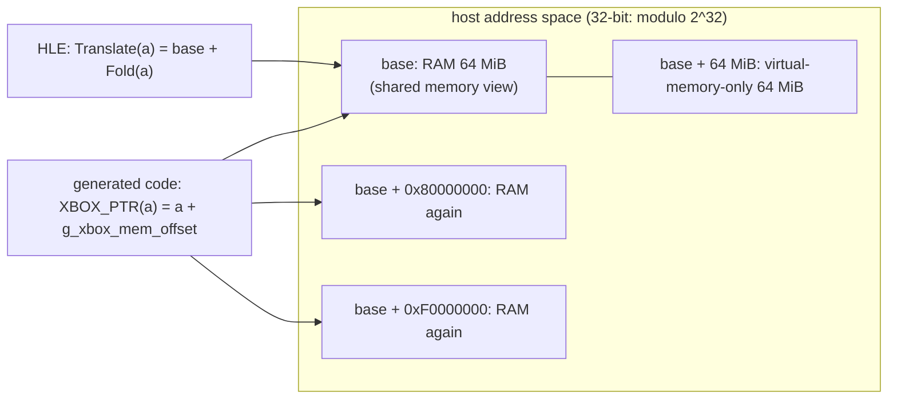

# 설계: 게스트 메모리의 물리 메모리 창 0x80000000 (issue #8)

## 1. 요구사항

Crazy Taxi 3(reexec/reCT3#3)가 D3D 디바이스를 만든 뒤 처음 텍스처를 읽을 때 게스트 주소 `806E6000`에 쓰다가 fault가 난다. lift된 타이틀 코드 `sub_000ABAA0`이 텍스처 헤더의 `Data`(물리 주소)에 `0x80000000`을 OR해 CPU 포인터를 만들고(`ecx = MEM32(eax + 4) | 0x80000000`) 그 주소로 파일을 읽는다. 타이틀 코드이므로 HLE로 대체할 수 없고, 같은 OR가 타이틀 코드에 30곳, `0xF0000000`도 11곳 있다.

## 2. Xbox의 메모리 창

Xbox 커널은 물리 RAM 64 MiB를 가상 주소 0x80000000(캐시됨, "contiguous window")과 0xF0000000(write-combined)에 다시 매핑한다. `MmAllocateContiguousMemory`는 0x8xxxxxxx 주소를 돌려주고, D3D 리소스의 `Data`는 물리 주소(= 그 주소 & 0x7FFFFFFF)다. 타이틀은 둘 사이를 비트 연산으로 오간다. → [docs/kb/xbox-memory-map.md](../kb/xbox-memory-map.md)

reJSRF는 게스트 메모리를 0부터 128 MiB 평면으로 두었고(설계 i029), JSRF가 이 창을 쓰지 않아 충분했다.

## 3. 설계

| 항목 | 결정 |
|---|---|
| 플랫폼 계약 | `AllocateGuestSpace(ram, extra, aliases[], count, &base)`: 공유 메모리 객체 하나를 `base`에 RAM으로, `base + alias`에 같은 페이지로 다시 매핑한다. 합은 호스트 포인터 폭에서 wrap한다. 32비트 호스트에서는 `base + 0x80000000`이 `base ^ 0x80000000`이 되어 2 GiB 연속 예약이 필요 없다(생성 코드의 `XBOX_PTR`도 같은 32비트 덧셈이므로 정확히 그 주소를 본다). 64비트 호스트에서는 약 4 GiB 범위를 쓰지만 주소 공간이 넉넉하다. Win32는 `CreateFileMapping` + `MapViewOfFileEx`(upstream xboxrecomp의 contiguous window와 같은 방법), Linux는 `memfd_create` + `mmap(MAP_SHARED | MAP_FIXED)`. 후보 base를 낮은 주소부터 훑어 모든 범위가 비어 있는 곳을 고른다 |
| `GuestMemory` | `Initialize(size, Options{physical_window})`. 창을 켜면 `Translate`/`IsValid`가 0x80000000·0xF0000000 범위를 RAM 아래 주소로 접는다(`Fold`). HLE가 받는 게스트 포인터(`NtReadFile`의 버퍼 등)가 그 범위여도 같은 바이트를 가리킨다. 창 밖(RAM 크기 이상)의 창 주소는 무효 |
| 쓰기 추적 | 파일 매핑 메모리에는 `GetWriteWatch`가 없으므로 창을 켠 메모리는 `TracksWrites()`가 false다. D3D8의 버퍼 비교가 전체 비교로 돌아간다(정확성 같음, 성능 비용). 그래서 타이틀이 선택한다: reCT3는 켜고, reJSRF는 기본(끔)이다 |
| D3D8 | `kPhysicalMask`(RAM 크기 - 1)가 `Data`에서 창 비트를 이미 벗겨 내므로 그대로 |
| fault 보고 | `ThreadReport::host_exception_address`를 더해 앱이 찍는다. 링커 map(`rect3.map`)으로 어느 lift 함수에서 fault가 났는지 찾을 수 있다 |

## 4. 검증

* `rexbox_kernel_probe`: 창을 켠 `GuestMemory`에서 물리 주소에 쓴 값이 `Translate(0x80000000 + P)`, `Translate(0xF0000000 + P)`와 생성 코드 방식의 주소(`base + 0x80000000`, 포인터 폭에서 wrap)로 읽히고, 창 범위 밖은 `IsValid`가 거부한다.
* Win32 x86과 Linux x64/x86의 빌드와 `ctest`.
* reCT3가 `806E6000` fault를 지나 다음 frontier로 간다.

---

# Design: the physical memory window at 0x80000000 in guest memory (issue #8)

Crazy Taxi 3 (reexec/reCT3#3) faults writing guest `806E6000` when it first reads a texture after creating the D3D device: the lifted title function `sub_000ABAA0` turns the texture header's `Data` (a physical address) into a CPU pointer with `| 0x80000000` and reads the file into it. That is title code, not replaceable by HLE, and the same OR appears 30 times in the title (11 more with `0xF0000000`). The Xbox kernel maps the 64 MiB of physical RAM again at 0x80000000 (cached, the contiguous window) and 0xF0000000 (write-combined); `MmAllocateContiguousMemory` returns 0x8xxxxxxx addresses and a D3D resource's `Data` is the physical address ([docs/kb/xbox-memory-map.md](../kb/xbox-memory-map.md)). reJSRF's flat 128 MiB at 0 (design i029) sufficed because JSRF never used the window.

Design, as in the table: a platform contract `AllocateGuestSpace(ram, extra, aliases[], count, &base)` maps one shared memory object as the RAM at `base` and again at `base + alias`, the sum wrapping at the host pointer width, so on a 32-bit host the 0x80000000 alias lands at `base ^ 0x80000000` with no 2 GiB span (the generated code's `XBOX_PTR` does the same 32-bit addition and reaches exactly that address); on a 64-bit host the span is about 4 GiB, which the address space affords. Win32 uses `CreateFileMapping` + `MapViewOfFileEx` (as upstream xboxrecomp's contiguous window does), Linux `memfd_create` + `mmap(MAP_SHARED | MAP_FIXED)`; candidate bases are scanned from low addresses until every range is free. `GuestMemory::Initialize(size, Options{physical_window})` folds the two window ranges in `Translate`/`IsValid`, so guest pointers the HLE receives in those ranges reach the same bytes, and window addresses past the RAM are invalid. File-mapped memory has no write watch, so such memory reports `TracksWrites()` false and D3D8 compares whole buffers (same correctness, a performance cost), which is why a title opts in (reCT3 on, reJSRF off). D3D8's `kPhysicalMask` already strips the window bits from `Data`. `ThreadReport::host_exception_address` is added for the app's fault report, so the linker map names the lifted function. Verification: a kernel-probe check of the window through `Translate` and through generated-code-style address arithmetic with `IsValid` rejecting addresses past the window; Win32 x86 and Linux x64/x86 builds with `ctest`; reCT3 passing the `806E6000` fault.
