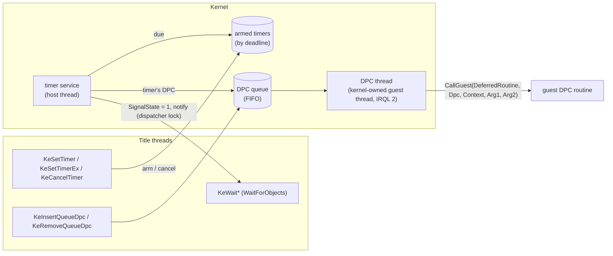

# 설계: 발화하는 커널 타이머, DPC 실행, `KeWaitForMultipleObjects` (issue #12)

## 1. 요구사항

Crazy Taxi 3(reexec/reCT3#3, XDK 4531)가 커널 import 150 `KeSetTimerEx`에서 멈춘다. 지금 rexbox 커널은 타이머를 등록만 하고 발화시키지 않으며(`KeSetTimer`: armed only), DPC는 받기만 하고 실행하지 않는다(`KeInsertQueueDpc`: queued but never run). 커널 ordinal 158 `KeWaitForMultipleObjects`도 없다.

타이틀이 하는 일(lift된 코드 `000E0Bxx`–`000E0Exx`, 스레드 루틴 `000DDF9D`가 실행):

| 호출 | 인자 | 상태 |
|---|---|---|
| `KeInitializeDpc` → 곧바로 `KeInsertQueueDpc(dpc, 0, 0)` | 루틴 `0x000E0A69`, 문맥 = 지역 변수 주소 | **확인됨**. 루틴이 실제로 돌아야 한다 |
| `KeWaitForMultipleObjects` | `Count`, 객체 배열, WaitAny(1), UserRequest(6), UserMode(1), Alertable 0, Timeout NULL, wait block 배열 | **확인됨**. timeout 없이 여러 객체를 기다린다 |
| `KeSetTimerEx(timer, DueTime, 0, NULL)` | Period 0, DPC 없음 | **확인됨**. 그 대기를 깨우는 타이머로 **추정** |
| `KeSetTimer` | 3곳(`000E4938`, `001096F2` 등) | 용도 **미확정** |

## 2. 현재 구조

* 디스패처 객체의 상태는 게스트 메모리의 `DISPATCHER_HEADER.SignalState`이며 전역 `dispatcher` 잠금 아래에서만 바뀐다. 대기는 조건 변수 `signalled` 하나에서 자고, 신호마다 다시 확인한다(`WaitForObjects`). 따라서 **타이머를 발화시키는 것은 잠금 아래에서 `SignalState`를 1로 만들고 `notify_all`하는 것**과 같다.
* 게스트 스레드는 호스트 스레드다(`CreateGuestThread` → `GuestExecutor::StartThread`). 게스트 함수는 게스트 스레드 위에서 `CallGuest`로 부른다. 커널 import는 합성 주소 `0xFE000000 + 4 × ordinal`(`KernelThunkVa`)에 바인딩된다.

## 3. 설계

| 항목 | 결정 |
|---|---|
| 타이머 서비스 | 새 `src/hle/kernel/kernel_timer.cpp`. 호스트 스레드 하나(게스트 코드를 실행하지 않는다)가 마감 시각(steady clock) 순 목록을 갖고, 가장 이른 마감까지 조건 변수로 잔다. 첫 타이머가 설정될 때 시작한다 |
| DueTime | 음수: 상대 시간(100 ns 단위). 양수: 절대 시스템 시간(`SystemTimeNt()`와의 차이로 마감 계산). 0: 즉시. NT와 같다 |
| `KeSetTimer`/`KeSetTimerEx(Timer, DueTime, Period, Dpc)` | `SignalState = 0`, KTIMER의 DueTime·Period(ms)·Dpc를 게스트 구조에 쓰고 목록에 넣는다. 이미 목록에 있었으면 TRUE. `KeSetTimer`는 Period 0인 `KeSetTimerEx`다 |
| 발화 | dispatcher 잠금 아래에서 `SignalState = 1`, `notify_all`. Period가 있으면 마감 += Period로 다시 넣는다. Dpc가 있으면 그 DPC를 큐에 넣는다(SystemArgument1/2 = 발화 시각의 하위/상위 32비트, NT와 같음) |
| `KeCancelTimer` | 목록에서 빼고, 있었으면 TRUE. `SignalState`는 그대로 |
| DPC 큐 | `KeInsertQueueDpc`: KDPC `Inserted`(+2)가 이미 1이면 FALSE, 아니면 SystemArgument1/2(+0x14/+0x18)를 쓰고 `Inserted = 1`로 큐에 넣고 TRUE. `KeRemoveQueueDpc`: 큐에 있으면 빼고 TRUE |
| DPC 스레드 | 커널 소유의 게스트 스레드 하나를 첫 DPC 때 `CreateGuestThread`로 만든다. 시작 주소는 커널 thunk 영역의 예약 ordinal(실제 ordinal 범위 밖, 예: `0x3FF`)의 합성 주소이고, 그 주소에 내부 export `rexbox_DpcLoop`를 바인딩한다. 루프는 큐를 기다렸다가 항목마다 `Inserted = 0`, KPCR IRQL = 2, `CallGuest(DeferredRoutine, {Dpc, DeferredContext, Arg1, Arg2})`, IRQL = 0을 한다 |
| `KeWaitForMultipleObjects` | 이미 작업 트리에 있는 구현: 객체 포인터 배열로 `WaitAndDeliver`. wait block 배열은 쓰지 않는다 |
| 종료 | 타이머 서비스 스레드는 프로세스 종료 때 깨워 끝낸다(detach하지 않는다). DPC 스레드는 다른 게스트 스레드처럼 프로세스와 함께 끝난다 |

### 동시성과 위험

* Xbox는 단일 CPU라서 DISPATCH_LEVEL 코드가 다른 스레드나 DPC에 선점되지 않는다. rexbox에서는 게스트 스레드가 동시에 돌므로, IRQL을 올려 DPC를 막는다고 가정한 타이틀 코드와 DPC 스레드가 겹칠 수 있다(**위험**).
  * 1단계(이 설계): 그런 경쟁을 막지 않는다. 실행에서 경쟁이 측정되면 2단계로 간다.
  * 2단계(필요할 때): "dispatch 잠금"(재귀). IRQL이 2 미만에서 2 이상으로 오를 때 잡고 2 미만으로 내려갈 때 놓는다. DPC 스레드는 DPC를 실행하는 동안 잡는다.
* 발화 시각은 호스트 스케줄러에 따라 늦을 수 있다. 정확도는 대기와 같은 조건 변수 수준이다.

### 대안과 기각 이유

* **대기 때 지연 평가**(대기 중인 스레드가 타이머 마감을 deadline으로 삼아 직접 확인): 스레드가 없어도 되지만, 아무도 기다리지 않을 때 DPC를 실행할 수 없다. 기각.
* **DPC를 넣은 스레드에서 바로 실행**: 호출자가 PASSIVE이면 의미가 바뀌고(DPC는 나중에 IRQL 2에서 돈다), 타이머 서비스 스레드는 게스트 문맥이 없어 실행할 수 없다. 기각.

## 4. 검증

* `rexbox_kernel_probe`(CTest): 상대 타이머가 마감 뒤 `KeWaitForSingleObject`를 깨운다. 절대 시간·0 DueTime, 주기 타이머가 다시 발화하고, `KeCancelTimer`의 반환값과 취소 뒤 발화하지 않음을 확인한다. `KeWaitForMultipleObjects`의 WaitAny·WaitAll, `KeInsertQueueDpc`를 두 번 부르면 두 번째는 FALSE, `KeRemoveQueueDpc`도 검사한다. probe의 executor는 게스트 스레드를 만들지 못하므로 DPC 루틴 실행은 여기서 검사하지 않는다.
* reCT3: `rect3.exe roms`가 `KeSetTimerEx`를 지나고, DPC 루틴 `000E0A69`가 DPC 스레드에서 실행되는지(`REXBOX_HLE_TRACE` 또는 첫 실행 trace) 확인한다.
* 빌드: Win32 x86 Debug, CTest. Linux 빌드는 CI.

---

# Design: kernel timers that fire, DPC delivery, `KeWaitForMultipleObjects` (issue #12)

## 1. Requirement

Crazy Taxi 3 (reexec/reCT3#3, XDK 4531) stops at kernel import 150 `KeSetTimerEx`. rexbox's kernel arms timers without firing them (`KeSetTimer`: armed only), accepts DPCs without running them (`KeInsertQueueDpc`: queued but never run), and lacks ordinal 158 `KeWaitForMultipleObjects`.

What the title does (lifted code `000E0Bxx`–`000E0Exx`, run by the thread routine `000DDF9D`): **confirmed**, `KeInitializeDpc` with routine `0x000E0A69` and a local as context, immediately followed by `KeInsertQueueDpc(dpc, 0, 0)`, so the routine must really run; **confirmed**, `KeWaitForMultipleObjects` with a count, an object array, WaitAny (1), UserRequest (6), UserMode (1), not alertable, no timeout and a wait-block array; **confirmed**, `KeSetTimerEx(timer, DueTime, 0, NULL)` with no period or DPC, **inferred** to be what ends that wait; `KeSetTimer` from three places (`000E4938`, `001096F2`, ...), purpose **unresolved**.

## 2. Current structure

Dispatcher-object state is `DISPATCHER_HEADER.SignalState` in guest memory, changed only under the global `dispatcher` lock; waiters sleep on the one condition variable `signalled` and re-check on every signal (`WaitForObjects`). **Firing a timer is therefore setting its `SignalState` to 1 under the lock and calling `notify_all`.** Guest threads are host threads (`CreateGuestThread` → `GuestExecutor::StartThread`); guest functions are called on a guest thread with `CallGuest`; kernel imports are bound at the synthetic addresses `0xFE000000 + 4 × ordinal` (`KernelThunkVa`).

## 3. Design

As in the diagram above.

* **Timer service**: a new `src/hle/kernel/kernel_timer.cpp`. One host thread, which never runs guest code, keeps the armed timers ordered by deadline (steady clock) and sleeps on a condition variable until the earliest; it starts with the first armed timer.
* **DueTime**: negative is relative (100 ns units), positive is absolute system time (the deadline from its difference to `SystemTimeNt()`), zero is now, as in NT.
* **`KeSetTimer`/`KeSetTimerEx(Timer, DueTime, Period, Dpc)`**: `SignalState = 0`; DueTime, Period (ms) and Dpc are written into the guest KTIMER and the timer is listed; returns TRUE when it was already listed. `KeSetTimer` is `KeSetTimerEx` with period 0.
* **Firing**: under the dispatcher lock, `SignalState = 1` and `notify_all`; a period re-lists it at deadline + period; a DPC is queued with SystemArgument1/2 set to the low/high 32 bits of the firing time, as in NT.
* **`KeCancelTimer`**: unlists the timer and returns TRUE when it was listed; `SignalState` is left alone.
* **DPC queue**: `KeInsertQueueDpc` returns FALSE when the KDPC's `Inserted` (+2) is already 1, else writes SystemArgument1/2 (+0x14/+0x18), sets `Inserted = 1`, queues it and returns TRUE; `KeRemoveQueueDpc` unqueues and returns TRUE when it was queued.
* **DPC thread**: one kernel-owned guest thread made with `CreateGuestThread` at the first DPC. It starts at the synthetic address of a reserved ordinal in the kernel thunk range (outside the real ordinals, e.g. `0x3FF`), bound to the internal export `rexbox_DpcLoop`. The loop waits on the queue and, for each entry, clears `Inserted`, sets the KPCR IRQL to 2, calls `CallGuest(DeferredRoutine, {Dpc, DeferredContext, Arg1, Arg2})` and sets the IRQL back to 0.
* **`KeWaitForMultipleObjects`**: the implementation already in the working tree, `WaitAndDeliver` on the object pointers; the wait-block array is unused.
* **Shutdown**: the timer service thread is woken and joined at process end (not detached); the DPC thread ends with the process like any guest thread.

**Concurrency and risk**: the Xbox has one CPU, so DISPATCH_LEVEL code is never preempted by another thread or a DPC; rexbox runs guest threads concurrently, so title code that raises the IRQL to keep DPCs out may overlap the DPC thread (**risk**). Phase 1 (this design) does not prevent that race; if a run measures it, phase 2 adds a recursive "dispatch lock" taken when the IRQL rises from below 2 to 2 or more, released when it drops below 2, and held by the DPC thread while it runs a DPC. Firing may be late by the host scheduler's slack, the same precision as waits.

**Alternatives rejected**: lazy evaluation at wait time (waiters treat timer deadlines as their own and check them; no thread, but a DPC cannot run while nobody waits); running a DPC on the inserting thread at once (changes the meaning when the caller is at PASSIVE, since a DPC runs later at IRQL 2, and the timer service thread has no guest context to run one).

## 4. Verification

* `rexbox_kernel_probe` (CTest): a relative timer wakes `KeWaitForSingleObject` after its deadline; absolute and zero due times; a periodic timer fires again; `KeCancelTimer`'s result and no firing after a cancel; `KeWaitForMultipleObjects` WaitAny and WaitAll; a second `KeInsertQueueDpc` returns FALSE; `KeRemoveQueueDpc`. The probe's executor cannot create guest threads, so DPC routines are not run there.
* reCT3: `rect3.exe roms` passes `KeSetTimerEx`, and the DPC routine `000E0A69` runs on the DPC thread (`REXBOX_HLE_TRACE` or a first-run trace).
* Build: Win32 x86 Debug and CTest; Linux builds in CI.
