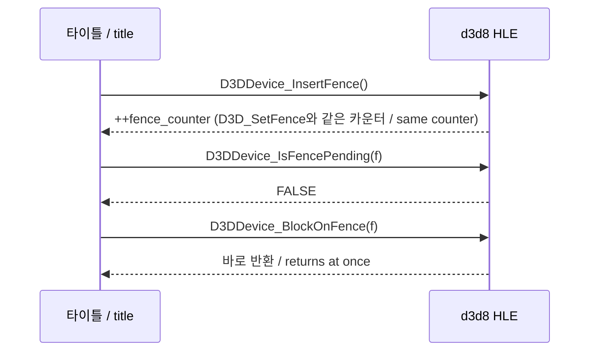

# 설계: D3D8 펜스 export `InsertFence`, `BlockOnFence`, `IsFencePending` (issue #19)

## 1. 요구사항

소비자 reexec/reCT3#14(Crazy Taxi 3, XDK 4531): 타이틀 화면에서 Start를 누르면 프레임 코드(`0005E7B8`)가 `D3DDevice_InsertFence`(`000F5050`)를 부르고, 뒤에 그 펜스로 `D3DDevice_BlockOnFence`(`000F4F40`, 호출 지점 `0005E859`)를 부른다. 두 함수에 HLE export가 없어서 게임이 첫 호출에서 멈춘다. `REXBOX_HLE_FALLBACK=lifted`로 라이브러리 코드를 lift된 그대로 실행할 때만 진행한다.

4531 라이브러리의 lift된 코드에서 **확인됨**:

| 함수 | 원본이 하는 일 |
|---|---|
| `D3DDevice_InsertFence()` | `return D3D_SetFence(0);` |
| `D3DDevice_BlockOnFence(DWORD Fence)` | `D3D_BlockOnTime(Fence, 0);` |

`D3D_SetFence`는 이미 HLE(`++fence_counter`를 돌려준다)이고, `D3D_BlockOnTime`은 HLE가 갱신하지 않는 장치 필드(`+0x30` push 위치, `+0x34` GPU가 마친 시각)를 읽는다. `D3DDevice_IsFencePending(DWORD Fence)`는 XbSymbolDatabase가 3911·4039 서명을 가진다(4531에는 4039 서명이 쓰인다). 서명 바이트로 보아 장치의 `+0x34`와 `+0x30`을 펜스와 비교한다(**추정**). Crazy Taxi 3은 이 함수를 링크하지 않는다.

## 2. 설계

rexbox는 그리기를 호출 안에서 끝내므로(동기) 펜스는 넣는 순간 이미 지나간 것이다.

* `D3DDevice_InsertFence()`(stdcall, 인자 0): `++State().fence_counter`를 돌려준다. `D3D_SetFence`와 같은 카운터를 써서 두 경로의 펜스가 한 순서를 이룬다.
* `D3DDevice_BlockOnFence(DWORD Fence)`(stdcall, 인자 1): 기다릴 것이 없으므로 바로 돌아온다.
* `D3DDevice_IsFencePending(DWORD Fence)`(stdcall, 인자 1): `FALSE`(0).
* 세 export는 `d3d8_device.cpp`의 `D3D_SetFence` 옆에 둔다. `D3D_BlockOnResource`가 이미 같은 이유로 바로 돌아오므로 그 규칙과 같다.

장치 필드 `+0x30`/`+0x34`는 갱신하지 않는다. 그 필드로 기다리는 길은 `D3D_BlockOnTime`이며, 그것을 부르는 라이브러리 함수 중 `D3D_BlockOnResource`와 `BlockOnFence`는 HLE로 바로 돌아온다. `D3D_BlockOnTime` 자체에는 export가 없으므로, 아직 lift된 채 그것을 부르는 함수가 있으면 지금처럼 미구현 HLE로 멈춰 드러난다(이 작업으로 달라지지 않는다).

## 3. 검증

* Win32 x86 빌드와 CTest.
* 소비자 reCT3: `REXBOX_HLE_FALLBACK` 없이 `REXBOX_INPUT=keyboard`로 타이틀에서 Enter(Start)를 누르면 미구현 HLE로 멈추지 않고 게임플레이(택시 운전)에 들어가야 한다.
* `IsFencePending`은 소비자가 링크하지 않아 실행으로 확인하지 못한다. 정의가 상수 반환이라 위 두 함수와 같은 근거에 기댄다.

---

# Design: the D3D8 fence exports `InsertFence`, `BlockOnFence`, `IsFencePending` (issue #19)

## 1. Requirement

Consumer reexec/reCT3#14 (Crazy Taxi 3, XDK 4531): pressing Start on the title screen makes the frame code (`0005E7B8`) call `D3DDevice_InsertFence` (`000F5050`) and later `D3DDevice_BlockOnFence` (`000F4F40`, called at `0005E859`) on that fence. Neither has an HLE export, so the game stops at the first call. It goes on only with `REXBOX_HLE_FALLBACK=lifted`, which runs the library code as lifted.

**Confirmed** in the lifted 4531 library: `D3DDevice_InsertFence()` is `return D3D_SetFence(0);` and `D3DDevice_BlockOnFence(DWORD Fence)` is `D3D_BlockOnTime(Fence, 0);`. `D3D_SetFence` is already HLE (it returns `++fence_counter`); `D3D_BlockOnTime` reads device fields the HLE never updates (`+0x30`, the push position; `+0x34`, the time the GPU has finished). XbSymbolDatabase has 3911 and 4039 signatures for `D3DDevice_IsFencePending(DWORD Fence)` (4531 uses the 4039 one); its signature bytes suggest it compares the fence with the device's `+0x34` and `+0x30` (**inferred**). Crazy Taxi 3 does not link it.

## 2. Design

rexbox finishes drawing inside each call (synchronously), so a fence has already passed when it is inserted (see the sequence diagram above).

* `D3DDevice_InsertFence()` (stdcall, no arguments) returns `++State().fence_counter`, the counter `D3D_SetFence` uses, so fences from both paths form one order.
* `D3DDevice_BlockOnFence(DWORD Fence)` (stdcall, one argument) returns at once: there is nothing to wait for.
* `D3DDevice_IsFencePending(DWORD Fence)` (stdcall, one argument) returns `FALSE` (0).
* The three exports sit next to `D3D_SetFence` in `d3d8_device.cpp`. `D3D_BlockOnResource` already returns at once for the same reason, and these follow it.

The device fields `+0x30`/`+0x34` stay unwritten. The wait on them is `D3D_BlockOnTime`; of the library functions that call it, `D3D_BlockOnResource` and `BlockOnFence` return at once in HLE. `D3D_BlockOnTime` itself has no export, so a function still lifted that calls it stops at the unimplemented HLE function, as it does today, and shows itself (this task does not change that).

## 3. Verification

* Win32 x86 build and CTest.
* Consumer reCT3: without `REXBOX_HLE_FALLBACK`, with `REXBOX_INPUT=keyboard`, Enter (Start) on the title screen must reach gameplay (driving the taxi) without stopping at an unimplemented HLE function.
* `IsFencePending` is not linked by the consumer, so no run exercises it; it returns a constant and rests on the same reasoning as the other two.
