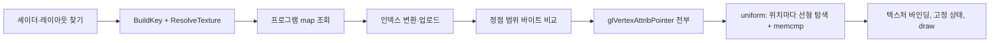

# 설계: D3D8 그리기 하나의 CPU 비용 (issue #23)

상태: 1차 구현(§3.1에서 1을 바꿈, 4는 하지 않음; [작업 로그](../work-logs/20261021-i023-draw-cpu-cost.md)). 소비자 측정: reexec/reCT3#17.

## 1. 요구사항

Crazy Taxi 3 운전 화면(소비자 reCT3 #17, i5-7200U 2코어 + HD 620, Win32 x86 Release)은 프레임당 그리기 약 810개, 42 ms(23.5 fps)다. 타이틀의 게임 시간은 present 하나에 1/60초이므로 게임이 실시간의 0.4배로 간다. 프레임은 다음으로 나뉜다(`REXBOX_D3D8_PROFILE` 120프레임 구간 평균, `REXBOX_SAMPLE` present 2500~3200):

| 부분 | ms/프레임 | 근거 |
|---|---|---|
| vblank 대기(양자화) | 8.5 | `wait`; 표본의 20%가 `ZwDelayExecution` |
| D3D8 그리기 단계 합 | 14.8 | setup 4.0, constants 2.9, indices 2.0, upload 1.7, attributes 1.4, state 1.1, textures 0.9, draw 0.4, target 0.3 |
| present(SwapBuffers 포함) | 1.3 | `present` |
| 그 밖(타이틀 코드, 그리지 않는 HLE 호출, 브리지) | 17.9 | `other`; 그중 lift된 코드 표본 21%(약 9 ms), 추적 문장 서식 약 3~4 ms(issue #22) |

GPU는 병목이 아니다: present가 1.3 ms이고 GL 드라이버(ig9icd32) 표본은 6%다(렌더 배율 비교는 소비자 작업 로그). 바쁜 시간(약 33 ms)이 vblank 둘(33.3 ms)을 넘나들어 프레임이 vblank 2~3개가 된다. 60 fps에는 16.7 ms가 필요하다.

가장 큰 단일 덩어리는 D3D8 그리기 단계 14.8 ms, **그리기 하나에 약 18 µs**다.

## 2. 현재 구조

`Draw`(d3d8_draw.cpp)는 그리기마다 전부 다시 한다.

* **setup 4.0 ms**: `BuildKey`가 렌더·텍스처 스테이지 상태를 게스트 메모리에서 읽고(`RenderStateValue` → `SlotFromLogical`), 텍스처를 해석하고(`ResolveTexture`, `SampleHash`), `FixedFunctionKey`/`psh::Key`를 해시해 `unordered_map`에서 프로그램을 찾는다. 이웃한 그리기 대부분은 같은 키다(같은 셰이더, 다른 변환).
* **constants 2.9 ms**: `UniformCache::Changed`가 위치마다 `entries_`를 선형 탐색하고 값을 memcmp한다. 고정 기능 그리기는 변환 행렬, world-view, 법선 행렬, 텍스처 행렬 4개(대개 항등) 등을 매번 보낸다.
* **indices 2.0 ms**: 푸시 버퍼 조각(`ARRAY_ELEMENT16`)의 인덱스는 캐시되지 않는 경로로 그리기마다 `std::vector` 두 개를 만들어 변환하고 스트림에 붙인다(프레임당 57 KiB).
* **upload 1.7 ms**: 캐시된 정점 범위가 바뀌었는지 그리기마다 전부 바이트 비교한다(프레임당 2 MB, 범위 약 800개, `Unchanged`).
* **attributes 1.4 ms**: 범위마다 GL 버퍼가 달라 attribute 포인터를 그리기마다 다시 지정한다(드라이버 표본의 1/3이 `SetAttribute`).

렌더·텍스처 상태는 라이브러리의 전역 배열(게스트 메모리)에 있고 타이틀 코드가 직접 쓰기도 하므로(4531의 `SetRenderState_Simple`), HLE 호출에 붙인 dirty 비트만으로는 바뀜을 알 수 없다.

## 3. 설계

원칙: 그리기 하나의 일을 **앞 그리기 이후 바뀐 것**에 비례하게 한다. 결과(그려지는 픽셀)는 바뀌지 않아야 한다.

1. **그리기 상태 메모(setup)**: 앞 그리기의 입력 스냅샷을 둔다: 렌더 상태 슬롯 블록과 텍스처 스테이지 상태 블록의 바이트(게스트 메모리, 수백 바이트), 정점·픽셀 셰이더 핸들, `input_shader`, `texture_generation`, 스테이지의 텍스처·팔레트, 레이아웃, 렌더 타깃. 스냅샷이 같으면(memcmp 한 번) 앞 그리기의 `FixedFunctionKey`/`psh::Key`, 해석된 텍스처, 프로그램을 그대로 쓴다. 다르면 지금처럼 만들고 스냅샷을 바꾼다. 텍스처 데이터의 쓰기는 지금처럼 `texture_generation`과 프레임당 표본 해시가 잡는다.
2. **uniform 캐시(constants)**: `UniformCache`를 위치로 바로 찾는 배열로 바꾼다(선형 탐색 제거). 파이프라인의 행렬(변환, 모델뷰, 텍스처 행렬, 조명)에 버전 번호를 두고, 프로그램이 마지막으로 받은 버전과 같으면 비교 없이 건너뛴다. 게스트 메모리에서 읽는 값(fog, tfactor, alpha ref)은 1의 스냅샷이 같으면 건너뛴다.
3. **인덱스(indices)**: 캐시되지 않는 경로의 변환을 재사용 버퍼(스레드 지역 `std::vector`, 용량 유지)로 하고, 16비트 인덱스에 base가 0이면 변환 없이 바로 붙인다.
4. **정점 비교(upload)**: 같은 프레임 안에서 이미 비교한 범위는 다시 비교하지 않는다(범위에 확인한 프레임 번호). 다음 단계로, 정점 버퍼 리소스는 Lock(`MarkWritten`)과 프레임당 표본 해시로 바뀜을 알고 전체 비교를 그만두는 방안을 측정해 정한다(무잠금 쓰기를 놓치면 틀린 그림이 되므로 정확성 확인이 먼저).
5. **attribute(attributes)**: 캐시된 범위마다 VAO를 두고(레이아웃 + 버퍼가 키), 같은 범위·레이아웃이면 VAO 바인딩 하나로 끝낸다. GLES 3.0도 VAO가 있으므로 플랫폼 분기가 없다.

각 단계는 `REXBOX_D3D8_PROFILE`의 해당 단계로 따로 측정할 수 있게 하나씩 넣는다.

기대: setup 4.0 → 약 1, constants 2.9 → 약 1, indices 2.0 → 약 0.7, attributes 1.4 → 약 0.5 ms(**추정**). #22와 합치면 바쁜 시간이 약 33 → 약 21 ms로, 이 기계에서 30 fps 고정(게임 0.5배)이 된다. 60 fps(16.7 ms)에는 모자란다.

### 3.1 구현에서 바꾼 것: 1의 스냅샷 메모 대신

구현 전에 코드를 다시 보니 1을 그대로 하면 그림이 틀릴 수 있다. `ResolveTexture`는 render target을 샘플링하면 그 자리에서 사본을 갱신하고(`SampleRenderTarget`, 앞 사본 뒤에 그 타깃에 그렸으면 복사), 텍스처마다 프레임당 한 번 표본 해시를 본다. 해석을 건너뛰면 이것들이 빠진다. 또 렌더 상태 블록 전체를 스냅샷에 넣으면 키와 무관한 상태(tfactor, alpha ref, fog 색)가 그리기마다 바뀌어 거의 맞지 않을 것이다. 그래서 1을 둘로 나눈다.

* **앞 조회 재사용**: 키는 그리기마다 지금처럼 만들고(텍스처 해석 포함), 프로그램 map 조회에서 키가 앞 조회와 같으면 해시와 탐색 없이 앞 결과를 쓴다. 키가 프로그램 선택의 입력 전부이므로 결과가 같다. map 항목은 지우지 않고 노드 기반이라 포인터가 유지된다.
* **싼 상태 읽기**: `RenderStateValue`/`TextureStateValue`가 읽을 때마다 `Resolve()`를 두 번, `Memory()`, `RenderStateSlotCount()`를 부르던 것을, 주소를 찾을 때 블록의 호스트 포인터와 슬롯 수를 보관해 load 하나로 한다.

### 3.2 다음 단계(이번 범위 밖): 렌더 스레드

2코어 기계에서 60 fps에는 GL 제출을 타이틀 스레드에서 떼어 내야 한다. 타이틀 스레드는 그리기마다 키·상수·정점 범위(게스트 메모리 사본)를 명령으로 기록하고, 렌더 스레드가 GL을 부른다. 그러면 타이틀 스레드는 lift된 코드(약 9 ms) + 기록(수 ms)이 된다. 게스트 메모리 사본, 렌더 타깃 읽기(lock)와 present의 동기화가 필요한 큰 변경이므로 위의 1~5를 먼저 하고 측정한 뒤 따로 설계한다.

## 4. 검증

* 소비자의 같은 입력 스크립트(reCT3 #17 작업 로그)로 운전 구간의 단계별 시간, fps, CPU, 게임 시간 진행을 전후 비교한다.
* 그림: 같은 프레임의 덤프(`REXBOX_FRAME_DUMP`)를 전후 비교한다. 운전 장면은 실행마다 시점이 달라지므로 어트랙트 데모의 고정 프레임(1500, 2100)도 비교한다.
* 1의 메모가 놓치는 상태가 없는지: 진단 변수(가칭 `REXBOX_D3D8_MEMO_CHECK=1`)로 메모가 맞을 때도 키를 다시 만들어 비교하고 다르면 보고한다.
* CTest.

---

# Design: the CPU cost of one D3D8 draw (issue #23)

Status: first pass implemented (item 1 changed in section 3.1, item 4 dropped; [work log](../work-logs/20261021-i023-draw-cpu-cost.md)). Consumer measurements: reexec/reCT3#17.

## 1. Requirement

Crazy Taxi 3 while driving (consumer reCT3 #17, i5-7200U two cores + HD 620, Win32 x86 Release) draws about 810 times per frame in 42 ms (23.5 fps). The title's game time advances 1/60 s per present, so the game runs at 0.4× real time. The frame splits as follows (`REXBOX_D3D8_PROFILE` 120-frame windows, `REXBOX_SAMPLE` over presents 2500–3200):

| Part | ms/frame | Evidence |
|---|---|---|
| vblank wait (quantization) | 8.5 | `wait`; 20% of samples in `ZwDelayExecution` |
| D3D8 draw phases | 14.8 | setup 4.0, constants 2.9, indices 2.0, upload 1.7, attributes 1.4, state 1.1, textures 0.9, draw 0.4, target 0.3 |
| present (including SwapBuffers) | 1.3 | `present` |
| other (title code, HLE calls that do not draw, the bridge) | 17.9 | `other`; lifted code is 21% of samples (about 9 ms), trace-text formatting about 3–4 ms (issue #22) |

The GPU is not the bottleneck: present is 1.3 ms and the GL driver (ig9icd32) has 6% of the samples (the render-scale comparison is in the consumer's work log). The busy time (about 33 ms) straddles two vblanks (33.3 ms), so frames take two or three. 60 fps needs 16.7 ms.

The largest single block is the D3D8 draw phases at 14.8 ms, **about 18 µs per draw**.

## 2. Current structure

`Draw` (d3d8_draw.cpp) redoes everything for every draw (diagram above):

* **setup 4.0 ms**: `BuildKey` reads render and texture-stage state from guest memory (`RenderStateValue` → `SlotFromLogical`), resolves textures (`ResolveTexture`, `SampleHash`), hashes `FixedFunctionKey`/`psh::Key` and finds the program in an `unordered_map`. Most neighbouring draws have the same key (same shader, different transform).
* **constants 2.9 ms**: `UniformCache::Changed` searches `entries_` linearly for every location and memcmps the values. A fixed-function draw sends the transform, world-view, normal matrix and four texture matrices (usually identity) every time.
* **indices 2.0 ms**: push-buffer fragments (`ARRAY_ELEMENT16`) take the uncached path, building two `std::vector`s per draw to convert and append their indices (57 KiB per frame).
* **upload 1.7 ms**: every cached vertex range is byte-compared on every draw to see whether it changed (2 MB per frame over about 800 ranges, `Unchanged`).
* **attributes 1.4 ms**: each range has its own GL buffer, so the attribute pointers are respecified on every draw (a third of the driver's samples are under `SetAttribute`).

Render and texture-stage state lives in the library's global arrays in guest memory, which title code may write directly (4531's `SetRenderState_Simple`), so dirty bits on HLE calls alone cannot tell what changed.

## 3. Design

Principle: make a draw's work proportional to **what changed since the previous draw**, with the drawn pixels unchanged.

1. **Draw-state memo (setup)**: keep a snapshot of the previous draw's inputs: the bytes of the render-state slot block and the texture-stage state block (guest memory, a few hundred bytes), the vertex and pixel shader handles, `input_shader`, `texture_generation`, each stage's texture and palette, the layout and the render target. When the snapshot matches (one memcmp), reuse the previous draw's `FixedFunctionKey`/`psh::Key`, resolved textures and program; otherwise build them as now and replace the snapshot. Writes to texture data are caught as now by `texture_generation` and the per-frame sampled hash.
2. **Uniform cache (constants)**: make `UniformCache` an array indexed by location (no linear search). Give the pipeline's matrices (transform, model view, texture matrices, lighting) version numbers and skip a uniform without comparing when the program last received the same version. Values read from guest memory (fog, tfactor, alpha ref) are skipped when the snapshot of 1 matched.
3. **Indices**: convert on the uncached path into reused buffers (thread-local `std::vector`s that keep their capacity), and append 16-bit indices with base 0 without converting.
4. **Vertex compare (upload)**: do not compare a range again within the frame it was already compared in (a checked-frame number per range). As a next step, measure whether vertex-buffer resources can rely on locks (`MarkWritten`) plus a per-frame sampled hash instead of the full compare (missing a lock-free write draws a wrong picture, so correctness is checked first).
5. **Attributes**: one VAO per cached range (keyed by layout + buffer), so the same range and layout is a single VAO bind. GLES 3.0 has VAOs too, so no platform branch.

Each step lands on its own so it can be measured in its own `REXBOX_D3D8_PROFILE` phase.

Expected: setup 4.0 → about 1, constants 2.9 → about 1, indices 2.0 → about 0.7, attributes 1.4 → about 0.5 ms (**inferred**). Together with #22 the busy time goes from about 33 to about 21 ms: a steady 30 fps on this machine (the game at 0.5×), still short of 60 fps (16.7 ms).

### 3.1 Changed in implementation: instead of the snapshot memo of 1

A second look before implementing shows that 1 as written could draw wrong pictures: `ResolveTexture` refreshes a render target's copy on the spot when it is sampled (`SampleRenderTarget` copies when the target was drawn to after the last copy) and checks each texture's sampled hash once per frame, and skipping the resolution skips both. A snapshot of the whole render-state block would also rarely match, since states unrelated to the key (tfactor, alpha ref, fog colour) change from draw to draw. So 1 becomes two pieces:

* **Reuse of the previous lookup**: the key is built on every draw as now (texture resolution included), and the program-map lookup returns the previous result without hashing and searching when the key equals the previous lookup's. The key is the whole input to the program choice, so the result is the same; map entries are never erased and the maps are node based, so the pointer stays valid.
* **Cheaper state reads**: `RenderStateValue`/`TextureStateValue` called `Resolve()` twice, `Memory()` and `RenderStateSlotCount()` on every read; the blocks' host pointers and the slot count are now kept when the addresses are found, so a read is one load.

### 3.2 Next step (out of scope): a render thread

60 fps on a two-core machine needs GL submission off the title thread: the title thread records each draw's key, constants and vertex ranges (copies of guest memory) as commands and a render thread makes the GL calls, leaving the title thread with the lifted code (about 9 ms) plus recording (a few ms). It needs guest-memory copies and synchronization for render-target reads (locks) and present, a large change, so 1–5 come first, are measured, and the render thread gets its own design.

## 4. Verification

* With the consumer's input script (reCT3 #17 work log), compare the phase times, fps, CPU and game-time rate over the driving span before and after.
* Pictures: compare dumps (`REXBOX_FRAME_DUMP`) of the same frame before and after; driving differs between runs, so also the attract demo's fixed frames (1500, 2100).
* That the memo of 1 misses no state: a diagnostic variable (working name `REXBOX_D3D8_MEMO_CHECK=1`) rebuilds the key even on a match and reports any difference.
* CTest.
