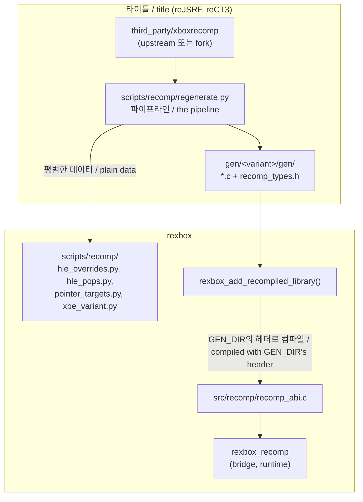
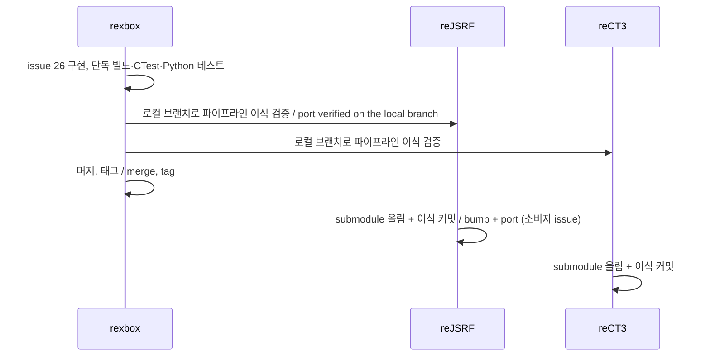

# 설계: xboxrecomp 의존 제거 — lifter 파이프라인과 ABI 헤더는 타이틀이 가진다 (issue #26)

## 1. 요구사항과 현황

rexbox는 `third_party/xboxrecomp`(upstream v0.15.0)를 submodule로 가진다. 그러나 두 소비자는 이 submodule을 쓰지 않는다. **확인됨**(2026-10-24, 각 저장소의 `CMakeLists.txt`와 `scripts/recomp/regenerate.py`):

| 쓰는 곳 | 실제로 쓰는 체크아웃 |
|---|---|
| CMake `REXBOX_XBOXRECOMP_DIR`(ABI 헤더) | reJSRF: 자기 fork(`nworkers/xboxrecomp`, `rejsrf` 브랜치), reCT3: 자기 upstream v0.15.0 pin |
| `scripts/recomp/regenerate.py --xboxrecomp`(파이프라인 도구) | 두 타이틀 wrapper가 모두 `ROOT/third_party/xboxrecomp`를 넘긴다 |
| rexbox 단독 빌드와 CI | rexbox의 submodule. `src/recomp/recomp_abi.c`가 `recomp_types.h`를 include한다 |

즉 rexbox의 사본은 rexbox 단독 빌드에서만 쓰이고, 그 외에는 아무도 쓰지 않는 기본 경로로만 남아 있다. 또 rexbox는 사본이 없어도 xboxrecomp를 **안다**. 다음이 모두 xboxrecomp의 도구와 출력 형식에 묶여 있다.

* `regenerate.py`: xboxrecomp 도구 다섯 개(`tools.xbe_parser`, `tools.disasm`, `tools.func_id`, `tools.abi_analysis`, `tools.recomp`)를 그 CLI 인자로 실행하고, `disasm/functions.json`을 읽는다.
* `check_hle_pops.py`: lift된 본문의 `/* ret N */` 주석을 읽는다.
* `find_pointer_targets.py`: `recomp_dispatch.c`의 표 형식을 읽는다.
* `cmake/rexbox_recomp.cmake`: 생성 코드와 체크아웃의 `recomp_types.h` 해시를 비교한다.
* `cmake/rexbox_license.cmake`: 체크아웃 안의 LGPL 경로를 막는다.

요구사항: rexbox가 xboxrecomp 체크아웃을 가지지 않고, 그 도구와 출력 형식도 모르게 한다. 파이프라인은 lifter를 고정하는 쪽, 즉 타이틀이 가진다.

## 2. 원칙

1. **lifter 체크아웃, 도구, 출력 형식은 타이틀의 것이다.** 어느 lifter를 어느 버전으로 쓰는지(upstream이든 fork든) 타이틀이 정하고, 그 lifter를 실행하고 출력을 읽는 코드도 타이틀에 둔다.
2. **rexbox는 lifter의 런타임 ABI를 구현한다.** 생성 코드가 부르는 전역과 콜백(`recomp_abi.c`, `recomp_bridge.cpp`)은 그대로 rexbox에 둔다. 다만 그 ABI 헤더는 타이틀이 생성 코드와 함께 넘긴다. rexbox는 헤더 파일을 가지지 않는다.
3. **rexbox의 보조 스크립트는 평범한 데이터를 받는 함수만 남긴다.** 예: 주소 집합, `rexbox_xdk_symbols`의 심볼 목록, XBE 바이트. lifter 출력에서 그 데이터를 뽑는 일은 타이틀이 한다. rexbox 자신의 계약(`rexbox_hle_enter`, `rexbox_xdk_variables`, HLE export의 pop 수)을 다루는 코드는 rexbox에 남아 두 타이틀이 같은 코드를 쓴다.

## 3. 설계

### 3.1 ABI 헤더: `recomp_abi.c`를 생성 코드 맥락에서 컴파일한다

* `recomp_abi.c`를 `rexbox_recomp`의 소스 목록에서 뺀다. `rexbox_recomp`에는 헤더에 묶이지 않은 `recomp_bridge.cpp`와 `recomp_runtime.cpp`만 남는다. 둘은 rexbox 계약인 `include/rexbox/recomp/recomp_abi.h`만 쓴다.
* `rexbox_add_recompiled_library(<target> GEN_DIR <dir> TITLE <lib>)`가 `${REXBOX}/src/recomp/recomp_abi.c`를 그 타깃 맥락에서 컴파일한다. include 경로는 `GEN_DIR`(lifter가 생성 코드 옆에 둔 `recomp_types.h`)이다.
  * 생성 코드와 `recomp_abi.c`가 같은 헤더 파일로 컴파일되므로 둘이 어긋날 수 없다. 그래서 체크아웃 헤더와의 SHA256 비교는 지운다.
  * `recomp_abi.c`는 rexbox 코드이므로 생성 코드의 `/w` 대신 rexbox의 엄격한 경고(`rexbox_strict_warnings`)와 `/wd4310`(upstream 헤더의 x87 상수 캐스트)로 컴파일한다. 방법은 `<target>`과 별도의 작은 타깃이나 소스별 옵션이다. 구현에서 링크 순환(아래)과 함께 정한다.
* **lifter ABI에 닿는 심볼을 모두 `recomp_abi.c`에 모은다.** 지금 `recomp_bridge.cpp`는 헤더를 include하지 않은 채 생성 코드가 부르는 콜백을 `extern "C"`로 직접 정의한다. 대상은 `recomp_lookup_manual`, `recomp_lookup_kernel`, `recomp_icall_fail_log`, `recomp_icall_not_code_log`, `recomp_unresolved_stub_log`, `recomp_unimpl`, `recomp_debug_service`, `recomp_abi_violation_log`, `recomp_call_profile_hit`, `xbox_Cpuid`, `xbox_PortIn`/`xbox_PortOut`, `xbox_ReadTimeStampCounter`, `xbox_GuestCpuPreempt`, `recomp_trace_*`, `recomp_setjmp_slot`, `recomp_guest_longjmp`이다. 그래서 lifter가 콜백 시그니처를 바꿔도 컴파일러가 잡지 못한다. C 링크는 이름만 맞으면 붙고, 어긋남은 실행 중에야 드러난다.
  * 이 콜백들의 `extern "C"` 껍데기를 `recomp_abi.c`로 옮긴다. 껍데기는 인자를 rexbox 자신의 시그니처를 가진 C++ 브리지 함수로 넘기기만 하고, 본체(HLE 조회, 멈춤, 진단)는 `recomp_bridge.cpp`에 그대로 둔다. 브리지 함수(`rexbox_bridge_*`)는 C에서도 include할 수 있는 내부 헤더 `src/recomp/recomp_callbacks.h`에 선언한다.
  * 그러면 lifter ABI에 닿는 정의가 모두 실제 헤더로 컴파일되는 한 파일에 모인다. 타이틀이 lifter를 바꿨을 때 헤더가 선언한 콜백의 시그니처가 어긋나면 컴파일 에러가 난다.
  * 헤더가 선언하지 않는 콜백(예: fork에만 있는 `recomp_unresolved_stub_log`)도 껍데기를 정의한다. upstream이든 fork든 같은 rexbox로 링크된다. 선언이 없으니 이것들만은 컴파일러가 확인하지 못한다.
  * `rexbox_hle_enter`는 rexbox 계약(`recomp_hle_entry.h`)이라 lifter ABI가 아니므로 `recomp_bridge.cpp`에 남는다.
* `RECOMP_XMM_PORTABLE`(옵션 `REXBOX_RECOMP_XMM_SSE2`)은 헤더를 include하는 곳, 즉 생성 코드와 `recomp_abi.c`에만 붙인다. 지금은 `rexbox_recomp`에 PUBLIC으로 붙어 전파된다.
* 생성 코드의 include 경로 `${REXBOX_XBOXRECOMP_DIR}/src/kernel`(`recomp_icall_feedback.h`)은 지운다. 이 헤더는 `RECOMP_ICALL_FEEDBACK`를 켤 때만 include되며 rexbox는 켜지 않는다. 그 기능이 필요한 타이틀은 자기 체크아웃 경로를 `target_include_directories`로 더한다.
* `CMakeLists.txt`의 `REXBOX_XBOXRECOMP_DIR` 캐시 변수와 존재 검사를 지운다.
* `GEN_DIR` 계약: `recomp_dispatch.c`와 `recomp_types.h`가 있어야 한다. 앞의 것이 없으면 지금처럼 타깃을 만들지 않고 돌아오고, 뒤의 것이 없으면 configure가 실패한다.

링크 순환: 지금은 `rexbox_recomp`가 `recomp_abi.c`의 함수(`rexbox_recomp_get_gprs` 등)를 자기 안에서 해결한다. 옮긴 뒤에는 방향이 둘이 된다. 콜백 껍데기 → C++ 브리지는 생성 코드 쪽이 `rexbox_recomp`를 부르는 보통 방향이다. 반대로 `recomp_runtime.cpp`와 HLE가 쓰는 레지스터 접근 함수(`rexbox_recomp_*`)는 `rexbox_recomp`가 생성 코드 쪽에 정의된 심볼을 부르는 방향이다. 생성 코드 ↔ 타이틀 사이에 이미 있는 순환과 같은 방식(양방향 `target_link_libraries`)으로 선언하고, GNU ld(Linux 프리셋)와 MSVC 둘 다에서 링크를 확인한다.

### 3.2 스크립트: 남는 것과 타이틀로 가는 것

| 지금 파일 | 남는 것(rexbox, 평범한 데이터) | 타이틀로 가는 것(lifter 형식) |
|---|---|---|
| `regenerate.py` | `hle_overrides.py`: `identify_symbols(tool, xbe, out_dir, extra)`(rexbox_xdk_symbols 실행), `write_hle_overrides(symbols, function_starts, out_dir, hle_libraries, entry_name, lifted_name)` | 변형 확인 호출, xboxrecomp 다섯 단계 실행, seed 파일 수집, `disasm/functions.json` → 시작 주소 집합, 덮어쓰기 소스 수집(`--exclude-manual`), 체크아웃 깨끗함 확인, CLI |
| `check_hle_pops.py` | `hle_pops.py`: `hle_pop_counts()`(rexbox HLE 소스의 `AddExport`/`Return(..., n)` 읽기), `compare_pops(name_by_address, lifted_ret_bytes, hle)` | lift된 본문의 `/* ret N */` 읽기, CLI |
| `find_pointer_targets.py` | `pointer_targets.py`: `scan(image, lifted)`(XBE 휴리스틱), `merge_seeds(seed_file, candidates)` | `recomp_dispatch.c` → lift된 주소 집합, CLI |
| `xbe_variant.py` | 그대로 둔다(XBE만 읽는다) | — |

* `write_hle_overrides`의 이름 규칙(지금은 `sub_%08X`와 `sub_%08X_gen`)은 lifter의 심볼 이름이다. 그래서 `entry_name(address)`와 `lifted_name(address)`를 타이틀이 넘긴다. 생성되는 C의 내용(`RexboxHleSlot`, `rexbox_hle_enter`, `rexbox_xdk_variables[]`)은 rexbox 계약이므로 rexbox가 쓴다.
* 지운 모듈 이름(`regenerate`, `check_hle_pops`, `find_pointer_targets`)을 남겨 두지 않는다. 이 이름을 import하는 소비자는 3.5의 일을 해야 하므로, 남기면 반쯤 동작하는 상태가 생긴다.
* 함수는 game data 없이 검증할 수 있다. `scripts/recomp/test_*.py`(unittest)에 합성 입력(가짜 심볼 목록, 작은 가짜 XBE 바이트, 가짜 HLE 소스 조각)으로 테스트를 두고 CI에서 `python -m unittest`로 돌린다.

### 3.3 라이선스 가드

`cmake/rexbox_license.cmake`의 `REXBOX_COPYLEFT_PATHS`는 xboxrecomp 체크아웃 안의 경로를 막는다. rexbox가 체크아웃 경로를 모르게 되므로 이 가드를 지운다.

* rexbox가 빌드하는 xboxrecomp 파일은 이제 `GEN_DIR`로 들어오는 `recomp_types.h`(MIT)뿐이다.
* LGPL 파일이 섞일 위험은 체크아웃을 가진 타이틀에 있다. 두 타이틀은 이미 자기 `AGENTS.md`에 같은 라이선스 규칙을 가진다. 가드는 타이틀이 원하면 옮겨 간다(소비자 할 일 3.5).
* rexbox 자기 소스에 대한 라이선스 규칙(AGENTS.md)은 그대로다.

### 3.4 submodule, CI, 문서

* `third_party/xboxrecomp` submodule과 `.gitmodules` 항목을 지운다.
* CI(`ci.yml`, `release.yml`)의 주석을 고친다. 다른 submodule(SDL, imgui, smaa, XbSymbolDatabase) 때문에 `submodules: true`는 남는다. 3.2의 Python 테스트 단계를 더한다.
* `THIRD_PARTY_NOTICES.md`: xboxrecomp 항목을 "옮긴 코드" 항목으로 줄인다. 대상은 `kernel_exports.cpp`의 `KERNEL_EXPORTS` 표, `xbox_Cpuid` 값, `recomp_abi.c`와 `recomp_bridge.cpp`가 구현하는 ABI다. MIT 전문은 이미 본문에 있으므로 `third_party/xboxrecomp/LICENSE` 참조를 지운다. "빌드에 쓰는 파일"과 "제외" 항목은 지운다.
* `CREDITS.md`, `docs/kb/`의 출처 링크는 그대로 둔다(지식 출처이지 의존이 아니다).
* `ARCHITECTURE.md`, `README.md`, `docs/guides/win32-setup-and-build.md`(§ 다른 lifter 체크아웃으로 컴파일), `docs/guides/linux-setup-and-build.md`: `REXBOX_XBOXRECOMP_DIR`, submodule, `regenerate.py` 설명을 고친다.
* `docs/kb/static-recompilation-and-hle.md`: 파이프라인이 타이틀에 있다는 점을 반영한다(필요하면).

### 3.5 규칙과 방향성

* `AGENTS.md` 레이어 규칙 "`rexbox_recomp`만 lifter의 ABI 헤더(`recomp_types.h`)를 안다"를 바꾼다. 새 규칙: "`src/recomp/recomp_abi.c`만 lifter의 ABI 헤더를 include하며, 타이틀의 생성 코드 맥락에서 그 생성 코드와 함께 온 헤더로 컴파일된다. rexbox는 lifter 체크아웃·도구·출력 형식을 모른다."
* `AGENTS.md` 라이선스 규칙에서 `REXBOX_COPYLEFT_PATHS` 문장과 "xboxrecomp의 문제는 upstream에 PR"을 고친다. 뒤의 것은 lifter를 가진 타이틀의 규칙이 된다.
* `docs/PROJECT_CHARTER.md` 단계 3 "모든 소비자가 업스트림 xboxrecomp를 쓴다"는 rexbox의 단계가 아니게 된다. "rexbox가 lifter에서 독립한다(issue #26)"로 바꾸고, 어느 lifter를 쓸지는 각 타이틀이 정한다고 적는다.

## 4. 소비자 영향과 할 일

공개 계약이 바뀐다(AGENTS.md 원칙 7). 릴리스 노트에 다음을 적는다.

| 바뀌는 것 | 소비자가 할 일 |
|---|---|
| CMake 변수 `REXBOX_XBOXRECOMP_DIR` 삭제 | `set(REXBOX_XBOXRECOMP_DIR ...)`를 지운다. 체크아웃 존재 검사는 자기 변수로 남겨도 된다. 남은 cache 값은 무해하다. |
| `GEN_DIR`에 `recomp_types.h` 필수 | xboxrecomp lifter는 이미 이렇게 쓴다. 할 일 없음. |
| `RECOMP_ICALL_FEEDBACK`용 include 경로 삭제 | 그 기능을 쓰는 타이틀만 자기 체크아웃의 `src/kernel`을 더한다(지금 둘 다 안 쓴다). |
| `scripts/recomp/regenerate.py` 삭제 | 파이프라인을 자기 `scripts/recomp/regenerate.py`로 옮긴다. rexbox의 `hle_overrides`, `xbe_variant`를 import한다. |
| `check_hle_pops.py`, `find_pointer_targets.py` 삭제 | lifter 출력 읽기를 자기 wrapper로 옮긴다. rexbox의 `hle_pops`, `pointer_targets`를 import한다. |
| 라이선스 가드 삭제(`rexbox_check_license`, `REXBOX_COPYLEFT_PATHS`) | `rexbox_check_license(...)` 호출을 지우거나, 원하면 가드를 자기 CMake로 옮겨 그것을 부른다. 두 타이틀 모두 지금 이 함수를 부르므로 지우지 않으면 configure가 실패한다. |

**생성 코드 재생성은 필요 없다.** ABI도, `hle_overrides.c`의 내용도 바뀌지 않는다. 그래도 옮긴 파이프라인을 검증하기 위해 한 번 재생성하고, 이전 출력과 바이트 단위로 같은지 비교한다.

순서:

rexbox를 머지하기 전에 두 타이틀에서 이식이 동작함을 확인한다. 그래서 소비자가 submodule을 올리는 커밋 하나로 따라올 수 있게 한다. 소비자 쪽 issue는 rexbox issue #26에 링크한다.

## 5. 고려한 대안

* **(가) 스크립트는 rexbox에 두고 `--xboxrecomp`만 필수 인자로 바꾸기.** 사본은 사라지지만 rexbox가 xboxrecomp CLI와 출력 형식을 계속 안다. lifter가 바뀌면 rexbox가 바뀌어야 하고, reJSRF fork의 CLI가 upstream과 갈라지면 공용 스크립트가 둘을 다 맞춰야 한다. 채택하지 않았다.
* **ABI 헤더를 rexbox에 복사해 두기(vendoring).** 빌드는 submodule 없이 되지만, 두 타이틀이 서로 다른 lifter를 쓰면 rexbox 사본은 둘 중 하나와만 맞는다. 채택하지 않았다.
* **`rexbox_recomp` 전체를 타이틀로 옮기기.** rexbox가 ABI도 모르게 되지만, 런타임과 강하게 묶인 브리지(약 1,200줄, 스레드·HLE 진입·디스패치)가 두 타이틀에 중복된다. lifter의 런타임 ABI 구현은 "생성 코드가 부르는 Xbox"의 일부이므로 rexbox에 둔다(원칙 2).
* **자체 lifter를 만들기.** 이 작업의 범위가 아니다. 타이틀이 lifter를 고르게 되므로, 앞으로 다른 lifter를 쓰는 타이틀도 같은 ABI 헤더 계약(`GEN_DIR/recomp_types.h`)만 지키면 된다.

## 6. 검증

* xboxrecomp 없이 새로 clone(`git submodule update --init` 후 `third_party/xboxrecomp`가 없는 상태)해서 Win32 x86 Debug/Release 빌드와 CTest를 돌린다. Linux x86/x64 프리셋도 configure와 빌드를 한다.
* `scripts/recomp/test_*.py`(합성 입력)를 로컬과 CI에서 돌린다.
* 소비자 reJSRF와 reCT3(로컬에서 rexbox submodule을 이 브랜치로 둔다):
  1. 옮긴 파이프라인으로 재생성한다. `gen/<variant>/gen/`과 `hle_overrides.c`가 이전 출력과 바이트 단위로 같아야 한다.
  2. 옮긴 `check_hle_pops`, `find_pointer_targets` wrapper의 출력이 이전과 같아야 한다.
  3. Win32 x86 앱이 링크되고, 각 타이틀이 이전과 같은 지점까지(reJSRF: 게임플레이, reCT3: 택시 운전) 진행해야 한다.
  4. Linux 프리셋에서 앱이 링크되는지 확인한다(GNU ld의 순환 해결, 3.1).

## 7. 열린 문제

* 3.1의 `recomp_abi.c` 컴파일 방식(별도 타깃 또는 소스별 옵션)과 순환 선언은 구현에서 GNU ld 링크를 보고 정한다. 결과는 작업 로그와 `ARCHITECTURE.md`에 적는다. 순환이 문제가 되면 남은 방향은 레지스터 접근 함수뿐이다. 그 경우 `recomp_abi.c`가 접근 함수 표를 `rexbox_recomp`에 등록하는 방식(함수 포인터)도 검토한다.

---

# Design: removing the xboxrecomp dependency — the lifter pipeline and ABI header belong to the titles (issue #26)

## 1. Requirement and current state

rexbox holds `third_party/xboxrecomp` (upstream v0.15.0) as a submodule, yet neither consumer uses it. **Confirmed** (2026-10-24, each repository's `CMakeLists.txt` and `scripts/recomp/regenerate.py`):

| Use | Checkout actually used |
|---|---|
| CMake `REXBOX_XBOXRECOMP_DIR` (ABI header) | reJSRF: its own fork (`nworkers/xboxrecomp`, branch `rejsrf`); reCT3: its own upstream v0.15.0 pin |
| `scripts/recomp/regenerate.py --xboxrecomp` (pipeline tools) | both titles' wrappers pass `ROOT/third_party/xboxrecomp` |
| rexbox's standalone build and CI | rexbox's submodule: `src/recomp/recomp_abi.c` includes `recomp_types.h` |

So the rexbox copy serves only rexbox's standalone build; otherwise it is a default path nobody takes. Even without the copy, rexbox **knows** xboxrecomp. Each of these is tied to xboxrecomp's tools or output formats:

* `regenerate.py` runs five xboxrecomp tools with their CLI arguments and reads `disasm/functions.json`.
* `check_hle_pops.py` reads the `/* ret N */` comments in lifted bodies.
* `find_pointer_targets.py` reads the table format of `recomp_dispatch.c`.
* `cmake/rexbox_recomp.cmake` compares the generated header's hash with the checkout's.
* `cmake/rexbox_license.cmake` blocks LGPL paths inside the checkout.

Requirement: rexbox holds no xboxrecomp checkout and knows neither its tools nor its output formats. The pipeline belongs to whoever pins the lifter: the title.

## 2. Principles

1. **The lifter's checkout, tools and output formats belong to the title.** The title picks the lifter and its version (upstream or a fork), and keeps the code that runs it and reads its output.
2. **rexbox implements the lifter's runtime ABI.** The globals and callbacks generated code calls (`recomp_abi.c`, `recomp_bridge.cpp`) stay in rexbox. The ABI header, however, comes from the title with its generated code; rexbox holds no copy.
3. **rexbox's helper scripts keep only functions over plain data:** address sets, the symbol list from `rexbox_xdk_symbols`, XBE bytes. Extracting that data from the lifter's output is the title's job. Code that handles rexbox's own contracts (`rexbox_hle_enter`, `rexbox_xdk_variables`, HLE exports' pop counts) stays in rexbox, so both titles share it.

The diagram above shows the split.

## 3. Design

### 3.1 The ABI header: `recomp_abi.c` compiles in the generated code's context

* `recomp_abi.c` leaves `rexbox_recomp`'s sources. `rexbox_recomp` keeps `recomp_bridge.cpp` and `recomp_runtime.cpp`, which use only rexbox's own contract `include/rexbox/recomp/recomp_abi.h`.
* `rexbox_add_recompiled_library(<target> GEN_DIR <dir> TITLE <lib>)` compiles `${REXBOX}/src/recomp/recomp_abi.c` in that target's context, with `GEN_DIR` (where the lifter put `recomp_types.h` next to the generated code) on the include path.
  * The generated code and `recomp_abi.c` compile against the same header file and cannot disagree, so the SHA256 comparison with a checkout's header goes away.
  * `recomp_abi.c` is rexbox code. It keeps rexbox's strict warnings (`rexbox_strict_warnings`) plus `/wd4310` (the upstream header's x87 constant casts) rather than the generated code's `/w`. Whether through a small separate target or per-source options is decided in implementation, together with the link cycle below.
* **Every symbol that touches the lifter ABI moves into `recomp_abi.c`.** Today `recomp_bridge.cpp` defines the callbacks generated code calls as `extern "C"` without including the header: `recomp_lookup_manual`, `recomp_lookup_kernel`, `recomp_icall_fail_log`, `recomp_icall_not_code_log`, `recomp_unresolved_stub_log`, `recomp_unimpl`, `recomp_debug_service`, `recomp_abi_violation_log`, `recomp_call_profile_hit`, `xbox_Cpuid`, `xbox_PortIn`/`xbox_PortOut`, `xbox_ReadTimeStampCounter`, `xbox_GuestCpuPreempt`, `recomp_trace_*`, `recomp_setjmp_slot` and `recomp_guest_longjmp`. If the lifter changes a callback's signature, no compiler notices: C links by name alone, and the mismatch only shows at run time.
  * The `extern "C"` shells of these callbacks move to `recomp_abi.c`. A shell only forwards to a C++ bridge function with rexbox's own signature; the bodies (HLE lookup, stops, diagnostics) stay in `recomp_bridge.cpp`. The bridge functions (`rexbox_bridge_*`) are declared in `src/recomp/recomp_callbacks.h`, an internal header C can include.
  * Every definition that touches the lifter ABI is then in one file compiled against the real header. When a title changes lifters, a callback whose declared signature no longer matches fails to compile.
  * Callbacks the header does not declare (for example `recomp_unresolved_stub_log`, which only the fork has) get shells as well, so the same rexbox links with upstream or the fork. Having no declaration, these alone go unchecked.
  * `rexbox_hle_enter` belongs to rexbox's contract (`recomp_hle_entry.h`), not the lifter ABI, and stays in `recomp_bridge.cpp`.
* `RECOMP_XMM_PORTABLE` (option `REXBOX_RECOMP_XMM_SSE2`) goes only where the header is included: the generated code and `recomp_abi.c`. Today it is PUBLIC on `rexbox_recomp` and propagates.
* The generated code's include path `${REXBOX_XBOXRECOMP_DIR}/src/kernel` (`recomp_icall_feedback.h`) goes away. That header is included only with `RECOMP_ICALL_FEEDBACK` on, which rexbox never sets. A title that wants the feature adds its own checkout's path with `target_include_directories`.
* The `REXBOX_XBOXRECOMP_DIR` cache variable and its existence check leave `CMakeLists.txt`.
* `GEN_DIR` contract: it must hold `recomp_dispatch.c` and `recomp_types.h`. Without the first, no target is made (as today). Without the second, configure fails.

Link cycle: today `rexbox_recomp` resolves `recomp_abi.c`'s functions (`rexbox_recomp_get_gprs`, ...) internally. After the move there are two directions. Callback shells → C++ bridge is the usual one: the generated-code side calls `rexbox_recomp`. The register accessors (`rexbox_recomp_*`) used by `recomp_runtime.cpp` and the HLE go the other way: `rexbox_recomp` calls symbols defined on the generated-code side. This cycle is declared like the existing generated-code ↔ title cycle (`target_link_libraries` in both directions), and linking is checked with both GNU ld (Linux presets) and MSVC.

### 3.2 Scripts: what stays and what moves to the titles

| Current file | Stays (rexbox, plain data) | Moves to the title (lifter formats) |
|---|---|---|
| `regenerate.py` | `hle_overrides.py`: `identify_symbols(tool, xbe, out_dir, extra)` (runs rexbox_xdk_symbols), `write_hle_overrides(symbols, function_starts, out_dir, hle_libraries, entry_name, lifted_name)` | the variant-check call, the five xboxrecomp steps, seed collection, `disasm/functions.json` → start addresses, override-source collection (`--exclude-manual`), the clean-checkout check, the CLI |
| `check_hle_pops.py` | `hle_pops.py`: `hle_pop_counts()` (reads `AddExport`/`Return(..., n)` in rexbox's HLE sources), `compare_pops(name_by_address, lifted_ret_bytes, hle)` | reading `/* ret N */` from lifted bodies, the CLI |
| `find_pointer_targets.py` | `pointer_targets.py`: `scan(image, lifted)` (the XBE heuristic), `merge_seeds(seed_file, candidates)` | `recomp_dispatch.c` → lifted addresses, the CLI |
| `xbe_variant.py` | stays as is (reads only the XBE) | — |

* The names in `write_hle_overrides` (today `sub_%08X` and `sub_%08X_gen`) are the lifter's symbol names, so the title passes `entry_name(address)` and `lifted_name(address)`. The C it writes (`RexboxHleSlot`, `rexbox_hle_enter`, `rexbox_xdk_variables[]`) is rexbox's contract, so rexbox writes it.
* The removed module names (`regenerate`, `check_hle_pops`, `find_pointer_targets`) are not kept around. A consumer importing them must do the work in section 4, and a half-working leftover would hide that.
* These functions are verifiable without game data: `scripts/recomp/test_*.py` (unittest) feed them synthetic inputs (fake symbol lists, small fake XBE bytes, fake HLE source snippets), and CI runs `python -m unittest`.

### 3.3 The license guard

`REXBOX_COPYLEFT_PATHS` in `cmake/rexbox_license.cmake` blocks paths inside the xboxrecomp checkout. Once rexbox no longer knows the checkout's path, the guard goes away.

* The only xboxrecomp file rexbox still compiles is `recomp_types.h` (MIT), arriving through `GEN_DIR`.
* The risk of LGPL files getting into the build lies with whoever holds the checkout: the title. Both titles already have the same license rules in their own `AGENTS.md`. A title that wants the guard takes it along (consumer work, section 4).
* The license rules for rexbox's own sources (AGENTS.md) are unchanged.

### 3.4 Submodule, CI, documents

* Remove the `third_party/xboxrecomp` submodule and its `.gitmodules` entry.
* Fix the comments in CI (`ci.yml`, `release.yml`). `submodules: true` stays for the other submodules (SDL, imgui, smaa, XbSymbolDatabase). Add a step for the Python tests of 3.2.
* `THIRD_PARTY_NOTICES.md`: shrink the xboxrecomp entry to the ported code: the `KERNEL_EXPORTS` table in `kernel_exports.cpp`, the `xbox_Cpuid` values, and the ABI that `recomp_abi.c` and `recomp_bridge.cpp` implement. The MIT text is already inline, so drop the `third_party/xboxrecomp/LICENSE` reference, and drop the "files used by the build" and "excluded" items.
* `CREDITS.md` and the source links in `docs/kb/` stay: they are knowledge sources, not dependencies.
* `ARCHITECTURE.md`, `README.md`, `docs/guides/win32-setup-and-build.md` (the section on compiling against another lifter checkout), `docs/guides/linux-setup-and-build.md`: fix what they say about `REXBOX_XBOXRECOMP_DIR`, the submodule and `regenerate.py`.
* `docs/kb/static-recompilation-and-hle.md`: note that the pipeline lives in the title (if needed).

### 3.5 Rules and direction

* The `AGENTS.md` layer rule "only `rexbox_recomp` knows the lifter's ABI header (`recomp_types.h`)" becomes: "only `src/recomp/recomp_abi.c` includes the lifter's ABI header, and it compiles in a title's generated-code context against the header that came with that generated code. rexbox knows neither the lifter's checkout, its tools, nor its output formats."
* The `AGENTS.md` license rules: change the sentence on `REXBOX_COPYLEFT_PATHS`, and "xboxrecomp problems go upstream as PRs", which becomes a rule of the titles that hold the lifter.
* `docs/PROJECT_CHARTER.md` stage 3, "every consumer on upstream xboxrecomp", stops being a rexbox stage. It becomes "rexbox independent of the lifter (issue #26)"; which lifter to use is each title's choice.

## 4. Consumer impact and work

A public contract changes (AGENTS.md principle 7). The release notes say:

| Change | What a consumer does |
|---|---|
| CMake variable `REXBOX_XBOXRECOMP_DIR` removed | Delete `set(REXBOX_XBOXRECOMP_DIR ...)`. The checkout existence check may stay under the title's own variable; a leftover cache value is harmless. |
| `GEN_DIR` must hold `recomp_types.h` | The xboxrecomp lifter already writes it. Nothing to do. |
| The include path for `RECOMP_ICALL_FEEDBACK` removed | Only a title using the feature adds its checkout's `src/kernel` (neither does today). |
| `scripts/recomp/regenerate.py` removed | Move the pipeline into the title's own `scripts/recomp/regenerate.py`, importing rexbox's `hle_overrides` and `xbe_variant`. |
| `check_hle_pops.py`, `find_pointer_targets.py` removed | Move the lifter-output reading into the title's wrappers, importing rexbox's `hle_pops` and `pointer_targets`. |
| License guard removed (`rexbox_check_license`, `REXBOX_COPYLEFT_PATHS`) | Delete the `rexbox_check_license(...)` calls, or move the guard into the title's CMake and call that. Both titles call the function today, so configure fails until they do. |

**No regeneration is needed:** neither the ABI nor the content of `hle_overrides.c` changes. To verify the moved pipeline, regenerate once anyway and compare with the previous output byte for byte.

Order (see the sequence diagram above): implement #26 in rexbox with the standalone build, CTest and the Python tests. Verify the port in both titles against the local branch. Then merge and tag rexbox. Then each title bumps its submodule together with its port, under a consumer issue linked to rexbox issue #26. Checking the port before the rexbox merge lets each consumer follow with one submodule-bump commit.

## 5. Alternatives considered

* **(a) Keep the scripts in rexbox and only make `--xboxrecomp` required.** The copy disappears, but rexbox still knows xboxrecomp's CLI and output formats. A lifter change would force a rexbox change, and once reJSRF's fork CLI drifts from upstream, the shared script must fit both. Rejected.
* **Vendor the ABI header into rexbox.** The build works without the submodule, but with two titles on different lifters, the rexbox copy matches only one of them. Rejected.
* **Move all of `rexbox_recomp` into the titles.** rexbox would not even know the ABI, but the bridge, tightly bound to the runtime (about 1,200 lines: threads, HLE entry, dispatch), would be duplicated in both titles. Implementing the lifter's runtime ABI is part of "the Xbox the generated code calls", so it stays in rexbox (principle 2).
* **Write our own lifter.** Out of scope. Since titles now choose their lifter, a future title on another lifter only has to keep the same ABI-header contract (`GEN_DIR/recomp_types.h`).

## 6. Verification

* From a fresh clone without xboxrecomp (`git submodule update --init` leaves no `third_party/xboxrecomp`): Win32 x86 Debug/Release builds and CTest; configure and build of the Linux x86/x64 presets.
* `scripts/recomp/test_*.py` (synthetic inputs) locally and in CI.
* Consumers reJSRF and reCT3, with their rexbox submodule on this branch locally:
  1. Regenerate with the moved pipeline. `gen/<variant>/gen/` and `hle_overrides.c` must match the previous output byte for byte.
  2. The moved `check_hle_pops` and `find_pointer_targets` wrappers must print the same as before.
  3. The Win32 x86 application links, and each title gets as far as before (reJSRF: gameplay; reCT3: driving the taxi).
  4. The application links under the Linux presets (GNU ld resolving the cycle, 3.1).

## 7. Open questions

* How `recomp_abi.c` is compiled in 3.1 (a separate target or per-source options) and how the cycle is declared are settled in implementation by watching the GNU ld link. The result goes into the work log and `ARCHITECTURE.md`. If the cycle is a problem, only the register accessors remain in the reverse direction. In that case, also consider `recomp_abi.c` registering a table of accessors (function pointers) with `rexbox_recomp`.
