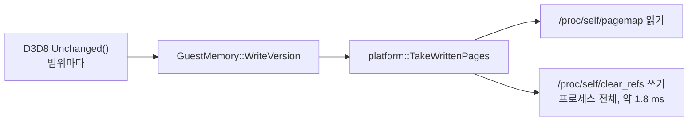

# 설계: Linux에서 soft-dirty 쓰기 추적을 쓰지 않는다 (issue #36)

상태: 구현됨([작업 지시](../work-orders/20261027-i036-linux-write-tracking.md), [작업 로그](../work-logs/20261027-i036-linux-write-tracking.md)). 소비자: nworkers/reJSRF#125. 이전 설계: [i004](20261020-i004-linux-preparation.md) §가상 메모리.

## 1. 요구사항

soft-dirty를 지원하는 커널(실제 Ubuntu 26.04, 커널 7.0, NVIDIA 드라이버)에서 reJSRF의 3D 어트랙트 데모가 약 4 fps로 돈다. 로고와 타이틀은 60 fps다. WSL2 커널은 soft-dirty가 없어서, i004 이후 Linux 확인은 이 경로를 한 번도 지나지 않았다(i004 작업 로그: "지원 커널에서의 추적 경로는 미검증").

## 2. 확인한 것

reJSRF US Release, 숨긴 창, 소리 없음, `REXBOX_D3D8_PROFILE`:

| | fps | 표시 스레드 CPU | upload 단계 | 비교한 바이트 |
|---|---|---|---|---|
| 데모, 지금 | 약 4 | 약 250 ms | 약 230 ms | 약 1.6 MB/프레임 |
| 데모, soft-dirty 끔(LD_PRELOAD로 `/proc/self/clear_refs` 열기 거부 → 자가 검사 실패 → 추적 없이 할당) | 약 60 | 약 3.4 ms | 약 0.4 ms | 약 4.3 MB/프레임 |

* **확인됨**(`strace -T`): 데모 중 `/proc/self/clear_refs` 쓰기가 초당 약 490번, 한 번에 약 1.8 ms. 프레임당 약 215 ms로 upload 단계 시간과 맞는다.
* `TakeWrittenPages`는 질의마다 `clear_refs`에 `4`를 쓴다. 이것은 프로세스의 **모든** 매핑의 페이지 표를 돈다. D3D8은 8 KiB 이상인 정점·인덱스 범위마다 `GuestMemory::WriteVersion`으로 묻는다(그리기 약 500개 프레임에서 질의 약 120번).
* **추정**: 한 번에 1.8 ms가 드는 것은 GL 드라이버(NVIDIA)가 큰 매핑을 많이 두기 때문이다. 드라이버마다 다르다.
* **추정**(코드에서 읽음, 재현하지 않음): 프로세스 전체를 지우므로, 아직 묻지 않은 다른 범위에 쓴 기록도 지워진다. 그 범위를 나중에 물으면 "안 쓰임"이 나와 바뀐 버퍼를 놓칠 수 있다. `GuestMemory`는 물은 페이지의 버전만 올리므로 이를 막지 못한다.

## 3. 방안

| 방안 | 내용 | 판단 |
|---|---|---|
| **A. Linux는 쓰기 추적 없음** | `AllocateVirtualMemory`가 `track_writes`를 무시하고, `TakeWrittenPages`는 늘 false. D3D8은 범위를 늘 `memcmp`로 비교한다(WSL2와 같은 경로) | **채택**. 측정으로 60 fps. 위의 정확성 문제도 없어진다. 공개 계약은 이미 "추적할 수 없으면 추적 없이 할당"을 허용한다 |
| B. `PAGEMAP_SCAN` + userfaultfd 비동기 쓰기 보호(Linux 6.7+) | 범위마다 쓰인 페이지를 얻고 그 범위만 다시 보호한다(Wine의 `GetWriteWatch` 방식) | 보류. A보다 줄일 수 있는 것은 비교 비용(이 머신에서 프레임당 1 ms 미만)뿐이고, userfaultfd 권한과 커널 버전 처리가 필요하다. 필요해지면 후속 issue |
| C. soft-dirty를 두고 지우기를 줄임(프레임당 한 번 등) | | 기각. 지우기 전에 묻지 않은 범위의 기록이 사라지는 문제가 남는다 |

## 4. 구조 (방안 A)

* `src/platform/linux/virtual_memory_linux.cpp`: soft-dirty 자가 검사, `ClearSoftDirty`, `ReadPagemap`, 추적 블록 목록을 지운다. `AllocateVirtualMemory`는 `track_writes`와 상관없이 같은 mmap을 한다. `TakeWrittenPages`는 false를 돌려준다.
* 공개 계약(`include/rexbox/platform/virtual_memory.h`)은 바뀌지 않는다. `GuestMemory`의 첫 페이지 검사가 실패해 `TracksWrites()`가 false가 되고, D3D8은 이미 있는 전체 비교 경로를 쓴다.
* Win32(`GetWriteWatch`)는 바뀌지 않는다. 범위별로 지우므로 같은 문제가 없다.
* 소비자가 할 일: submodule을 올린다. 재생성은 필요 없다.

## 5. 검증

1. Linux x64 Release/Debug 빌드, 경고 0, `ctest` 통과. Linux x86은 i386 개발 패키지가 있는 곳(CI)에서.
2. reJSRF에서 이 커밋으로 빌드해 데모 구간을 `REXBOX_D3D8_PROFILE`로 다시 잰다: 약 60 fps.
3. reJSRF `rejsrf_decomp_check`, `rejsrf_d3d8_check` 회귀 없음.
4. Win32 코드는 바뀌지 않으므로 CI의 Win32 빌드로 확인한다.

---

# Design: no soft-dirty write tracking on Linux (issue #36)

Status: implemented ([work order](../work-orders/20261027-i036-linux-write-tracking.md), [work log](../work-logs/20261027-i036-linux-write-tracking.md)). Consumer: nworkers/reJSRF#125. Earlier design: [i004](20261020-i004-linux-preparation.md), virtual memory.

## 1. Requirement

On a kernel with soft-dirty tracking (a real Ubuntu 26.04, kernel 7.0, NVIDIA driver), reJSRF's 3D attract demo runs at about 4 fps; the logos and title run at 60 fps. WSL2 kernels have no soft-dirty, so no Linux check since i004 ever took this path (i004 work log: "the tracking path on a supporting kernel is unverified").

## 2. Findings

reJSRF US Release, hidden window, no audio, `REXBOX_D3D8_PROFILE`:

| | fps | presenting-thread CPU | upload phase | bytes compared |
|---|---|---|---|---|
| demo, as is | ~4 | ~250 ms | ~230 ms | ~1.6 MB/frame |
| demo, soft-dirty off (LD_PRELOAD refuses `/proc/self/clear_refs` → the self test fails → allocated untracked) | ~60 | ~3.4 ms | ~0.4 ms | ~4.3 MB/frame |

* **Confirmed** (`strace -T`): during the demo `/proc/self/clear_refs` is written ~490 times a second at ~1.8 ms each, ~215 ms per frame, matching the upload phase.
* `TakeWrittenPages` writes `4` to `clear_refs` on every query, which walks the page tables of **every** mapping of the process. D3D8 asks through `GuestMemory::WriteVersion` for every vertex and index range of 8 KiB or more (about 120 queries in a ~500-draw frame).
* **Inferred**: the 1.8 ms per clear comes from the GL driver's (NVIDIA) many large mappings; it varies by driver.
* **Inferred** (read from the code, not reproduced): the process-wide clear also drops the record of writes to ranges not queried yet, so a later query of such a range answers "not written" and a changed buffer can be missed. `GuestMemory` raises versions only for the pages it queried, so it does not prevent this.

The diagram above shows the query path.

## 3. Options

| Option | What | Decision |
|---|---|---|
| **A. No write tracking on Linux** | `AllocateVirtualMemory` ignores `track_writes` and `TakeWrittenPages` always returns false; D3D8 always compares ranges with `memcmp` (the WSL2 path) | **Taken**. Measured at 60 fps; the correctness problem above goes too. The public contract already allows "allocated untracked where it cannot track" |
| B. `PAGEMAP_SCAN` + userfaultfd async write protection (Linux 6.7+) | Per-range written pages, re-protecting only that range (how Wine does `GetWriteWatch`) | Deferred. It could save only the comparison cost over A (under 1 ms a frame here) and needs userfaultfd permissions and kernel-version handling; a follow-up issue if needed |
| C. Keep soft-dirty, clear less often (once a frame, ...) | | Rejected. Ranges not queried before a clear still lose their record |

## 4. Structure (option A)

* `src/platform/linux/virtual_memory_linux.cpp`: the soft-dirty self test, `ClearSoftDirty`, `ReadPagemap` and the tracked-block list go. `AllocateVirtualMemory` maps the same way whatever `track_writes` says; `TakeWrittenPages` returns false.
* The public contract (`include/rexbox/platform/virtual_memory.h`) does not change. `GuestMemory`'s first-page probe fails, `TracksWrites()` is false, and D3D8 takes its existing whole-comparison path.
* Win32 (`GetWriteWatch`) does not change; it resets per range and has no such problem.
* Consumers: move the submodule; no regeneration needed.

## 5. Verification

1. Linux x64 Release and Debug build with 0 warnings and pass `ctest`; Linux x86 where the i386 development packages are (CI).
2. Build reJSRF on this commit and measure the demo with `REXBOX_D3D8_PROFILE` again: about 60 fps.
3. No regression in reJSRF's `rejsrf_decomp_check` and `rejsrf_d3d8_check`.
4. Win32 code does not change; CI's Win32 build checks it.
