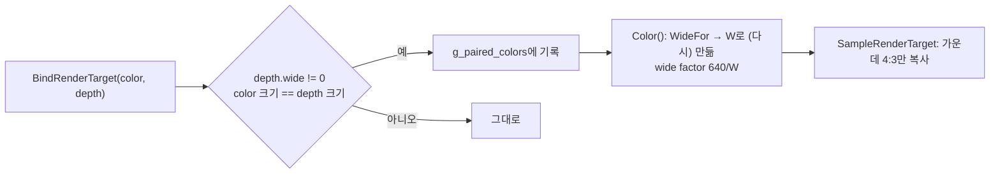
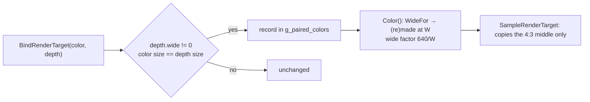

# 설계: Hor+에서 넓힌 깊이 스텐실과 함께 묶인 4:3 색 타깃 (issue #38)

상태: 설계. 소비자: reexec/reCT3#30. 이전 설계: reJSRF [i085 Hor+ 와이드스크린](https://github.com/nworkers/reJSRF/blob/main/docs/design/20261018-i085-widescreen-horplus.md)(이 저장소로 옮기기 전의 설계).

## 1. 요구사항

Crazy Taxi 3를 21:9로 밤에 운전하면 길 위에 검은 점 두 개가 택시 헤드라이트를 따라다닌다. 점은 헤드라이트에서 정확히 왼쪽으로 240 게스트 픽셀 떨어져 있다. 240은 21:9 백버퍼(1120)에서 가운데 4:3 그림이 시작되는 `(1120 − 640) / 2`다.

## 2. 확인한 것 (reCT3 캡처 프레임 7289, 21:9, 렌더 배율 4)

* 점은 구멍이다. 백버퍼를 지운 뒤 어떤 그리기도 그 픽셀의 색을 바꾸지 않았다. 길 그리기(z LESSEQUAL, 스텐실·알파 테스트 없음)가 그 자리에서 깊이 검사에 떨어졌다.
* 타이틀은 빛나는 물체(헤드라이트 등)를 640x480 텍스처 렌더 타깃에 깊이 쓰기를 켠 채 그린다. 이 그리기는 장면 그리기 사이사이에 끼어 있다(31건, 다섯 묶음). 그 뒤 320x240으로 줄이고, 그것을 백버퍼에 더한다.
* Hor+는 백버퍼와 깊이 스텐실만 넓힌다(W = 1120). 텍스처 타깃은 640 그대로이고, 그리기의 클립 x 배율은 색 타깃에서 오므로 1이다. GL은 한 framebuffer의 모든 첨부를 같은 픽셀 좌표로 다룬다. 그래서 4:3 x에 그린 깊이가 넓은 깊이 버퍼의 `x + (W − 640)/2`가 아니라 `x`에 들어가고, 이후 장면 그리기가 그 깊이에 가려진다. 텍스처 타깃 그리기도 장면 깊이의 엉뚱한 부분과 비교된다.
* **추정**(캡처가 그리기의 깊이 버퍼를 적지 않음): 텍스처 타깃과 묶인 깊이는 백버퍼의 깊이 스텐실이다. 깊이 없이 묶였다면 깊이 검사가 꺼지므로 구멍이 생길 수 없고, 넓혀진 깊이는 깊이 스텐실 종류뿐이다. 캡처 줄에 깊이 버퍼를 더해(§4.3) 확인한다.

## 3. 방안

| 방안 | 내용 | 판단 |
|---|---|---|
| A. 깊이 가운데 복사 | 묶일 때 넓은 깊이·스텐실의 가운데를 4:3 깊이로 복사해 쓰고, 풀릴 때 되돌린다 | 기각. 멀티샘플 깊이는 위치가 다른 사각형끼리 blit할 수 없다(GLES 3.0과 데스크톱 GL 모두 멀티샘플끼리는 같은 사각형만 허용). MSAA에서 쓸 수 없다 |
| **B. 그 색 타깃도 넓힌다** | 넓힌 깊이 스텐실과 같은 게스트 크기로 묶인 색 타깃은 백버퍼처럼 W로 넓힌다. 샘플링용 복사는 가운데 4:3만 가져간다 | **채택** |
| C. 따로 깊이를 준다 | 그런 색 타깃에 4:3 깊이를 따로 붙인다 | 기각. 장면 깊이와 비교하지 못해 빛나는 물체가 벽을 뚫고 보인다 |

방안 B가 안전한 이유: 넓힌 타깃의 가운데 4:3 영역은 Hor+ 원리(i085 §3.1)대로 4:3 그림과 같다. 타이틀이 그 타깃에서 읽는 것은 샘플링 복사뿐이고, 그것이 가운데만 가져가면 타이틀은 4:3 때와 같은 픽셀을 본다. 넓힌 깊이와 넓힌 색은 같은 좌표계를 쓰므로 깊이도 제자리에 들어간다. 양옆에 더 그려지는 것은 버려진다.

## 4. 구조

### 4.1 짝지은 색 타깃 (`d3d8_gl_targets.cpp`)

* `g_paired_colors`: 표면 메모리 → 게스트 크기. `BindRenderTarget`이 색 타깃과 깊이 타깃을 함께 묶을 때, 깊이 타깃이 넓혀졌고(`wide != 0`) 색 표면의 게스트 크기가 깊이와 같으면 그 색 메모리를 기록한다. 크기가 다르면 한 번 보고하고 그대로 둔다(이 프레임에는 없다).
* `WideFor(surface, width, height)`: 백버퍼, 깊이 스텐실, 그리고 같은 크기로 기록된 짝지은 색 메모리는 `WideWidth(aspect, height)`, 나머지는 0이다.
* 기록은 지우지 않는다. 그 메모리에 같은 크기의 다른 텍스처가 와서 넓혀져도, 아래 §4.2 때문에 타이틀이 보는 결과는 같다.
* 처음 짝지을 때 색 타깃은 넓게 다시 만들어진다. 이미 있는 다시 만들기 경로(배율·종횡비 변경)가 옛 픽셀을 새 크기로 늘려 옮긴다.

### 4.2 샘플링 복사 (`SampleRenderTarget`)

넓힌 타깃(백버퍼 포함)의 샘플링 복사는 `width × scale` 너비이고, 원본의 가운데 `[(GlWidth − width·scale)/2, +width·scale)`만 blit한다. 단일 샘플 색 blit이므로 위치가 달라도 된다(멀티샘플은 `ReadableFramebuffer`가 먼저 같은 사각형으로 resolve한다).

이것은 백버퍼 샘플링도 바꾼다. 지금은 넓은 그림 전체가 4:3 텍스처 크기로 눌려서 샘플된다. 앞으로는 타이틀이 기대하는 4:3 그림을 본다(i085 §3.5의 "백버퍼를 텍스처로 읽는 효과" 한계가 이 방향으로 바로잡힌다).

### 4.3 캡처 (`d3d8_capture.cpp`)

그리기 줄의 `rt …` 뒤에 `zs <깊이 표면 헤더>`(없으면 `-`)를 적는다.

### 4.4 바뀌지 않는 것

* 4:3에서는 아무것도 넓히지 않으므로 그대로다.
* 깊이 없이 묶이는 텍스처 타깃, 다른 크기의 타깃은 그대로다.
* 합성 사각형(텍스처가 있는 2D 사각형)은 가운데에 놓이므로, 양옆에는 글로우가 없다(i085의 알려진 한계 그대로).

## 5. 검증

* Win32 x86 Debug/Release 빌드 경고 0, `ctest`(probe 넷).
* reCT3: 21:9로 밤 운전 장면을 캡처해 `zs`로 짝을 확인하고, 검은 점이 없고 헤드라이트 글로우가 제자리에 있는지 본다. 4:3 프레임은 바뀌지 않는다(같은 데모 프레임 비교).
* reJSRF는 이 변경을 받을 때 데모 프레임으로 확인한다(이 작업에서는 reJSRF를 바꾸지 않는다).

---

# Design: a 4:3 color target bound with the widened depth stencil under Hor+ (issue #38)

Status: design. Consumer: reexec/reCT3#30. Earlier design: reJSRF [i085 Hor+ widescreen](https://github.com/nworkers/reJSRF/blob/main/docs/design/20261018-i085-widescreen-horplus.md) (made before the code moved to this repository).

## 1. Requirement

Driving Crazy Taxi 3 at night at 21:9, two black dots follow the taxi's headlights over the road, exactly 240 guest pixels to their left. 240 is `(1120 − 640) / 2`, where the 4:3 picture starts in a 21:9 back buffer (1120).

## 2. Findings (reCT3 capture of frame 7289, 21:9, render scale 4)

* The dots are holes: no draw changed those pixels after the back buffer's Clear. The road draw (z LESSEQUAL, no stencil or alpha test) failed the depth test there.
* The title draws its glow sources (the headlights and others) into a 640x480 texture render target with depth writes on, interleaved with the scene (31 draws in five runs), then shrinks that to 320x240 and adds it onto the back buffer.
* Hor+ widens only the back buffer and the depth stencil (W = 1120). The texture target stays 640, and the draw's clip x scale comes from the color target, so it is 1. GL addresses every attachment of a framebuffer with the same pixel coordinates, so depth drawn at 4:3 x lands at `x` in the widened depth buffer instead of `x + (W − 640)/2`, and later scene draws fail against it. The texture-target draws also test against the wrong part of the scene's depth.
* **Inferred** (captures do not record a draw's depth buffer): the depth bound with the texture target is the back buffer's depth stencil. Bound without depth, the depth test would be off and no holes could appear, and only depth-stencil surfaces are widened. The capture lines gain the depth buffer (§4.3) to confirm it.

## 3. Options

| Option | What | Decision |
|---|---|---|
| A. Copy the depth's middle | While bound, copy the widened depth/stencil's middle into a 4:3 depth and copy it back when unbound | Rejected. Multisample depth cannot be blitted between rectangles at different positions (GLES 3.0 and desktop GL both require identical rectangles between multisample buffers), so it fails with MSAA |
| **B. Widen that color target too** | A color target bound at the widened depth stencil's guest size is widened to W like a back buffer; its sampling copy takes only the 4:3 middle | **Chosen** |
| C. Give it its own depth | Attach a separate 4:3 depth to such a color target | Rejected. It cannot test against the scene's depth, so glow shows through walls |

Why B is safe: by the Hor+ principle (i085 §3.1) the middle 4:3 region of a widened target equals the 4:3 picture. The title reads such a target only through the sampling copy, and when that copy takes only the middle the title sees the pixels it saw at 4:3. Widened depth and widened color share one coordinate system, so depth lands in place too. What is drawn at the sides is discarded.

## 4. Structure

### 4.1 Paired color targets (`d3d8_gl_targets.cpp`)

* `g_paired_colors`: surface memory → guest size. When `BindRenderTarget` binds a color and a depth target together, the depth target is widened (`wide != 0`) and the color surface's guest size equals the depth's, it records the color memory. A different size is reported once and left alone (this frame has none).
* `WideFor(surface, width, height)`: `WideWidth(aspect, height)` for a back buffer, a depth stencil, and a paired color memory recorded at this size; 0 otherwise.
* Records are never removed. Another texture of the same size at that memory may be widened as well; by §4.2 the title sees the same result.
* The first pairing remakes the color target wide; the existing remake path (scale and aspect changes) stretches the old pixels into the new size.

### 4.2 The sampling copy (`SampleRenderTarget`)

For a widened target (back buffers included) the sampling copy is `width × scale` wide and blits only the source's middle `[(GlWidth − width·scale)/2, +width·scale)`. It is a single-sample color blit, so the positions may differ (`ReadableFramebuffer` first resolves a multisample target with identical rectangles).

This changes back-buffer sampling too: today the whole wide picture is squeezed into the 4:3 texture size when sampled; from now on the title sees the 4:3 picture it expects (i085 §3.5's limit on effects that read the back buffer is corrected in that direction).

### 4.3 Capture (`d3d8_capture.cpp`)

A draw line gains `zs <depth surface header>` (or `-`) after `rt …`.

### 4.4 Unchanged

* Nothing is widened at 4:3, so nothing changes there.
* Texture targets bound without depth, and targets of other sizes, stay as they are.
* The composite quad (a textured 2D quad) stays centered, so the sides get no glow (i085's known limit, unchanged).

## 5. Verification

* Win32 x86 Debug and Release builds with zero warnings, `ctest` (the four probes).
* reCT3: capture a night driving scene at 21:9, confirm the pairing through `zs`, and check that the dots are gone and the headlight glow is in place. 4:3 frames do not change (same demo frames compared).
* reJSRF checks its demo frames when it takes this change (this task does not change reJSRF).
