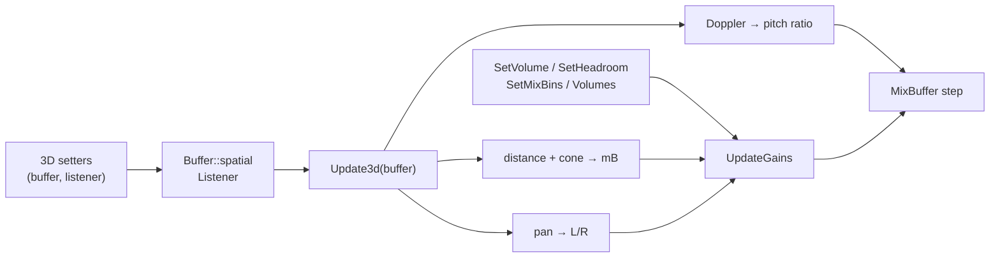

# 설계: DSOUND 음성 headroom과 3D 음성 (issue #40)

상태: 구현 중([작업 지시](../work-orders/20261102-i040-dsound-3d.md)). 소비자: reexec/reCT3#33. 이전 설계: reJSRF i017 §5·§7(3D와 headroom은 받기만 하고 소리에 반영하지 않음).

## 1. 요구사항

Crazy Taxi 3(XDK 4531)의 소리가 부자연스럽게 들린다. 데모 160초 동안의 호출 수와 인자(진단 빌드)는 다음과 같다.

| 기능 | 호출 | 값 |
|---|---|---|
| 3D 음성 | `SetPosition` 약 2,500회, `SetVelocity` 약 2,500회, `SetMode` 103회 | 음성 약 50개, 모드 `NORMAL`, 위치 ±1,300 단위, 리스너는 옮기지 않음 |
| 거리 | `SetMinDistance`·`SetMaxDistance`·버퍼 `SetRolloffFactor` 각 51회 | 최소 4.9, 최대 1e9, 버퍼 rolloff 0.1 |
| 리스너 | `SetRolloffFactor`, `SetDistanceFactor`, `SetDopplerFactor` 각 1회 | rolloff 0.1, 거리 계수 10 |
| cone | `SetConeAngles`, `SetConeOutsideVolume` 각 51회, `SetConeOrientation` 102회 | |
| headroom | 버퍼 `SetHeadroom` 75회 | 효과음 600, 음악 0 |

지금 믹서에서는 3D 음성이 모두 가운데에서 최대 음량으로 들린다. headroom은 기록만 하므로 효과음이 Xbox보다 6 dB 크다.

## 2. 원본에서 확인한 것 (CT3에 정적 링크된 XDK 4531 DSOUND, 디스어셈블)

* **headroom**(**확인됨**): `CDirectSoundVoice_SetVolume`(`00105B72`)은 `volume − headroom`을 저장한다. `CDirectSoundVoice_SetHeadroom`(`00105BA1`)은 저장한 음량을 headroom 변화만큼 옮긴다. 버퍼를 만들 때(`00107696`) headroom은 `MIXIN|FXIN`(`0x82000`)이면 0, `CTRL3D`(`0x10`)이면 0, 그 밖(2D)이면 600이다.
* **거리 감쇠**(**확인됨**, `001082E7`): 거리 `d`가 최소 거리 이하이면 0 mB. 최대 거리를 넘으면 최대 거리로 자른다. 그 밖에는 `−2000 · log10(1 + R · (d / min − 1))` mB(`00108057`: `-2000`, `fldlg2`/`fyl2x`). rolloff 곡선이 있으면 곡선이 대신한다(CT3는 쓰지 않음).
* **R = 리스너 rolloff × 버퍼 rolloff**(**추정**, 강함): 감쇠 식은 버퍼 rolloff(`+0x44`)에 리스너 쪽 값 하나를 곱한다. 리스너 `SetRolloffFactor`(`+0x6C`)와 버퍼 `SetRolloffFactor`, `SetMin/MaxDistance`는 모두 같은 재계산 비트(4)를 세운다. 거리 계수(`+0x68`)와 도플러 계수(`+0x70`)는 다른 비트(0x60, 0x40)를 세운다.
* **모드**(**확인됨**, `001082BC`): `DS3DMODE_HEADRELATIVE`(1)이면 리스너 위치를 빼지 않는다.
* 패닝은 원본이 HRTF 필터 쌍(`CFullHrtfSource_GetHrtfFilterPair`)으로 만든다. 도플러와 cone의 정확한 식은 이번에 확인하지 않았다.

## 3. 설계

* **headroom**: `Buffer::headroom`의 기본값을 원본처럼 정한다(2D 600, 3D·submix 0). 이득은 `volume − headroom`(−10000에서 자름)으로 계산한다. `SetHeadroom`은 값을 바꾸고 이득을 다시 계산한다.
* **3D 상태**: `CTRL3D` 버퍼는 위치, 속도, cone(안·바깥 각, 방향, 바깥 음량), 최소·최대 거리, rolloff, 도플러 계수, 모드를 가진다. 리스너는 위치, 속도, 앞·위 방향, 거리 계수, 도플러 계수, rolloff를 가진다. 기본값은 DirectSound 3D의 것(최소 1, 최대 1e9, 계수 1, cone 360°, 앞 (0,0,1), 위 (0,1,0)).
* **적용 시점**: 설정은 값을 바로 저장하고 다시 계산한다. `DS3D_DEFERRED`도 바로 적용한다. `CommitDeferredSettings`는 모든 3D 버퍼를 다시 계산한다. 리스너 설정은 모든 3D 버퍼를 다시 계산한다. 원본과 같은 프레임 안에서 적용 시점만 다를 수 있다.
* **거리 감쇠**: §2의 식(`R = 리스너 × 버퍼`).
* **cone**: DirectSound 3D 정의. 음원에서 리스너로 가는 방향과 cone 방향의 각이 안쪽 각의 절반 이하이면 0 mB, 바깥 각의 절반 이상이면 바깥 음량이다. 그 사이는 mB로 선형 보간한다. 두 각이 모두 360°이면 계산하지 않는다(**추정**: 원본 식은 확인하지 않음).
* **패닝**(근사): 리스너 기준 방향 벡터를 오른쪽 축(위 × 앞, 왼손 좌표)에 투영해 `p ∈ [−1, 1]`를 얻는다. 균형 법칙 `L = min(1, 1 − p)`, `R = min(1, 1 + p)`로 나눈다. 가운데는 지금처럼 양쪽 1이다. HRTF(앞뒤, 높이, ITD)는 다루지 않는다.
* **도플러**(**추정**: DirectSound 정의): `f' = f · (c + vL·u) / (c + vS·u)`. `u`는 리스너에서 음원으로 가는 단위 벡터, `c = 343.3 m/s ÷ 거리 계수`(단위/초)다. 속도에는 리스너와 버퍼의 도플러 계수를 곱한다. 비는 0.5~2로 자른다. 믹서의 재생 간격(step)에 곱한다.
* **믹스 빈과의 결합**: 3D 음성은 모노 음원으로 본다. 믹스 빈(또는 기본값)에서 얻은 좌우 이득의 평균을 기본 이득으로 삼고, 여기에 거리·cone 감쇠와 패닝을 곱한다. 효과 송신(I3DL2, FXSEND)은 지금처럼 소리 내지 않는다.

### 하지 않는 것

HRTF 필터와 ITD, I3DL2 리버브, rolloff 곡선, `SetAllParameters`(구조체 배치 미확인), 버퍼 거리 계수, 이득 변화의 램프(설정이 프레임마다 바뀌어 작은 계단 소리가 날 수 있다), EG·LFO·필터.

## 4. 검증

| 검증 | 기대 |
|---|---|
| dsound probe | headroom 기본값(2D 600, 3D 0)과 `SetHeadroom`, 최소 거리 안 0 dB, 거리 감쇠 식, 최대 거리 자름, 좌우 패닝, head-relative, cone, 도플러 비 |
| Win32·Linux 빌드, CTest | 경고 0, 통과 |
| CT3 데모·플레이 | 멀리 있는 차 소리가 작아지고 좌우로 갈림. 효과음이 6 dB 작아짐 |

---

# Design: DSOUND voice headroom and 3D voices (issue #40)

Status: in progress ([work order](../work-orders/20261102-i040-dsound-3d.md)). Consumer: reexec/reCT3#33. Earlier design: reJSRF i017 sections 5 and 7 (3D and headroom accepted but not rendered).

## 1. Requirement

Crazy Taxi 3 (XDK 4531) sounds unnatural. Over 160 s of its demo (a diagnostic build) it makes about 2,500 `SetPosition` and 2,500 `SetVelocity` calls on about 50 3D voices in `NORMAL` mode, positions over ±1,300 units with the listener never moved; min distance 4.9, max 1e9, buffer rolloff 0.1 (51 voices); listener rolloff 0.1 and distance factor 10; cones on 51 voices; buffer headroom 600 on effects and 0 on the music. Today every 3D voice plays centered at full volume, and the effects are 6 dB louder than on the Xbox.

## 2. Confirmed in the original (CT3's statically linked XDK 4531 DSOUND, disassembly)

Headroom (**confirmed**): `CDirectSoundVoice_SetVolume` (`00105B72`) stores `volume − headroom`, `CDirectSoundVoice_SetHeadroom` (`00105BA1`) moves the stored volume by the change, and buffer creation (`00107696`) sets headroom 0 for `MIXIN|FXIN` (`0x82000`), 0 for `CTRL3D` (`0x10`), else (2D) 600. Distance attenuation (**confirmed**, `001082E7`): 0 mB at or below min distance, the distance clamped to max, else `−2000 · log10(1 + R · (d / min − 1))` mB (`00108057`), a rolloff curve replacing it when set (CT3 sets none). `R` = listener rolloff × buffer rolloff (**inferred**, strongly): the formula multiplies the buffer rolloff (`+0x44`) by one listener value, and the listener `SetRolloffFactor` (`+0x6C`), the buffer `SetRolloffFactor` and `SetMin/MaxDistance` all set the same recompute bit (4), while the distance factor (`+0x68`) and the Doppler factor (`+0x70`) set others (0x60, 0x40). Mode (**confirmed**, `001082BC`): `DS3DMODE_HEADRELATIVE` (1) skips subtracting the listener position. The original pans through HRTF filter pairs (`CFullHrtfSource_GetHrtfFilterPair`); its Doppler and cone formulas were not checked this time.

## 3. Design

As the diagram above shows. Headroom gets the original defaults (2D 600, 3D and submix 0), the gain uses `volume − headroom` (clamped at −10000), and `SetHeadroom` stores and re-derives. `CTRL3D` buffers carry position, velocity, cone (inside and outside angles, orientation, outside volume), min and max distance, rolloff, Doppler factor and mode; the listener carries position, velocity, front and top, distance factor, Doppler factor and rolloff; defaults are DirectSound 3D's (min 1, max 1e9, factors 1, cones 360°, front (0,0,1), top (0,1,0)). Settings are stored and applied at once, `DS3D_DEFERRED` included; `CommitDeferredSettings` and any listener setting recompute every 3D buffer (only the moment within the frame can differ from the original). Distance attenuation follows section 2 (`R` = listener × buffer). Cone: DirectSound 3D's definition, 0 mB within half the inside angle, the outside volume beyond half the outside angle, mB interpolated linearly between, skipped when both angles are 360° (**inferred**; the original formula unchecked). Panning (an approximation): the listener-relative direction projected on the right axis (top × front, left-handed) gives `p ∈ [−1, 1]`, split by the balance law `L = min(1, 1 − p)`, `R = min(1, 1 + p)`, so the center stays at 1 on both sides; HRTF (front/back, elevation, ITD) is not modeled. Doppler (**inferred**, DirectSound's definition): `f' = f · (c + vL·u) / (c + vS·u)`, `u` the unit vector from listener to source, `c = 343.3 m/s ÷ distance factor` in units per second, velocities scaled by the listener and buffer Doppler factors, the ratio clamped to 0.5–2 and applied to the mixer's step. A 3D voice is treated as a mono source: the mean of the left and right gains from its mix bins (or the defaults) is its base gain, times the distance and cone attenuation and the pan; effect sends (I3DL2, FXSEND) stay silent.

Not done: HRTF filters and ITD, I3DL2 reverb, rolloff curves, `SetAllParameters` (structure layout unconfirmed), buffer distance factors, gain ramps (settings change every frame, so small steps may be audible), EG, LFO and filters.

## 4. Verification

The dsound probe checks the headroom defaults (2D 600, 3D 0) and `SetHeadroom`, 0 dB inside the min distance, the attenuation formula, the max-distance clamp, left and right panning, head-relative mode, the cone and the Doppler ratio; Win32 and Linux build with 0 warnings and pass CTest; in CT3's demo and play, distant cars get quieter and split left and right, and the effects drop by 6 dB.
