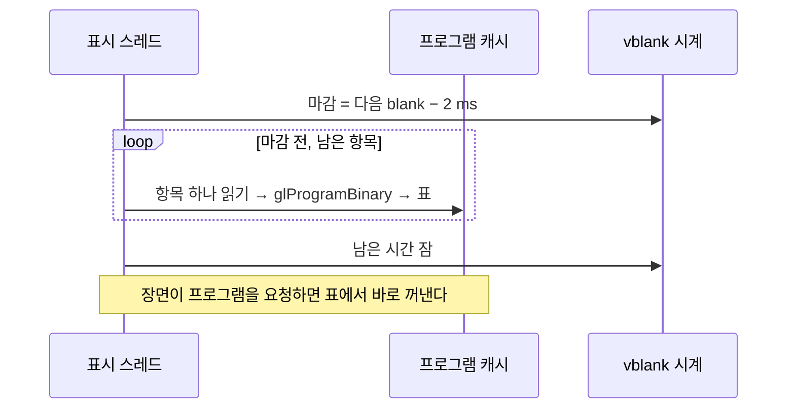

# 설계: 프로그램 캐시를 vblank 대기 시간에 미리 올린다 (issue #23, 2차)

상태: 설계. 소비자: reexec/reCT3#20. 이전 설계: [i023 그리기 CPU 비용](20261021-i023-draw-cpu-cost.md). 프로그램 캐시: reJSRF 설계 i051(이 저장소로 옮기기 전, `d3d8_gl_program_cache.h` 머리 주석).

## 1. 요구사항

Crazy Taxi 3 운전이 시작되는 몇 초 동안 50~120 ms 프레임이 몇 개 생긴다. 꾸준한 운전은 60 fps다(Ryzen 5 5600X, RTX 4090, Win32 x86 Release).

## 2. 확인한 것 (`REXBOX_D3D8_SLOW_FRAME=25`, 프레임별 텍스처·프로그램 시간)

| 프레임 | 길이 | 텍스처 | 프로그램 |
|---|---|---|---|
| 운전 시작 | 115 ms | 112개 54 ms | 25개 21 ms |
| +17 | 52 ms | 15개 16 ms | 6개 13 ms |
| +27 | 56 ms | 8개 0.3 ms | 22개 28 ms |

* 실행할 때마다 같은 프로그램이 디스크 캐시에서 다시 만들어진다. 캐시에서 불러와도 하나에 1~2 ms다(파일 읽기, `glProgramBinary`, 링크 상태 확인).
* 캐시 디렉터리에는 항목이 1301개(29 MB) 있다. 셰이더 소스가 바뀐 예전 버전의 항목이 남아 있어서다. 전부를 시작할 때 한꺼번에 올리면 부팅이 1초 넘게 멈춘다.
* 60 fps에서 표시 스레드는 프레임마다 약 11 ms를 vblank를 기다리며 잔다(`wait`).

## 3. 설계

### 3.1 미리 올리기 (`d3d8_gl_program_cache.cpp`)

* `WarmProgramCache(deadline)`: 처음 부를 때 캐시 디렉터리의 항목 목록을 만든다. 최근에 쓴 순서(파일 수정 시각 내림차순)로 정렬하고, 최대 `REXBOX_SHADER_WARM`개(기본 1024, 0이면 끔)만 둔다. 그 뒤 `deadline` 전까지 항목을 하나씩 읽어 프로그램을 만들고, 미리 올린 표에 둔다. 다음 항목이 끝나기 전에 `deadline`을 넘길 것 같으면 멈춘다(지금까지 가장 오래 걸린 항목 시간으로 추정).
* 미리 올린 표: 항목 이름(드라이버·소스 해시) → 프로그램과 소스 확인값. 확인값은 파일의 정점·조각 소스로 계산한 두 번째 해시(다른 시드)다. 드라이버가 다르거나 링크가 안 되는 항목은 건너뛴다.
* `LoadCachedProgram`: 먼저 표에서 이름을 찾고, 확인값이 같으면 그 프로그램을 돌려주고 표에서 뺀다. 없으면 지금처럼 파일에서 읽는다.
* 쓰인 항목(표에서 꺼냈거나 파일에서 읽음)은 파일 수정 시각을 지금으로 바꾼다. 그래서 다음 실행에서 앞에 온다. 쓰이지 않는 예전 항목은 뒤로 밀려 상한 밖으로 빠진다.

### 3.2 언제 (`d3d8_device.cpp`, `d3d8_vblank.*`)

* 표시 스레드(`D3DDevice_Swap`을 부르는 스레드, GL 문맥이 있는 곳)가 vblank를 기다리기 직전에만 한다.
  * `D3DDevice_Swap`: present 대기 전. 마감은 `QueuedPresentTime()`(이전 present가 보이는 blank)에서 여유 2 ms를 뺀 시각이다.
  * `D3DDevice_BlockUntilVerticalBlank`: 표시 스레드가 부를 때만. 마감은 `NextVerticalBlankTime()`에서 2 ms를 뺀 시각이다.
* 기다릴 시간이 없는 프레임(이미 늦음)에서는 아무것도 하지 않는다. 그래서 프레임 시간을 늘리지 않는다.
* 시간은 프로파일의 `wait`에 들어간다. 프로파일의 프로그램 줄에 미리 올린 수와 시간을 더한다.

## 4. 바뀌지 않는 것

* 프로그램을 만드는 규칙과 캐시 파일 형식은 그대로다. `REXBOX_SHADER_CACHE=0`이면 미리 올리기도 없다.
* 캐시에 없는 프로그램(처음 실행, 소스 변경)은 지금처럼 장면에서 컴파일된다.

## 5. 검증

* Win32 x86 Release 경고 0, `ctest`.
* reCT3 운전 진입을 `REXBOX_SHADER_WARM=0`과 기본값으로 번갈아 실행해, 운전 시작의 긴 프레임에서 프로그램 시간과 프레임 길이를 비교한다. 꾸준한 운전의 fps와 `wait`가 같은지 본다.
* 그림: 운전 프레임 덤프가 같은 장면에서 같은지 본다.

---

# Design: warm the program cache in the vertical-blank wait (issue #23, second pass)

Status: design. Consumer: reexec/reCT3#20. Earlier design: [i023 draw CPU cost](20261021-i023-draw-cpu-cost.md). Program cache: reJSRF design i051 (before the move to this repository; the head comment of `d3d8_gl_program_cache.h`).

## 1. Requirement

For a few seconds after Crazy Taxi 3 starts driving, a few frames take 50–120 ms. Steady driving runs at 60 fps (Ryzen 5 5600X, RTX 4090, Win32 x86 Release).

## 2. Findings (`REXBOX_D3D8_SLOW_FRAME=25`, per-frame texture and program times)

| Frame | Length | Textures | Programs |
|---|---|---|---|
| driving starts | 115 ms | 112, 54 ms | 25, 21 ms |
| +17 | 52 ms | 15, 16 ms | 6, 13 ms |
| +27 | 56 ms | 8, 0.3 ms | 22, 28 ms |

* Every run makes the same programs again from the disk cache, at 1–2 ms each even from the cache (reading the file, `glProgramBinary`, the link-status check).
* The cache directory holds 1301 entries (29 MB), including entries of earlier versions whose shader sources changed. Making all of them at start would stall the boot for over a second.
* At 60 fps the presenting thread sleeps about 11 ms per frame waiting for the vertical blank (`wait`).

## 3. Design

### 3.1 Warming (`d3d8_gl_program_cache.cpp`)

* `WarmProgramCache(deadline)`: the first call lists the cache directory's entries, most recently used first (file modification time, descending), keeping at most `REXBOX_SHADER_WARM` (default 1024, 0 turns warming off). Until `deadline` it then reads entries one at a time, makes their programs and keeps them in a warm table. It stops when the next entry would likely end past `deadline` (estimated from the longest entry so far).
* Warm table: entry name (the driver and source hash) → program and a source check, a second hash (another seed) of the file's vertex and fragment sources. Entries of another driver, or that do not link, are skipped.
* `LoadCachedProgram` looks the name up first and, when the check matches, returns that program and removes it from the table; otherwise it reads the file as now.
* A used entry (taken from the table or read from its file) has its file's modification time set to now, so the next run warms it early; unused old entries move back and fall past the limit.

### 3.2 When (`d3d8_device.cpp`, `d3d8_vblank.*`)

* Only on the presenting thread (the one calling `D3DDevice_Swap`, which holds the GL context), right before it waits for a vertical blank:
  * `D3DDevice_Swap`, before the present wait, with the deadline `QueuedPresentTime()` (the blank that shows the previous present) less a 2 ms margin;
  * `D3DDevice_BlockUntilVerticalBlank` when the presenting thread calls it, with the deadline `NextVerticalBlankTime()` less 2 ms.
* A frame with no time to wait (already late) does nothing, so frame times do not grow.
* The time counts in the profile's `wait`; the profile's program line adds the number warmed and their time.

(The sequence diagram above applies.)

## 4. Unchanged

* How programs are made and the cache file format stay as they are; with `REXBOX_SHADER_CACHE=0` there is no warming either.
* Programs not in the cache (a first run, changed sources) are compiled in the scene as now.

## 5. Verification

* Win32 x86 Release with 0 warnings, `ctest`.
* reCT3's drive into gameplay with `REXBOX_SHADER_WARM=0` and the default in alternating runs, comparing the program time and length of the long frames at the start of driving, and the fps and `wait` of steady driving.
* Pictures: driving frame dumps match in matching scenes.
