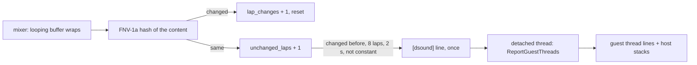

# 설계: 다시 채워지지 않는 스트림 루프 버퍼 보고 (issue #43)

상태: 구현됨([작업 지시](../work-orders/20261103-i043-stream-stall-report.md), [작업 로그](../work-logs/20261103-i043-stream-stall-report.md)). 소비자: reexec/reCT3#29.

## 1. 요구사항

Crazy Taxi 3의 ADX 음악이 플레이 중 0.34초 구간을 계속 반복한다. 스트림을 채우던 타이틀 코드가 DirectSound 루프 버퍼를 더 쓰지 않는데 버퍼는 계속 돌아서다(reCT3 작업 로그 i029, **확인됨**). 자주 재현되므로, 진단 빌드가 아니라 평소 실행 로그에서 근거를 얻고 싶다. 기본으로 켜져 있고 비용이 거의 없어야 하며, 정적 루프(엔진음 등)와 곡 사이 무음에는 보고하지 않아야 한다.

## 2. 설계

* **감시 대상**: 16 KiB 이상인 루프 버퍼. 바퀴(루프 끝을 넘어 감길 때)마다 내용 해시(FNV-1a)를 낸다. 64 KiB 버퍼면 0.34초에 한 번이다.
* **보고 조건**: `Play` 뒤 해시가 두 번 이상 바뀐 적이 있고(스트림. 정적 루프는 바뀌지 않음), 그 뒤 8바퀴 이상, 2초 이상 같으며, 내용이 한 프레임의 반복(무음 채움)이 아닐 때 한 번. 내용이 다시 바뀌면 그 사실을 한 줄로 알리고 다시 감시한다.
* **보고**: `[dsound] buffer <객체> (<바이트>, <Hz>, <ch>) has replayed the same <초> s for <n> laps: its writer stopped`. 이어서 분리한 스레드가 `runtime::ReportGuestThreads`를 부른다. 오디오 콜백은 기다리지 않는다.
* **`ReportGuestThreads`**(runtime): 정지 보고와 같은 스레드 줄, `REXBOX_STALL_DUMP`, 그리고 플랫폼이 할 수 있으면 게스트 스레드마다 호스트 콜스택. 정지 보고(present 정지)도 같은 출력을 쓴다.
* **플랫폼 계약 `stack_report.h`**: `RegisterStackReportThread(name)`(스레드가 자기를 등록, `NoteThreadName`이 부름), `PrintThreadStacks()`. Linux는 SIGUSR2를 한 스레드씩 보내고 처리기에서 `backtrace_symbols_fd`로 stderr에 쓴다. `backtrace`는 등록할 때 한 번 미리 불러 libgcc를 올려 둔다. Win32는 아직 없음(false).

### 하지 않는 것

Win32의 콜스택(다른 스레드의 스택은 `SuspendThread`와 스택 워크가 필요), 원인 자체의 수정(reCT3#29).

## 3. 검증

빌드·CTest. reCT3 데모 160초: 정적 루프와 무음에 보고 없음, 48 kHz 음악 버퍼가 멈춘 순간 보고 한 번, 스레드 줄과 호스트 콜스택.

---

# Design: reporting a streamed loop buffer no longer refilled (issue #43)

Status: implemented ([work order](../work-orders/20261103-i043-stream-stall-report.md), [work log](../work-logs/20261103-i043-stream-stall-report.md)). Consumer: reexec/reCT3#29.

Requirement: Crazy Taxi 3's ADX music repeats a 0.34 s stretch during play because the title code that fed the stream stops writing the DirectSound loop buffer while the buffer keeps playing (reCT3 work log i029, **confirmed**). It recurs often, so evidence is wanted from ordinary runs rather than diagnostic builds: on by default, nearly free, and silent for static loops (engine sounds) and silence between tracks.

Design (diagram above): looping buffers of 16 KiB or more are hashed (FNV-1a) at each lap, once per 0.34 s for 64 KiB. A buffer whose hash has changed at least twice since `Play` (a stream; static loops never change) and then stays the same for 8 laps and 2 s, with content that is not one frame repeated (silence fill), is reported once: `[dsound] buffer <object> (<bytes>, <Hz>, <ch>) has replayed the same <s> s for <n> laps: its writer stopped`; a later change is announced in one line and watching resumes. A detached thread then calls `runtime::ReportGuestThreads`, so the audio callback never waits; it prints the stall report's thread lines, honors `REXBOX_STALL_DUMP`, and adds each guest thread's host call stack where the platform can, and the present-stall report now uses the same output. The platform contract `stack_report.h` has `RegisterStackReportThread(name)` (each thread registers itself; `NoteThreadName` calls it) and `PrintThreadStacks()`: on Linux each thread gets SIGUSR2 in turn and its handler writes `backtrace_symbols_fd` to stderr, `backtrace` being called once at registration to load libgcc beforehand; Win32 has none yet (false). Not done: Win32 stacks (another thread's stack needs `SuspendThread` and a stack walk), and the cause itself (reCT3#29).

Verification: build and CTest; a 160 s reCT3 demo: no report for static loops and silence, one report when the 48 kHz music buffer stops, with thread lines and host stacks.
