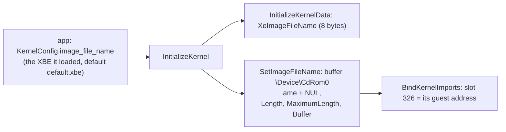

# 설계: 커널 데이터 export `XeImageFileName` (issue #49)

상태: 구현됨([작업 지시](../work-orders/20261103-i049-xe-image-file-name.md), [작업 로그](../work-logs/20261103-i049-xe-image-file-name.md)). 소비자: reexec/reEXCEED#4.

## 1. 요구사항

Pump It Up: Exceed(XDK 5849)는 커널 import 326 `XeImageFileName`을 쓴다. 커널 HLE에 이 데이터 export가 없어 thunk 슬롯에 바인딩되지 않은 합성 VA(`0xFE000518`)가 남는다. XAPI 시작 코드(타이틀의 `0x0008723B`)는 `\??\D:` 링크를 푼 뒤 이것을 `ANSI_STRING {USHORT Length, MaximumLength; PCHAR Buffer}`로 읽어 실행 중인 이미지 경로와 D: 대상을 비교하고, 거기서 타이틀 디렉터리를 얻는다. 지금은 게스트 RAM 밖을 읽어 fault한다(**확인됨**, reEXCEED 작업 로그 i004).

## 2. 설계

* `XeImageFileName`을 데이터 export 표에 더한다(크기 8, `ANSI_STRING`).
* 내용은 실행 중인 XBE의 DVD 장치 경로 `\Device\CdRom0\<파일 이름>`이다. 실기의 값과 같은 형식이다(**추정**: 실기 덤프로 확인하지 않음, 형식은 XAPI가 D: 링크 대상 `\Device\CdRom0`과 접두어 비교하는 코드로 확인).
* 파일 이름은 앱만 안다(`--xbe`). `KernelConfig`에 `image_file_name`(기본 `default.xbe`)을 더한다. 기본값이 있으므로 기존 소비자(reJSRF, reCT3)는 바꾸지 않아도 된다.
* 문자열 버퍼는 커널 데이터와 같이 게스트 힙에서 0으로 채워 할당한다. `Length`는 NUL을 빼고, `MaximumLength`는 NUL을 포함한다.
* 검증용 공개 함수 `DataExportAddress(name)`을 `kernel_hle.h`에 더한다(없으면 0). 앱의 진단에도 쓸 수 있다.

## 3. 검증

* kernel probe: `XeImageFileName`의 주소가 0이 아니고, `Length`/`MaximumLength`/`Buffer` 문자열이 `\Device\CdRom0\default.xbe`와 같다.
* reEXCEED: 시작 코드가 fault 없이 이 지점을 지난다.

---

# Design: the kernel data export `XeImageFileName` (issue #49)

Status: implemented ([work order](../work-orders/20261103-i049-xe-image-file-name.md), [work log](../work-logs/20261103-i049-xe-image-file-name.md)). Consumer: reexec/reEXCEED#4.

## 1. Requirements

Pump It Up: Exceed (XDK 5849) imports kernel ordinal 326, `XeImageFileName`. The kernel HLE has no such data export, so its thunk slot keeps the unbound synthetic VA (`0xFE000518`). XAPI's start-up (the title's `0x0008723B`) resolves the `\??\D:` link and then reads it as an `ANSI_STRING {USHORT Length, MaximumLength; PCHAR Buffer}` to compare the running image's path with the D: target and take the title's directory from it; today it reads outside guest RAM and faults (**confirmed**, reEXCEED work log i004).

## 2. Design

The diagram above applies. `XeImageFileName` joins the data export table (8 bytes, an `ANSI_STRING`). Its content is the running XBE's path on the DVD device, `\Device\CdRom0\<file name>`, the format of the real kernel's (**inferred**: not checked against a console dump; the format follows from XAPI's prefix comparison with the D: target `\Device\CdRom0`). Only the app knows the file name (`--xbe`), so `KernelConfig` gains `image_file_name` (default `default.xbe`); existing consumers (reJSRF, reCT3) need no change. The string buffer is zero-filled guest heap like the other kernel data; `Length` excludes the NUL and `MaximumLength` includes it. A public `DataExportAddress(name)` in `kernel_hle.h` (0 when unknown) serves the check and app diagnostics.

## 3. Verification

The kernel probe checks that `XeImageFileName` has an address and that its `Length`, `MaximumLength` and `Buffer` spell `\Device\CdRom0\default.xbe`; in reEXCEED the start-up passes this point without a fault.
