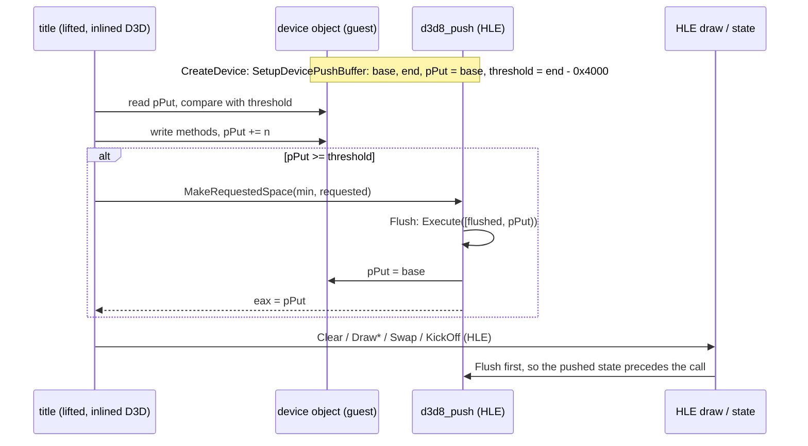

# 설계: 타이틀이 직접 쓰는 디바이스 푸시 버퍼 (issue #51)

상태: **1단계 구현됨**(버퍼, 공간 확보, flush, 기존 메서드 해석). 작업 지시: [20261103-i051](../work-orders/20261103-i051-device-push-buffer.md) · 작업 로그: [20261103-i051](../work-logs/20261103-i051-device-push-buffer.md). 소비자: reexec/reEXCEED#4. 선행: [i007 푸시 버퍼](20261020-i007-push-buffer.md), [i050 LTCG 변형](20261103-i050-d3d8-ltcg-variants.md).

## 1. 요구사항

Pump It Up: Exceed(XDK 5849, D3D8LTCG)는 D3D 호출이 게임 코드에 인라인되어, 게임 함수 7개와 식별되지 않은 D3D 내부 함수들이 NV2A 메서드를 디바이스의 푸시 버퍼에 직접 쓴다. HLE 디바이스에는 푸시 버퍼가 없어 부팅이 `D3D_MakeRequestedSpace_4__LTCG_eax2`에서 멈추고, 그 너머에서도 타이틀이 쓴 명령은 GPU 상태에 닿지 않는다. 소비자는 rexbox가 디바이스 푸시 버퍼를 해석하는 방향을 골랐다(NV2A 하드웨어 LLE나 타이틀 쪽 디컴파일 대신).

## 2. 타이틀이 기대하는 것 (Exceed에서 확인)

| 디바이스 필드 | 쓰임 | 상태 |
|---|---|---|
| `+0x00` | 쓰기 포인터 `pPut`. 타이틀이 메서드를 쓰고 전진시킨다 | **확인됨**(`000765E0`, `00179470`) |
| `+0x04` | 한계. `pPut < [+4]`이면 공간 확보 없이 쓴다 | **확인됨** |
| `+0x08` | 플래그. bit 2가 켜지면 `MakeRequestedSpace`가 `+0x764` 쪽(녹화 버퍼로 **추정**)을 쓴다 | **확인됨**(분기), 의미는 추정 |
| `+0x24`, `+0x28` | 버퍼 시작과 끝 | **확인됨** |
| `+0x30` | GPU의 읽기 위치를 가리키는 포인터 | **확인됨**(읽기만) |
| `MakeRequestedSpace_4__LTCG_eax2` | 스택 = MinimumSpace(바이트), eax = RequestedSpace(바이트), `ret 4`, 결과 eax = 새 `pPut` | **확인됨**(호출 지점의 `[0x186C30] >> 1`과 `[0x186C30]`) |

* 원래 라이브러리는 `MakeRequestedSpace`에서 GPU가 따라오기를 기다리고 버퍼를 감는다(`+0x40`, `+0x44`). HLE에는 GPU가 없으니 그 자리에서 해석하면 된다.

## 3. 설계

* 버퍼: 디바이스마다 게스트 힙 512 KiB(라이브러리 기본값 `0x80000`과 같음). 한계는 끝 − 16 KiB(라이브러리의 `+0x4000` 여유와 같은 크기).
* flush: `[flushed, pPut)`를 i007의 `Execute`로 해석하고 `flushed = pPut`. `pPut`이 버퍼 밖이거나 `flushed`보다 작으면(감김) 보고하고 `flushed`를 맞춘다.
* flush 지점: `MakeRequestedSpace`, `KickOff`, `Swap`, `Clear`, `Draw*`, `BeginPush`, `EndPush`. 타이틀이 쓴 상태와 HLE 호출의 상태가 그리기 전에 같은 순서가 된다. 그리기 사이에 같은 상태를 HLE 호출과 푸시 버퍼가 번갈아 바꾸면 순서가 어긋날 수 있다(**미확정**, 관측되면 다시 본다).
* 해석기가 모르는 메서드는 지금처럼 메서드마다 한 번 보고하고 건너뛴다. NV2A Kelvin 메서드 → HLE 렌더 상태 매핑은 타이틀이 실제로 쓰는 메서드를 보며 다음 단계에서 더한다.
* 녹화(`+0x08` bit 2)는 다루지 않는다. 켜지면 보고한다(다음 단계).

## 4. 검증

* probe·CTest 그대로 통과.
* reEXCEED: `MakeRequestedSpace`를 지나 다음 정지점으로 가고, 해석하지 않은 메서드 목록이 보고된다.

---

# Design: the device push buffer the title writes itself (issue #51)

Status: **stage 1 implemented** (the buffer, making room, flushes, the existing method interpreter). Work order: [20261103-i051](../work-orders/20261103-i051-device-push-buffer.md) · Work log: [20261103-i051](../work-logs/20261103-i051-device-push-buffer.md). Consumer: reexec/reEXCEED#4. Before: [i007 push buffer](20261020-i007-push-buffer.md), [i050 LTCG variants](20261103-i050-d3d8-ltcg-variants.md).

## 1. Requirements

In Pump It Up: Exceed (XDK 5849, D3D8LTCG) D3D calls are inlined into game code, so seven game functions and unidentified D3D internals write NV2A methods straight into the device's push buffer. The HLE device has none, so the boot stops at `D3D_MakeRequestedSpace_4__LTCG_eax2`, and past it nothing the title writes would reach the GPU state. The consumer chose to have rexbox interpret the device push buffer (rather than NV2A hardware LLE or title-side decompilation).

## 2. What the title expects (checked in Exceed)

As in the table above: `+0x00` is the write pointer `pPut` the title writes through and advances; `+0x04` the threshold below which it writes without making room; `+0x08` flags, bit 2 sending `MakeRequestedSpace` to `+0x764` (a recording buffer, **inferred**); `+0x24` and `+0x28` the buffer's base and end; `+0x30` a pointer to the GPU's read position (read only). `MakeRequestedSpace_4__LTCG_eax2` takes MinimumSpace (bytes) on the stack and RequestedSpace (bytes) in eax, pops 4 bytes and returns the new `pPut` in eax (**confirmed** from the call site's `[0x186C30] >> 1` and `[0x186C30]`). The library waits there for the GPU and wraps the buffer (`+0x40`, `+0x44`); with no GPU, the HLE interprets on the spot.

## 3. Design

The sequence above applies. Each device gets 512 KiB of guest heap (the library default `0x80000`) with the threshold 16 KiB before the end (the library's `+0x4000` margin). A flush interprets `[flushed, pPut)` with i007's `Execute` and sets `flushed = pPut`; a `pPut` outside the buffer or below `flushed` (a wrap) is reported and `flushed` realigned. Flushes happen at `MakeRequestedSpace`, `KickOff`, `Swap`, `Clear`, `Draw*`, `BeginPush` and `EndPush`, so the state the title pushed and the state HLE calls set reach a draw in order; a state changed alternately by HLE calls and pushes between two draws could still be applied out of order (**unresolved**, revisited if seen). Unknown methods are reported once each and skipped as now; mapping NV2A Kelvin methods onto the HLE render state comes next, driven by the methods the title actually writes. Recording (`+0x08` bit 2) is not handled; it is reported when on (next stage).

## 4. Verification

The probes and CTest pass unchanged; in reEXCEED the run passes `MakeRequestedSpace` to its next stop, and the methods left uninterpreted are reported.
