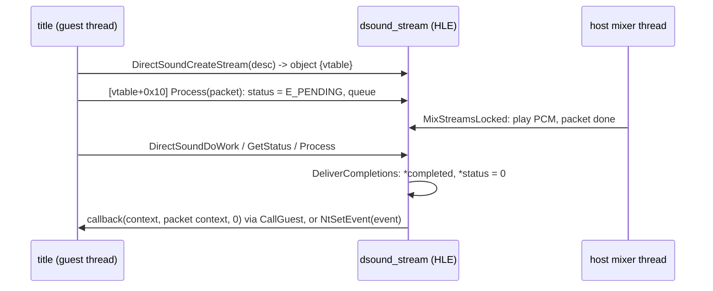

# 설계: DirectSound 스트림 (issue #54)

상태: **1단계 구현됨**(생성, vtable, 패킷 큐, 믹싱, 완료 전달, 기본 설정). 작업 지시: [20261103-i054](../work-orders/20261103-i054-dsound-streams.md) · 작업 로그: [20261103-i054](../work-logs/20261103-i054-dsound-streams.md). 소비자: reexec/reEXCEED#4.

## 1. 요구사항

Pump It Up: Exceed(XDK 5849)는 부팅 중 DirectSound 스트림을 만들고(`DirectSoundCreateStream`, 타이틀 `0x0007E4BC`), 스트림의 vtable로 XMediaObject 메서드를 부른다. HLE에 스트림이 없어 부팅이 멈춘다. WMA 곡 음악과 XMV 동영상 소리도 같은 경로로 볼 수 있다(**추정**).

## 2. 타이틀에서 확인한 것

| 항목 | 내용 | 상태 |
|---|---|---|
| vtable(`0x00190470`) | `+00` AddRef, `+04` Release, `+08` GetInfo, `+0C` GetStatus, `+10` Process, `+14` Discontinuity, `+18` Flush, `+1C` 소멸자 | **확인됨**(XbSymbolDatabase 이름의 주소가 표에 순서대로 있다) |
| `DSSTREAMDESC` | `+0` flags, `+4` 최대 패킷 수(43), `+8` WAVEFORMATEX(PCM 2ch 44.1 kHz 16bit), `+C` 콜백(`0x0007E9C0`), `+10` 컨텍스트, `+14` mix bins | **확인됨**(생성 지점) |
| `Process` | `(this, XMEDIAPACKET* in, XMEDIAPACKET* out)` stdcall | **확인됨**(`0x0007E8B1`) |
| `XMEDIAPACKET` | `+0` 버퍼, `+4` 크기, `+8` 완료 크기 포인터, `+C` 상태 포인터, `+10` 이벤트(콜백이 있으면 패킷 컨텍스트), `+14` 시각 | **확인됨**(앞 넷), 뒤 둘은 **추정** |
| 콜백 | `(pStreamContext, pPacketContext, dwStatus)` stdcall 12. 타이틀 것은 둘 다 0이면 컨텍스트 `+8`(완료 수)을 늘린다 | **확인됨** |
| `DirectSoundDoWork` | 타이틀이 9곳에서 부른다 | **확인됨** |
| 패킷 상태 값 | 성공 0, 대기 `E_PENDING`, 비움 `E_ABORT` | **추정** |

## 3. 설계

* 스트림은 패킷 큐를 가진 목소리다. 믹서(호스트 스레드)는 앞 패킷의 PCM(8/16비트)을 소비하고, 끝난 패킷을 표시만 한다.
* 완료는 게스트 스레드에서 한다(`DirectSoundDoWork`, `Process`, `GetStatus`, `Flush`, `Release`): 완료 크기와 상태를 쓰고, 콜백은 실행기의 `CallGuest`로, 이벤트는 레지스트리에서 찾은 커널 export `NtSetEvent`로 신호한다(모듈 간 링크 없이 레지스트리로만 닿는다). 실기에서는 DSOUND의 작업 루틴이 완료를 낸다(**추정**: 시점이 같지는 않다).
* vtable 항목은 합성 코드 주소 `0xFD000000 + 4·i`(kernel thunk `0xFE000000` 아래)이며 `BindGuestAddress`로 HLE 메서드에 묶인다.
* `GetStatus`는 큐가 최대 패킷 수보다 작으면 `XMO_STATUSF_ACCEPT_INPUT_DATA`.
* 설정: `Pause`, `SetVolume`, `SetHeadroom`, `SetFrequency`, `FlushEx`는 반영한다. `SetMixBins`, `SetMixBinVolumes_8`, `SetPitch`, `SetFilter`, `SetLFO`, `SetEG`, `SetOutputBuffer`, `Set3DVoiceData`, `Use3DVoiceData`, `SetFormat`은 받기만 한다(다음 단계).
* 채널: 모노는 양쪽, 스테레오는 그대로, 3채널 이상은 앞 두 채널만 섞는다(**미확정**: 필요해지면 mix bin 경로로).

## 4. 검증

* probe·CTest 그대로 통과.
* reEXCEED: 스트림 생성 로그(`REXBOX_DSOUND_TRACE=1`)가 나오고 다음 정지점으로 간다. 패킷 완료와 소리는 타이틀이 패킷을 넣는 지점까지 간 뒤 확인한다.

---

# Design: DirectSound streams (issue #54)

Status: **stage 1 implemented** (creation, the vtable, the packet queue, mixing, completion delivery, basic settings). Work order: [20261103-i054](../work-orders/20261103-i054-dsound-streams.md) · Work log: [20261103-i054](../work-logs/20261103-i054-dsound-streams.md). Consumer: reexec/reEXCEED#4.

## 1. Requirements

Pump It Up: Exceed (XDK 5849) creates a DirectSound stream at boot (`DirectSoundCreateStream`, the title's `0x0007E4BC`) and calls the XMediaObject methods through the stream's vtable; the HLE has no streams, so the boot stops. Its WMA song music and XMV movie sound likely take the same path (**inferred**).

## 2. Checked in the title

As in the table above: the vtable at `0x00190470` is AddRef, Release, GetInfo, GetStatus, Process, Discontinuity, Flush, then the destructor (**confirmed**: the XbSymbolDatabase names' addresses sit in the table in that order); `DSSTREAMDESC` holds the flags, the maximum packet count (43), the WAVEFORMATEX (PCM, 2 ch, 44.1 kHz, 16 bit), the callback (`0x0007E9C0`), its context and the mix bins (**confirmed** at the creation site); `Process` is `(this, XMEDIAPACKET* in, XMEDIAPACKET* out)` stdcall (**confirmed**, `0x0007E8B1`); `XMEDIAPACKET` holds the buffer, its size, a pointer for the completed size, a pointer for the status, the event (the packet context when the stream has a callback) and a time stamp (the first four **confirmed**, the last two **inferred**); the callback is `(pStreamContext, pPacketContext, dwStatus)` stdcall 12, and the title's counts completions at its context `+8` when both are 0 (**confirmed**); the title calls `DirectSoundDoWork` from nine places (**confirmed**); the packet status values are 0 for success, `E_PENDING` while queued and `E_ABORT` when flushed (**inferred**).

## 3. Design

The sequence above applies. A stream is a voice with a packet queue: the mixer (a host thread) consumes the front packet's PCM (8 or 16 bit) and only marks finished packets. Completion happens on a guest thread (`DirectSoundDoWork`, `Process`, `GetStatus`, `Flush`, `Release`): the completed size and status are written, the callback runs through the executor's `CallGuest`, and an event is set through the kernel's `NtSetEvent` export found in the registry (reached through the registry only, no link between modules); on the console the DSOUND work routine completes packets (**inferred**: not at the same moments). The vtable entries are synthetic code addresses `0xFD000000 + 4·i` (below the kernel thunks at `0xFE000000`) bound to the HLE methods with `BindGuestAddress`. `GetStatus` reports `XMO_STATUSF_ACCEPT_INPUT_DATA` while the queue is below the maximum packet count. `Pause`, `SetVolume`, `SetHeadroom`, `SetFrequency` and `FlushEx` take effect; `SetMixBins`, `SetMixBinVolumes_8`, `SetPitch`, `SetFilter`, `SetLFO`, `SetEG`, `SetOutputBuffer`, `Set3DVoiceData`, `Use3DVoiceData` and `SetFormat` are accepted only (next stage). Mono plays on both sides and stereo as is; streams of three or more channels mix their first two (**unresolved**: through the mix-bin path when needed).

## 4. Verification

The probes and CTest pass unchanged; in reEXCEED the stream creation is logged (`REXBOX_DSOUND_TRACE=1`) and the run reaches its next stop. Packet completion and sound are checked once the title gets to queueing packets.
