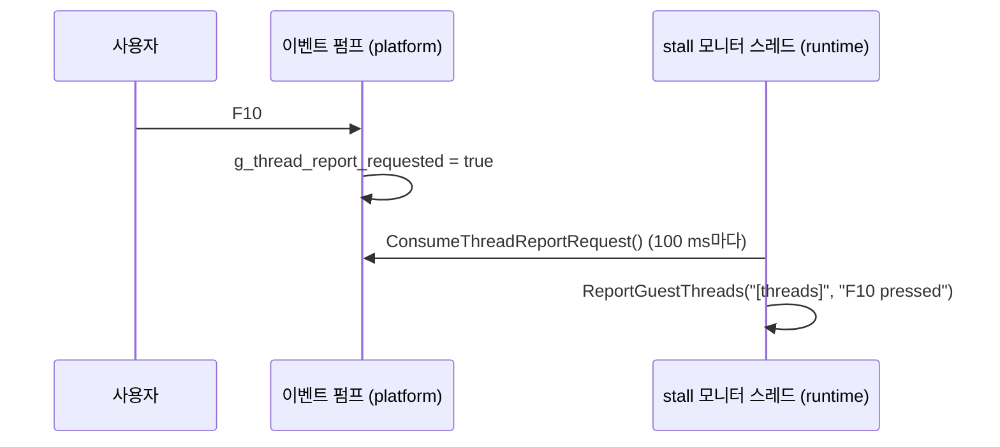

# 설계: F10으로 게스트 스레드 보고를 한 번 출력 (issue #89)

상태: 구현됨. 소비자: reexec/reEXCEED(곡 음악 무음 조사). 이전: [i060 stall 보고](20261015-i060-stall-report.md), [i043 스트림 정지 보고](20261103-i043-stream-stall-report.md).

## 1. 요구사항

게스트 스레드 보고(`ReportGuestThreads`: 스레드마다 대기와 그 대상, 마지막 HLE 호출, 게스트 스택에서 추정한 반환 주소)는 present가 멈추거나 반복 버퍼의 작성자가 멈출 때만 출력된다. 그런데 그림은 계속 나오는데 스레드 하나만 막히는 경우가 있다.

* reEXCEED에서는 음악 스트림을 flush한 뒤 타이틀이 스트림 공급과 효과음 요청을 모두 멈춘다.
* `REXBOX_DSOUND_TRACE`/`REXBOX_AUDIO_DUMP`를 켜고 로그를 파일로 쓰면 재현되지 않는다. 호출마다 기록하는 진단으로는 찾을 수 없다.

필요한 것은 사용자가 원하는 순간에 한 번, 타이밍을 바꾸지 않고 받는 보고다.

## 2. 설계

* platform 계약 `display.h`에 `bool ConsumeThreadReportRequest()`를 더한다. F9의 `ConsumeCaptureRequest`와 같은 모양이다. SDL 백엔드가 `SDLK_F10` 키 누름에서 원자 플래그를 세운다.
* runtime의 stall 모니터 스레드가 100 ms 틱마다 플래그를 보고, 서 있으면 `ReportGuestThreads`를 부른다. 이벤트 펌프나 게스트 스레드에서 출력하지 않으므로, 막힌 게스트 스레드가 보고를 막지 못한다.
* 보고 내용은 기존 stall 보고와 같다. `REXBOX_STALL_DUMP`가 있으면 게스트 메모리도 쓴다.
* 새로 기록하는 것은 없다. 키를 누르기 전에는 원자 플래그 읽기 하나가 100 ms마다 더해질 뿐이다.
* 모니터 스레드는 `REXBOX_STALL_REPORT=0`에서도 돈다. 0은 present 정지 보고만 끈다. 전에는 스레드를 아예 만들지 않았다.

## 3. 검증

* rexbox Release 빌드(경고 0), CTest.
* 소비자(reEXCEED)에서 실행 중 F10을 눌러 `[threads] F10 pressed; guest threads:`와 스레드 줄이 나오는지 본다.

---

# Design: F10 prints the guest thread report once (issue #89)

Status: implemented. Consumer: reexec/reEXCEED (the silent song music). Earlier: [i060 stall report](20261015-i060-stall-report.md), [i043 stream stall report](20261103-i043-stream-stall-report.md).

## 1. Requirement

The guest thread report (`ReportGuestThreads`: each thread's wait and its objects, last HLE call, return addresses guessed from the guest stack) prints only when presents stop or a looping buffer's writer stops. A title can hang one thread while the picture goes on: in reEXCEED the title stops feeding the music stream and asking for sound effects after a flush, and with `REXBOX_DSOUND_TRACE`/`REXBOX_AUDIO_DUMP` logging to a file it does not happen, so per-call diagnostics cannot find it. What is needed is a report taken once, when the user chooses, without changing the timing.

## 2. Design

* The platform contract `display.h` gains `bool ConsumeThreadReportRequest()`, shaped like F9's `ConsumeCaptureRequest`; the SDL backend sets an atomic flag on an `SDLK_F10` key press.
* The runtime's stall monitor thread checks the flag at each 100 ms tick and, when it is set, calls `ReportGuestThreads`. Printing happens on neither the event pump nor a guest thread, so a hung guest thread cannot hold the report back.
* The report is the stall report's; `REXBOX_STALL_DUMP` writes guest memory too.
* Nothing new is recorded; before the key is pressed the only addition is one atomic read every 100 ms.
* The monitor thread runs even with `REXBOX_STALL_REPORT=0`, which now turns off only the no-present report (before, the thread was not created).

## 3. Verification

* rexbox Release build (0 warnings), CTest.
* In the consumer (reEXCEED), F10 while running prints `[threads] F10 pressed; guest threads:` and the thread lines.
