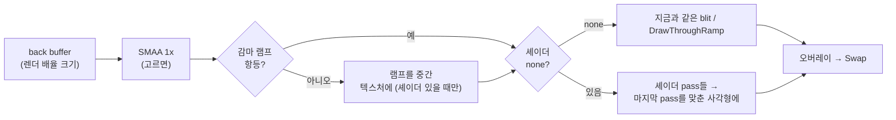

# 설계: 표시 단계 화면 셰이더(libretro GLSL) (issue #91)

상태: 구현됨(`d2a3b19`). 소비자: reexec/reEXCEED#20. 참고 구현: reexec/repsp v0.0.24(#50, reexec/reDMP1 설계 i049), 그 원본 re2DJ v0.0.75.

## 1. 요구사항

* 사용자 요청(2026-11-24): reDMP1에 넣은 화면 셰이더 기능을 reEXCEED에 똑같이 넣는다. 게임과 무관한 부분은 rexbox가 맡는다(repsp가 reDMP1에 맡은 것과 같다).
* 범위는 repsp v0.0.24와 같다.
  * 단일 pass `.glsl`, 다단계 `.glslp`(libretro 형식의 부분집합), `#pragma parameter`.
  * 내장 `crt`, `scanline`, `fsr`, `scalefx`, `anime4k`.
  * 사용자 디렉터리의 파일, Reload. 실패하면 `none`으로 그리고 이유를 남긴다.
* repsp 코드(MIT, re2DJ에서 BSD 3-Clause로 가져와 GL 3.3 core에 맞춘 것)를 rexbox 구조에 맞게 옮긴다. 고지는 rexbox `THIRD_PARTY_NOTICES.md`에 repsp와 같은 내용으로 적는다(re2DJ BSD 3-Clause 전문, FSR 1.0·ScaleFX·Anime4K MIT, 각 파일의 고지 유지).

## 2. 위치

* rexbox는 화면 출력 GL을 HLE D3D8이 갖는다(repsp는 플랫폼 GL 헬퍼). 그래서 전부 `hle/d3d8`에 둔다.
  * GL 없는 부분: `src/hle/d3d8/post_shader_catalog.cpp`, `post_shader_preset.cpp`, `post_shader_source.cpp`. repsp `src/platform/post_shader_*.cpp`에서 옮긴다.
  * GL 후처리: `src/hle/d3d8/d3d8_post_process.cpp`(+ `.h`). repsp `src/platform/sdl/opengl_post_process.cpp`에서 옮기고, rexbox의 GL 함수 표(`d3d8_gl.h`의 `GlFunctions`)로 부른다.
  * 내장 셰이더: `src/hle/d3d8/post_shaders/`(repsp `src/platform/post_shaders/` 그대로), CMake가 빌드 디렉터리에 생성 파일로 넣는다(repsp `post_shader_builtins.inc.in` 방식).
  * 공개 계약: `include/rexbox/hle/d3d8/d3d8_post_shader.h`. 목록·preset·소스 형식의 공개 타입은 같은 디렉터리의 헤더 몇 개로 둔다(repsp `post_shader_catalog.h`, `post_shader_preset.h`, `post_shader_source.h`에 대응).
* 플랫폼 계층과 런타임은 바뀌지 않는다.

## 3. 표시 경로

`d3d8_gl_targets.cpp`의 `PresentRenderTarget`에 끼운다.

* 셰이더가 `none`이면 GL 호출이 지금과 같다.
* 셰이더가 있으면 입력 텍스처는 SMAA 결과(또는 back buffer)다. 감마 램프가 항등이 아니면 먼저 램프를 입력 크기의 중간 텍스처에 그리고, 그 텍스처를 입력으로 쓴다.
* 마지막 pass는 지금 계산하는 맞춘 사각형(`x, y, width, height`) viewport에 그린다. 둘레는 지금처럼 검다.
* 텍스처 행 방향: back buffer는 창과 같은 방향으로 들어 있다(지금의 blit이 뒤집지 않고 똑바로 보인다). 그래서 단위 사각형의 TexCoord를 뒤집지 않고 쓴다. 샘플링용 사본(`ColorTarget::copy`, 뒤집혀 있음)은 입력으로 쓰지 않는다. repsp의 `flip_y`처럼 방향은 꼭짓점에서만 다루어, 셰이더는 위아래를 신경 쓰지 않는다. probe로 확인한다.
* 셰이더 pass가 쓰는 GL 상태(프로그램, VAO, 텍스처, 프레임버퍼, viewport)는 끝난 뒤 `InvalidateGlStateCache()`로 D3D8 상태 캐시에 알린다. 오버레이는 셰이더 뒤에, 창 프레임버퍼에 그린다(메뉴에는 셰이더가 걸리지 않는다).
* F9 캡처(`d3d8_capture`)는 back buffer를 읽으므로 셰이더와 무관하다.

## 4. 크기 uniform

* `TextureSize`, `InputSize`: 입력 텍스처의 실제 픽셀 크기. 렌더 배율과 Hor+ 넓힌 폭을 포함한다(`GlWidth(source)` × `height × scale`).
* `OutputSize`: 맞춘 사각형의 픽셀 크기.
* `LogicalSize`: 게스트 그림 크기. `source.wide`가 있으면 그 폭, 아니면 `source.width`, 높이는 `source.height`(Exceed는 640x480, 16:9이면 넓힌 폭). 내장 `crt`, `scanline`은 repsp처럼 이것을 쓴다.
* 다단계 이름(`Texture`, `OrigTexture`, `PassPrevNTexture`, `...TextureSize`, `...InputSize`), `FrameCount`, `FrameDirection`(1), `MVPMatrix`는 repsp와 같다.

## 5. 필터

repsp와 같다. 단일 pass와 `filter_linear0` 없는 첫 pass는 선형으로 읽는다(rexbox 표시 blit이 `GL_LINEAR`이므로). preset의 `filter_linearN`은 따른다. 배율 있는 마지막 pass는 선형으로 창에 그린다.

## 6. 제어 계약 (`include/rexbox/hle/d3d8/d3d8_post_shader.h`)

repsp `PostShaderControl`과 같은 기능을 `rexbox::hle::d3d8` 네임스페이스로 둔다.

* `SetPostShaderDirectory(path)`, `GetPostShaderDirectory()`: 앱이 정한다. rexbox는 경로를 정하지 않는다.
* `SetInitialPostShader(id)`: 장치가 만들어지기 전에 앱이 고른다. 첫 present에서 적용하고, 실패하면 `[d3d8] post shader '<id>' not applied: <이유>`를 남긴다.
* `GetPostShaderControl()`: GL 장치가 있으면 제어 객체, 없으면 null. 객체의 메서드(`catalog`, `shader_directory`, `active_id`, `last_error`, `Select`, `Reload`, `parameters`)는 **오버레이 빌더 안에서만** 부른다. 오버레이는 `PresentRenderTarget` 안, GL 문맥이 있는 표시 스레드에서 만들어지므로 repsp의 "UI 스레드" 조건과 같다. `Select`/`Reload`가 GL을 만지면 `InvalidateGlStateCache()`를 부르고 창 프레임버퍼를 다시 묶는다(오버레이가 이어서 그리므로).
* 목록: 내장(고정 순서) 다음 디렉터리의 `.glsl`, `.glslp` 이름순. id는 `none`, 내장 이름, 파일 이름.
* 앱용 도우미(repsp와 같음): `ResolvePostShaderDirectory(exe_dir)`는 작업 디렉터리의 `shaders/`가 있으면 그것, 없으면 실행 파일 옆의 `shaders/`. `ChoosePostShader(cli, env, file)`는 명령줄 > 환경 변수 > 설정 파일 > `none`.

## 7. 실패

컴파일·링크·타깃 생성 실패는 화면을 검게 만들지 않는다. `none`으로 그리고 이유를 로그와 `last_error`에 남긴다. 게임은 계속 돈다.

## 8. 검증

1. GL 없는 단위 시험: repsp 시험을 옮긴다(`#pragma parameter` 해석, 소스 조립의 `#version`·호환 매크로·`gl_FragColor` 치환, `.glslp` 해석, 목록). rexbox의 테스트 방식(CTest에 등록되는 probe 또는 Python 시험)에 맞춘다.
2. GL probe: repsp `tools/post_shader_probe`를 rexbox `rexbox_d3d8_probe` 또는 새 probe로 옮긴다(숨은 창 GL 문맥 허용). 내장 다섯 개가 3.3 core에서 컴파일·링크, 2 pass preset 연결, 깨진 셰이더의 `none` 복귀와 오류.
3. reEXCEED에서 Win32 x86 Release·Debug 경고 0, CTest 통과, 창에서 내장 셰이더·`none`·Hor+ 16:9·렌더 배율 1·2·MSAA·SMAA·감마 램프 조합에서 위아래·위치·크기가 맞는지(사용자 확인 포함).
4. 셰이더 `none`에서 표시 시간이 이전과 같은 범위인지.

## 9. 기록

`ARCHITECTURE.md`(표시 단계 후처리, 제어 계약), 셰이더 작성 안내(`docs/guides/post-process-shaders.md`, repsp `docs/post-process-shaders.md`를 rexbox에 맞게: GL 3.3 core 변환, `LogicalSize`), `THIRD_PARTY_NOTICES.md`.

---

# Design: screen shaders (libretro GLSL) at presentation (issue #91)

Status: implemented (`d2a3b19`). Consumer: reexec/reEXCEED#20. Reference: reexec/repsp v0.0.24 (#50, reexec/reDMP1 design i049), from re2DJ v0.0.75.

## 1. Requirements

* User request (2026-11-24): give reEXCEED the screen shader feature reDMP1 has; the game-independent part belongs to rexbox (as repsp's does for reDMP1).
* The scope is repsp v0.0.24's:
  * single-pass `.glsl`, multi-pass `.glslp` (a subset of libretro's format) and `#pragma parameter`;
  * the built-ins `crt`, `scanline`, `fsr`, `scalefx` and `anime4k`;
  * user files in a directory and Reload; on failure, drawing with `none` and recording the reason.
* repsp's code (MIT; taken from re2DJ under BSD 3-Clause and made GL 3.3 core) is moved into rexbox's structure. rexbox's `THIRD_PARTY_NOTICES.md` gets the same notices as repsp's (re2DJ's BSD 3-Clause text, FSR 1.0, ScaleFX and Anime4K under MIT, each file keeping its notice).

## 2. Placement

* In rexbox the HLE D3D8 owns the presentation GL (in repsp it is the platform GL helper), so everything goes under `hle/d3d8`:
  * GL-free parts: `src/hle/d3d8/post_shader_catalog.cpp`, `post_shader_preset.cpp`, `post_shader_source.cpp`, moved from repsp `src/platform/post_shader_*.cpp`.
  * The GL pass: `src/hle/d3d8/d3d8_post_process.cpp` (+ `.h`), moved from repsp `src/platform/sdl/opengl_post_process.cpp`, calling through rexbox's GL table (`GlFunctions` in `d3d8_gl.h`).
  * Built-ins: `src/hle/d3d8/post_shaders/` (repsp's `src/platform/post_shaders/` as is), embedded by CMake as a generated file in the build directory (repsp's `post_shader_builtins.inc.in` way).
  * Public contract: `include/rexbox/hle/d3d8/d3d8_post_shader.h`, with the public catalog, preset and source types in a few headers next to it (for repsp's `post_shader_catalog.h`, `post_shader_preset.h`, `post_shader_source.h`).
* The platform layer and the runtime do not change.

## 3. Presentation path

Into `PresentRenderTarget` in `d3d8_gl_targets.cpp` (diagram above):

* With `none`, the GL calls are today's.
* With a shader, the input is the SMAA result (or the back buffer). A gamma ramp that is not the identity is first drawn into an input-sized intermediate texture, which then becomes the input.
* The last pass draws into the viewport of the fitted rectangle computed today (`x, y, width, height`); the rest stays black.
* Row order: the back buffer is stored the way the window shows it (today's blit draws it upright without flipping), so the unit square's TexCoord is used unflipped. The sampling copy (`ColorTarget::copy`, which is flipped) is never the input. As with repsp's `flip_y`, orientation lives only in the vertices, so shaders need not care which way is up; the probe checks it.
* After the passes, the GL state they touched (program, VAO, textures, framebuffers, viewport) is reported to the D3D8 state cache with `InvalidateGlStateCache()`. The overlay is drawn after the shader into the window framebuffer, so the menu is never shaded.
* F9 capture (`d3d8_capture`) reads the back buffer and is unaffected.

## 4. Size uniforms

* `TextureSize`, `InputSize`: the input texture's real pixel size, including the render scale and the Hor+ widened width (`GlWidth(source)` x `height x scale`).
* `OutputSize`: the fitted rectangle's pixel size.
* `LogicalSize`: the guest picture size, `source.wide` when set or else `source.width`, by `source.height` (640x480 for Exceed, the widened width at 16:9). The built-in `crt` and `scanline` read it, as in repsp.
* Multi-pass names (`Texture`, `OrigTexture`, `PassPrevNTexture`, `...TextureSize`, `...InputSize`), `FrameCount`, `FrameDirection` (1) and `MVPMatrix` are repsp's.

## 5. Filtering

As in repsp. A single pass, or a first pass without `filter_linear0`, samples linearly (rexbox's presentation blit is `GL_LINEAR`); a preset's `filter_linearN` is followed; a scaled last pass goes to the window linearly.

## 6. Control contract (`include/rexbox/hle/d3d8/d3d8_post_shader.h`)

repsp's `PostShaderControl` functionality in the `rexbox::hle::d3d8` namespace:

* `SetPostShaderDirectory(path)` and `GetPostShaderDirectory()`: the app decides; rexbox chooses no path.
* `SetInitialPostShader(id)`: chosen by the app before the device exists. It is applied at the first present; on failure the log says `[d3d8] post shader '<id>' not applied: <reason>`.
* `GetPostShaderControl()`: the control object when a GL device exists, else null.
  * Its methods (`catalog`, `shader_directory`, `active_id`, `last_error`, `Select`, `Reload`, `parameters`) are called **only from the overlay builder**.
  * The overlay is built inside `PresentRenderTarget` on the presenting thread with the GL context current, which is repsp's "UI thread" condition.
  * When `Select` or `Reload` touches GL, it calls `InvalidateGlStateCache()` and binds the window framebuffer again, since the overlay draws next.
* The list holds the built-ins in a fixed order, then the directory's `.glsl` and `.glslp` files by name. Ids are `none`, a built-in name, or a file name.
* App helpers (as in repsp): `ResolvePostShaderDirectory(exe_dir)` gives the working directory's `shaders/` when it exists, else the one next to the executable; `ChoosePostShader(cli, env, file)` takes the command line over the environment over the settings file over `none`.

## 7. Failure

A failed compile, link or target creation never blackens the screen. It draws with `none` and records the reason in the log and `last_error`; the game goes on.

## 8. Verification

1. GL-free unit tests moved from repsp:
   * `#pragma parameter` parsing;
   * source assembly: `#version`, the compatibility macros and the `gl_FragColor` replacement;
   * `.glslp` parsing and the listing.
   They fit rexbox's test style (a CTest probe or Python tests).
2. A GL probe moved from repsp `tools/post_shader_probe` into `rexbox_d3d8_probe` or a new probe (a hidden-window GL context is allowed). It checks:
   * the five built-ins compile and link on 3.3 core;
   * a 2-pass preset chains;
   * a broken shader falls back to `none` with its error.
3. In reEXCEED:
   * Win32 x86 Release and Debug with 0 warnings and CTest passing.
   * In the window, the built-ins, `none`, Hor+ 16:9, render scale 1 and 2, MSAA, SMAA and the gamma ramp all give a picture that is upright, placed and sized correctly (including the user's check).
4. With `none`, presentation time stays in today's range.

## 9. Records

`ARCHITECTURE.md` (presentation post-processing, the control contract), a shader authoring guide (`docs/guides/post-process-shaders.md`, repsp's `docs/post-process-shaders.md` adapted: the GL 3.3 core translation, `LogicalSize`), and `THIRD_PARTY_NOTICES.md`.
